# Görüntü İşleme Tabanlı Akıllı Lösemi Tarama ve Tanı Destek Sistemi

Mikroskobik kan yayması görüntülerinden beyaz kan hücresi çekirdeklerini bulan ve her hücreyi
**ALL** (akut lenfoblastik lösemi), **AML** (akut miyeloid lösemi) veya **Normal** olarak sınıflandıran
bir tarama ve tanı destek sistemi. Sistem yalnızca klasik görüntü işleme ve klasik makine öğrenmesi
yöntemleriyle çalışır; derin öğrenme kullanılmaz. Her aşamada alternatif yöntemler ölçülerek karşılaştırılmış,
seçimler sayısal gerekçelere dayandırılmıştır.

| Öne çıkan sonuç (sızıntısız kilitli test seti) | Değer |
|---|---:|
| Görüntü düzeyi makro F1 (hücre bulunan / tüm görüntüler) | **0.985** / 0.967 |
| Lösemi hücresi (ALL + AML) duyarlılığı | **%98.2** |
| Hücre düzeyi makro F1 | 0.949 |

*Test seti, aynı ALL-IDB kaynak yaymasından türeyen görüntüler tek grupta toplanarak ayrıldı
([sızıntı tespiti ve düzeltme](#sızıntı-tespiti-ve-düzeltme)).*

> [!WARNING]
> **Bu sistem araştırma ve eğitim amaçlı bir prototiptir; klinik teşhis aracı değildir.**
> Ürettiği sınıflandırma, risk skoru ve raporlar tıbbi karar için kullanılamaz.

## İçindekiler

- [Pipeline](#pipeline)
- [Veri seti](#veri-seti)
- [Yöntem](#yöntem)
- [Sonuçlar](#sonuçlar)
- [Kısıtlar ve ileride yapılacaklar](#kısıtlar-ve-ileride-yapılacaklar)
- [Kurulum ve kullanım](#kurulum-ve-kullanım)
- [Proje yapısı](#proje-yapısı)
- [Kaynakça](#kaynakça)

## Pipeline

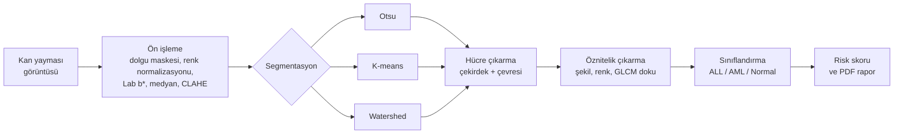

- Sınıflandırma hücre düzeyinde yapılır. Görüntünün sonucu, hücre olasılıklarının ortalamasından elde edilir.
- **Risk skoru**, görüntüdeki anormal (ALL veya AML) hücre oranıdır. Raporda baskın lösemi tipi de yer alır.
- Sistem hastanın yaşını tahmin etmez. ALL'ın çoğunlukla çocuklarda, AML'nin yetişkinlerde görülmesi
  yalnızca klinik arka plan bilgisidir.

## Veri seti

- **Kaynak:** Kaggle — [Leukemia Types](https://www.kaggle.com/datasets/sheikhlubna/leukemia-types) (`sheikhlubna/leukemia-types`).
  Veri setinden yalnızca üç klasör kullanılır:

  | Kaggle klasörü | Projedeki klasör | Sınıf |
  |---|---|---|
  | `acute_lymphocytic` | `data/raw/ALL` | ALL |
  | `acute_myeloid` | `data/raw/AML` | AML |
  | `healthy_blood_cell` | `data/raw/Healthy` | Normal (Healthy) |

- **Kopya tespiti.** Veri setinde aynı kaynak görüntünün augmentasyonları (döndürme, aynalama, renk kaydırma,
  kırpma) ve birebir kopyaları var.
  - Birebir kopyalar MD5 ile bulundu.
  - Neredeyse aynı kopyalar için önce döndürme ve aynalamaya dayanıklı pHash ile aday çiftler seçildi, sonra
    bu adaylar ORB + RANSAC eşleştirmesiyle doğrulandı.
  - Kopyalar aynı `grup_id` altında toplandı. Eğitim/test ayrımı bu gruplara göre yapılır.

  | Sınıf | Görüntü | Birebir fazlalık (MD5) | Kopyası olan görüntü | **Benzersiz grup** | En büyük grup |
  |---|---:|---:|---:|---:|---:|
  | ALL | 600 | 19 | 268 | **421** | 11 |
  | AML | 600 | 112 | 477 | **163** | 38 |
  | Normal | 600 | 84 | 451 | **248** | 24 |
  | Toplam | 1800 | 215 | 1196 | **832** | — |

  - Toplam 354 birebir ve 5 566 neredeyse aynı kopya çifti bulundu. Hiçbiri sınıflar arası değil.
  - Sınıflar 600'er görüntüyle dengeli görünüyor, ama AML'de yalnızca 163 benzersiz kaynak var.

- **Görüntü tipi.** Görüntüler iki büyütmede çekilmiş: çok hücreli yayma ve tek hücreli yakın çekim.
  - Yakın çekim sayıları: ALL 290, AML 30, Normal 0.
  - Bu dağılım bir kısayol riski taşır: model lösemi tipi yerine büyütmeyi öğrenebilir. Bu risk öznitelik
    ve sınıflandırma aşamalarında ayrıca test edildi.

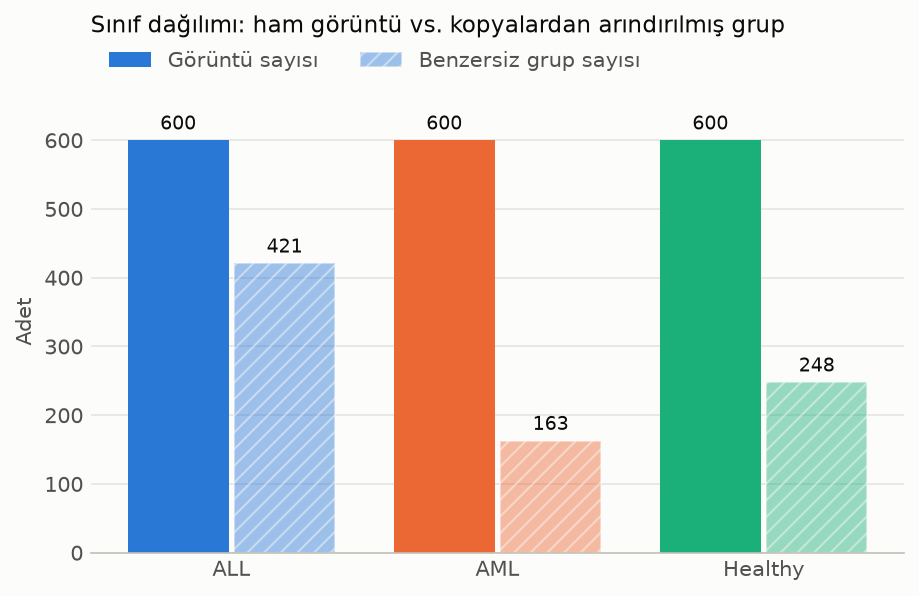
*Her sınıfta 600 görüntü var, ama kopyalar gruplandığında benzersiz kaynak sayısı 163 ile 421 arasına düşüyor.*

**Veriyi edinme:** Veri dosyaları lisans ve boyut nedeniyle repoya eklenmemiştir (`data/` klasörü `.gitignore`
içindedir). Veri setini Kaggle sayfasından indirip yukarıdaki üç klasörü `data/raw/` altına yerleştirin. Kaggle
CLI ile:

```bash
kaggle datasets download -d sheikhlubna/leukemia-types --unzip -p indirilen/
# acute_lymphocytic → data/raw/ALL, acute_myeloid → data/raw/AML, healthy_blood_cell → data/raw/Healthy
```

> **Kısıt:** Veri setinin klinik kaynağı (hastane, mikroskop, boyama protokolü, hasta sayısı) belirtilmemiştir.
> Görüntülerin bağımsız hastalardan gelip gelmediği doğrulanamaz. Karşılaştırma sonucunda ALL görüntülerinin %47'si
> ve normal görüntülerin %56'sı açık ALL-IDB veri setinden (ALL-IDB1 yaymaları, ALL-IDB2 hücre kırpımları) türetilmiş
> çıktı. AML'nin hiçbir görüntüsü ALL-IDB'de bulunamadı.

## Yöntem

### 1. Ön işleme

Görüntüler en-boy oranı korunarak 256x256'ya getirilir. Döndürme augmentasyonlarından kalan siyah ve koyu renkli
köşeler bir **dolgu maskesiyle** tüm hesaplardan dışlanır. Renk normalizasyonu yalnızca **zemin**
(eritrosit + plazma) istatistiklerine dayanır: L\* çarpımsal, a\*/b\* toplamsal olarak hizalanır. Bu sayede zemin
rengi tutarlı hâle gelir (zemin b\* std 7.4 → 1.3), ama çekirdek−zemin farkı değişmez.

Klasik Reinhard yöntemi (tüm piksellerin ortalaması ve std'si) bu veri setinde uygun değil. Bir görüntünün renk
std'si boyadan çok içerikten etkileniyor: AML yaymaları çekirdekle dolu, normal yaymalarda neredeyse hiç
çekirdek yok. Bu yüzden Reinhard normal görüntülerin rengini ×4.7 geriyor ve bu görüntülerdeki çekirdek
piksellerinin %100'ü RGB gamutunda kırpılıyor. Sonuçta sınıfa bağlı, yapay bir ipucu oluşuyor.

Çekirdek kanalı 11 aday arasından seçildi. Ölçüt, çekirdek ile arka plan arasındaki Fisher oranı
(89 görüntünün medyanı):

| Kanal | Fisher | Fisher ALL | Fisher AML | Fisher Normal |
|---|---:|---:|---:|---:|
| **Lab b\* (ters, seçilen)** | **22.9** | **23.6** | **17.9** | **36.9** |
| B−G | 18.9 | 21.7 | 14.9 | 29.5 |
| Lab a\* | 14.7 | 15.1 | 11.1 | 19.8 |
| HSV S | 14.2 | 14.0 | 10.1 | 24.5 |
| Gri | 8.8 | 10.1 | 5.3 | 13.6 |

Mor çekirdek b\* kanalında mavidir. Pembe eritrosit ve plazma bu kanalda nötrdür, yani kanal yalnızca çekirdeğe
tepki verir. Kanala sonra **medyan 5x5** filtre uygulanır: gürültüyü %38 azaltır ve sınır gradyanının %94'ünü
korur. Ardından **CLAHE** gelir (clipLimit 1.0, 64 px karo). Bu ayar, gürültüyü düşük tutarken genel ayrışmayı
korudu (Fisher 18.2). 16 px karo genel ölçümde başa baş çıktı (18.3), ama yakın çekimlerde ayrışmayı daha çok
düşürdü (20.4'e karşı 30.3).

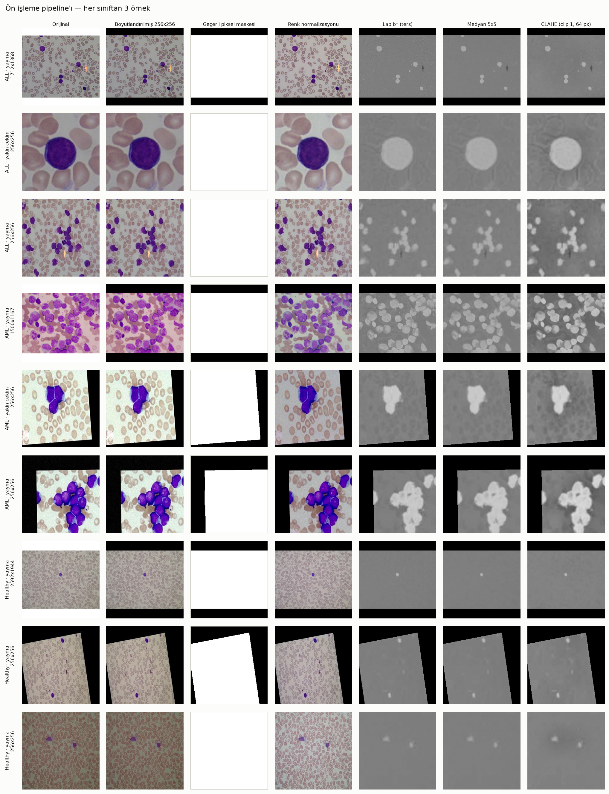
*Her sınıftan üç örnekte ön işleme aşamaları: orijinal → 256x256 → geçerli piksel maskesi → renk normalizasyonu → ters Lab b\* → medyan → CLAHE.*

### 2. Segmentasyon

Üç yöntem uygulandı: **Otsu** eşikleme, Lab uzayında **K-means** (k = 3) ve marker kontrollü **Watershed**.
Görüntüler farklı büyütmelerde olduğu için tüm boyut parametreleri, her görüntüde tahmin edilen **eritrosit
çapına** oranlandı. Elle işaretlenmiş maske olmadığından yöntemler etiket gerektirmeyen altı ölçütle karşılaştırıldı
(her sınıftan 30 farklı gruptan görüntü):

| Yöntem | Sınır gradyanı ↑ (yayma) | Fisher ↑ (yayma) | Birleşik çekirdek ↓ (yayma) | Boş görüntü ↓ (yayma) | Sınıf tutarsızlığı ↓ (yayma) | **Nihai sıra skoru** ↓ |
|---|---:|---:|---:|---:|---:|---:|
| Otsu | **144.5** | 16.0 | 0.072 | **%0** | 0.161 | 2.12 |
| **K-means (seçilen)** | 135.8 | **20.7** | 0.069 | %2.6 | **0.134** | **1.75** |
| Watershed | **144.5** | 16.0 | **0.067** | **%0** | 0.163 | 2.12 |

Nihai skor, yayma ve yakın çekim için ayrı ayrı hesaplanan ortalama sıraların ortalamasıdır. K-means bu skorda
öne çıktı. Asıl üstünlüğü yoğun AML yaymalarında görülüyor: Otsu ve Watershed yalnızca b\* kanalına dayandığı için
blastların mavimsi sitoplazması üzerinden çekirdekleri birleştiriyor. K-means parlaklık bilgisini de kullandığı
için koyu çekirdeği daha açık sitoplazmadan ayırabiliyor. Zayıf yanı ise çekirdeğin görüntünün çok küçük bir kısmını
kapladığı normal yaymalarda bazen hiç hücre bulamaması.

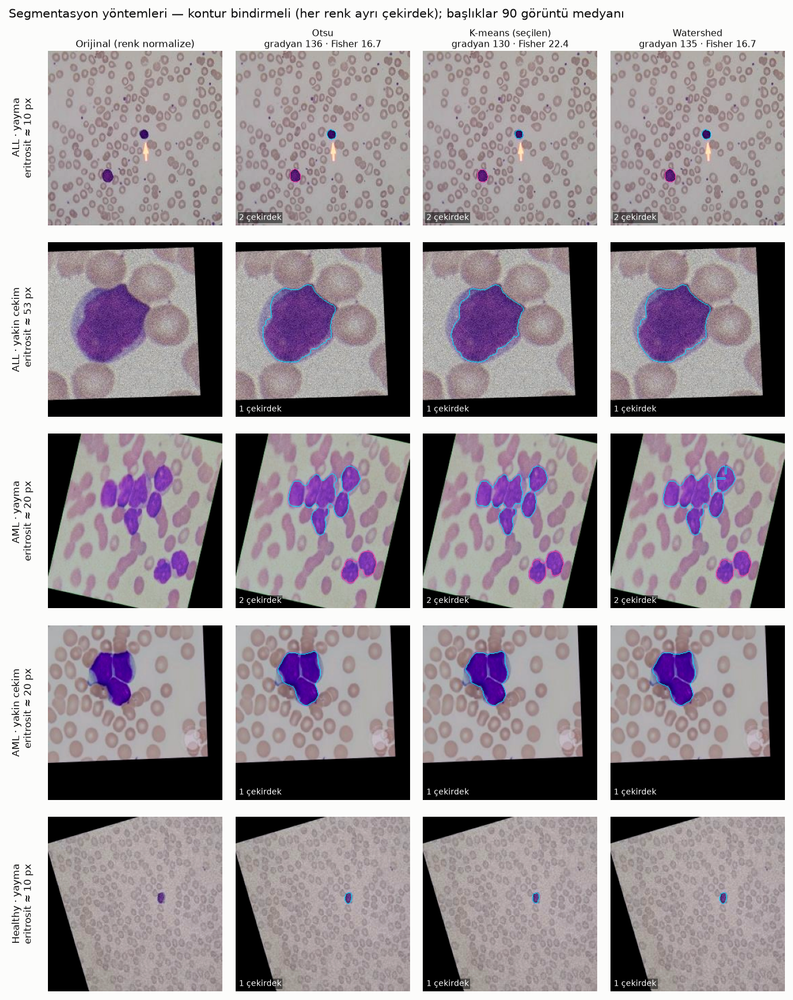
*Üç yöntemin bulduğu çekirdek konturları; her renk ayrı bir çekirdeği gösteriyor.*

### 3. Öznitelik çıkarma

Her hücreden **58 öznitelik** çıkarıldı:

| Grup | Sayı | İçerik |
|---|---:|---|
| Şekil | 11 | alan/d², çevre/d, dairesellik, eksantrisite, solidity, extent, eksenler, eksen oranı, lob sayısı, girinti derinliği |
| Renk | 28 | Çekirdek ve çekirdek çevresi halkası için Lab/HSV ortalama ve std (H dairesel), çekirdek − halka farkı (ΔL\*, Δa\*, Δb\*, ΔE) |
| Doku | 19 | GLCM: contrast, dissimilarity, homogeneity, energy, correlation, ASM (d = 1, 2, 3; 4 açının ortalaması), entropi |

**Ölçek normalizasyonu.** Yakın çekimlerde aynı çekirdek yaymadakinden ~40 kat fazla piksel kaplar ve yakın
çekimlerin neredeyse tamamı ALL sınıfındadır. Bu yüzden ham piksel ölçüleri "ALL"ı değil, "büyütmeyi" öğretir.
Bunu önlemek için boyut ölçüleri eritrosit çapına (d) oranlandı. Ayrıca her hücre, eritrosit çapı 10 px olacak
şekilde ortak bir ölçeğe yeniden örneklendi. Ham piksel ölçüleri, görüntü tipi, konum ve N/C oranı öznitelik olarak
kullanılmadı.

Kısayol testinde, tek bir ölçüyle görüntü tipini tahmin eden bir model kuruldu (grup bazlı çapraz doğrulama):

| Ölçü | Görüntü tipi tahmini ROC AUC |
|---|---:|
| Çekirdek alanı (ham piksel) | 0.99 |
| Çekirdek alanı / eritrosit çapı² | **0.46** |
| GLCM contrast, yerel ölçek | 0.95 |
| GLCM contrast, referans ölçek | **0.57** |

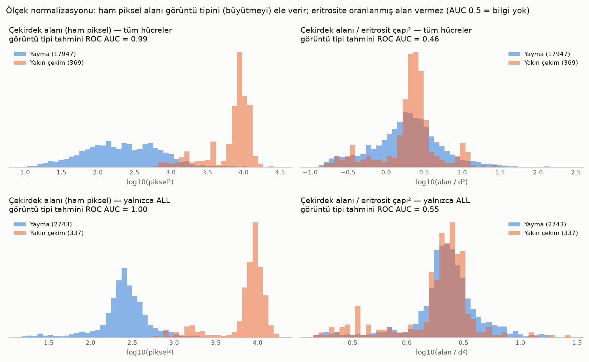
*Ham piksel alanı yayma ve yakın çekimi neredeyse kusursuz ayırıyor (AUC 0.99); eritrosit çapına oranlanmış alan bu bilgiyi taşımıyor (AUC 0.46).*

### 4. Sınıflandırma

- **Kaynak bazlı ayrım.** Görüntüler `StratifiedGroupKFold` ile ayrıldı (grup = `kaynak_grup_id`). Bu grup, Adım 1'in
  kopya gruplarını aynı ALL-IDB yaymasına bağlanan tüm türevlerle birleştirir: tam boy, 256x256'ya sıkıştırılmış ve
  kırpılmış hâller ile o yaymadan kesilmiş hücre kırpımları. Aynı kaynağın türevleri hiçbir zaman hem eğitimde hem
  testte bulunmaz. Kod bunu her çalıştırmada doğrular.
- **Kilitli test seti.** Görüntülerin %20'si (361 görüntü) bir kez ayrılıp dosyaya yazıldı (`veri_bolumu_v2.csv`).
  - Model, hiperparametre, öznitelik kümesi ve segmentasyon seçimlerinin tamamı yalnızca geliştirme setinde
    (1 439 görüntü), 5 katlı grup çapraz doğrulamayla yapıldı.
  - Test seti yalnızca son değerlendirmede, bir kez kullanıldı.
- **Modeller.** Yalnızca klasik makine öğrenmesi (scikit-learn) kullanıldı: lojistik regresyon, k-NN, SVM (RBF),
  Random Forest ve gradyan artırma (HistGradientBoosting).
  - Hücrelerin %77'si AML olduğu için sınıf ağırlıkları dengelendi.
  - Birincil ölçüt makro F1.
- **Görüntü düzeyi karar.** Hücre olasılıkları ortalanır. Görüntüde tam hücre varsa, görüntü kenarına değen
  (kesik) hücreler bu ortalamaya katılmaz.

## Sonuçlar

### Model karşılaştırması

Geliştirme seti, 5 katlı kaynak grubu çapraz doğrulaması. Tabloda her modelin en iyi yapılandırması var:

| Model | En iyi parametre | Hücre makro F1 (± kat std) | Dengeli doğruluk | Normal duyarlılığı | Görüntü makro F1 |
|---|---|---:|---:|---:|---:|
| **Gradyan artırma (HGB)** | lr 0.1, 300 iterasyon | **0.903 ± 0.089** | **0.937** | 0.915 | **0.952** |
| Random Forest | yaprak ≥ 1 | 0.889 ± 0.054 | 0.886 | 0.782 | 0.901 |
| SVM (RBF) | C = 30 | 0.887 ± 0.106 | 0.933 | 0.920 | 0.947 |
| k-NN | k = 5 | 0.867 ± 0.088 | 0.909 | 0.860 | 0.932 |
| Lojistik regresyon | C = 10 | 0.845 ± 0.089 | 0.925 | 0.937 | 0.941 |

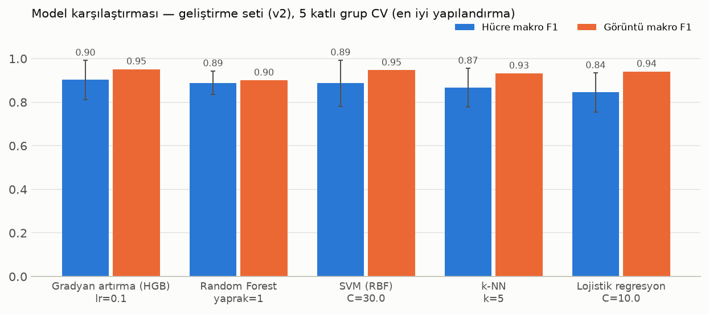
*Her modelin en iyi yapılandırması; hata çubukları hücre makro F1'in katlar arası standart sapması.*

Seçilen model gradyan artırma (HGB). SVM ile farkı katlar arası sapmadan küçük, ama HGB hem hücre hem görüntü
düzeyinde en üst grupta. Random Forest ve k-NN, normal hücreleri çoğunluk sınıfı AML'ye kaydırıyor.

### Kilitli test seti

| Düzey | n | Doğruluk | Makro F1 | Duyarlılık ALL | Duyarlılık AML | Duyarlılık Normal |
|---|---:|---:|---:|---:|---:|---:|
| Hücre (kenara değmeyen) | 2 666 | 0.974 | **0.949** | 0.980 | 0.974 | 0.961 |
| Hücre (tümü) | 3 587 | 0.966 | 0.927 | 0.960 | 0.970 | 0.935 |
| Görüntü (hücre bulunan) | 348 | 0.986 | **0.985** | 1.000 | 0.992 | 0.963 |
| Görüntü (tümü; hücre bulunamayan = hata) | 361 | 0.950 | 0.967 | 0.983 | 0.992 | 0.875 |

- Lösemi hücrelerinin %98.2'si anormal olarak işaretlendi. Hücre bulunan 348 görüntüden yalnızca 5'i yanlış
  sınıflandı: 4 normal → AML (her birinde 1-2 hücre) ve 1 AML → normal.
- Geliştirme CV'siyle tutarlı: hücre makro F1 0.903 → 0.949, görüntü (tümü) 0.952 → 0.967. Test seti küçük
  (sınıf başına ~120 görüntü); ±0.02'lik farklar gürültü düzeyinde.
- 13 test görüntüsünde (11 normal) hiç hücre bulunamadı; K-means'in kapsama sorunu sürüyor.

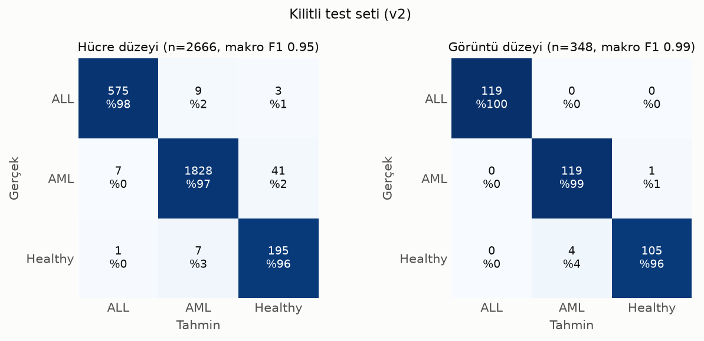
*Kilitli test setinde hücre ve görüntü düzeyi karışıklık matrisleri (satır gerçek sınıf, sütun tahmin; hücrelerde sayı ve satır yüzdesi).*

### Sızıntı tespiti ve düzeltme

İlk kilitli test seti Adım 1'in kopya gruplarına (`grup_id`) göre ayrılmıştı. Kaggle görüntüleri ALL-IDB ile
karşılaştırıldığında, aynı ALL-IDB1 yaymasının bazı türevlerinin farklı gruplara düştüğü görüldü. Bu türevler en-boy
oranı bozularak 256x256'ya sıkıştırılmış hâller, kırpımlar ve o yaymadan kesilmiş hücre kırpımlarıydı. Bu yüzden eski
test setindeki ALL görüntülerinin 44/120'sinin, normal görüntülerin 63/120'sinin kaynağı eğitimde de vardı.

| Değerlendirme | Hücre makro F1 | Görüntü makro F1 (hücre bulunan) | Görüntü makro F1 (tümü) |
|---|---:|---:|---:|
| Eski model, eski test (tümü, sızıntılı) | 0.958 | 0.968 | 0.952 |
| Eski model, eski testin yalnız sızıntısız görüntüleri | 0.959 | 0.974 | 0.958 |
| **Yeni model, yeni sızıntısız test** | **0.949** | **0.985** | **0.967** |

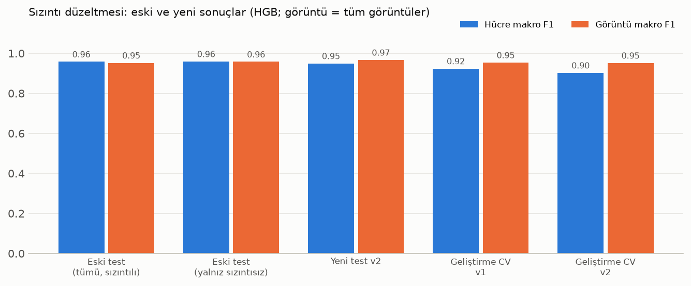
*Eski ve yeni test sonuçları ile iki ayrımın geliştirme CV'si (HGB).*

- Sızıntı eski test skorunu ölçülebilir biçimde şişirmemiş. Yine de ayrım kaynak gruplarıyla yeniden kuruldu ve model
  yeniden eğitildi. Seçilen model değişmedi.
- Geliştirme CV'si hücre düzeyinde 0.924'ten 0.903'e indi; eski CV katları da aynı sızıntıyı taşıyordu.
- **Kaynak kısayolu.** Öznitelikler, görüntünün ALL-IDB kaynaklı olup olmadığını sınıf içinde kısmen ele veriyor
  (grup bazlı CV, ROC AUC 0.68-0.85). Ancak model ALL ve normal hücreleri iki kaynakta da aynı düzeyde ayırıyor
  (CV, görüntü doğruluğu: ALL %99 / %98, normal %95 / %94; ALL-IDB / kaynağı bilinmeyen). ALL-IDB'nin kendi içinde iki
  sınıf da bulunduğu için bu ayrım kaynaktan gelemez.

### Segmentasyon yönteminin sınıflandırmaya etkisi

Aynı model ve aynı çapraz doğrulama katlarıyla üç segmentasyon yönteminin öznitelikleri karşılaştırıldı (ilk ayrımla,
`grup_id`; bu deney yeni ayrımla tekrarlanmadı):

| Yöntem | Hücre makro F1 | Görüntü makro F1 (hücre bulunan) | Kapsama | Görüntü makro F1 (tümü) |
|---|---:|---:|---:|---:|
| K-means | 0.924 ± 0.041 | **0.976** | 0.956 | 0.954 |
| Otsu | **0.928 ± 0.029** | 0.968 | **0.988** | 0.962 |
| Watershed | 0.912 ± 0.038 | 0.969 | **0.988** | **0.963** |

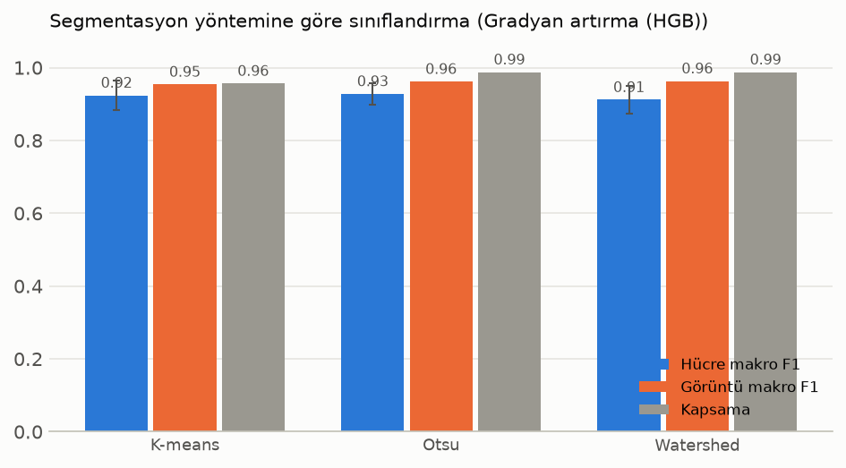
*Kapsama: en az bir hücre bulunan görüntülerin oranı.*

Farkın kaynağı kapsama. K-means, geliştirme setindeki normal görüntülerin %11'inde hiç çekirdek bulamıyor.
İki yöntemin de hücre bulduğu görüntülerde ise K-means biraz önde. Farklar katlar arası sapma düzeyinde olduğundan
K-means korundu.

### Öznitelik ablasyonu

| Öznitelik kümesi | Sayı | Hücre makro F1 | Görüntü makro F1 |
|---|---:|---:|---:|
| Tümü | 58 | **0.903** | 0.952 |
| Yalnız şekil | 11 | 0.526 | 0.605 |
| Yalnız renk | 28 | 0.876 | 0.941 |
| Yalnız doku | 19 | 0.663 | 0.712 |
| Şekil + doku (renksiz) | 30 | 0.732 | 0.784 |
| Şekil + renk | 39 | 0.905 | **0.953** |

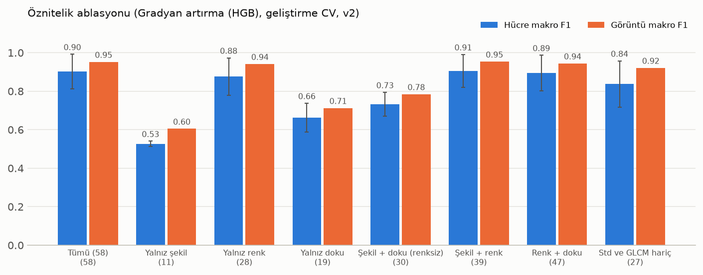
*Seçilen modelin farklı öznitelik gruplarıyla geliştirme setindeki başarısı (birleşimler dahil, kaynak gruplu ayrım).*

Bilginin çoğu renk özniteliklerinde. Şekil ve doku tek başına zayıf, ama renge eklendiklerinde başarıyı
0.876'dan 0.903'e çıkarıyor. "Şekil + renk" ile "Tümü" arasındaki fark katlar arası sapmanın çok altında olduğu için
58 özniteliğin tamamı korundu. Renk baskınlığı kısmen biyolojik farklardan kaynaklanabilir: ALL çekirdekleri
belirgin şekilde daha koyu. Ancak sınıfların farklı laboratuvar ya da boyama protokollerinden gelmesinden de
kaynaklanıyor olabilir; bu ihtimal dışlanamaz.

**Kısayol kontrolü.** 58 öznitelik birlikte kullanıldığında görüntü tipi hâlâ okunabiliyor (ALL içinde ROC AUC 0.97-0.98).
Ancak yakın çekimler hiç görülmeden eğitilen bir model, yayma görüntülerinde aynı başarıyı verdi (makro F1 0.920'ye
karşı 0.922). Yani model yayma görüntülerinde büyütme ipucuna dayanmıyor.

### Dış doğrulama

Model, eğitimde hiç görülmemiş iki veri setinde sınandı. **Kaggle'daki başarı başka merkezlere genellenmiyor.**

| Veri seti | n | Sonuç (mevcut model) |
|---|---:|---|
| ALL-IDB, eğitimde görülmemiş görüntüler (ALL + sağlıklı) | 121 | Lösemi duyarlılığı **0.92**, özgüllük **0.43**; ALL hastalarının 75 görüntüsünden 68'i **AML** olarak tiplendi |
| Münih AML veri seti (Matek ve ark. 2019), TEST | 540 | Miyeloblast → AML %92; ama lenfositlerin %96'sı ve nötrofillerin %100'ü de AML. Dengeli doğruluk **0.32** (şans 0.33) |

- **Sebep: çekim kaynağı ile sınıfın karışması.** Kaggle'da AML görüntüleri, ALL ve sağlıklı görüntülerden (yaklaşık
  yarısı ALL-IDB) farklı bir kaynaktan geliyor: parlak zemin (L\* ≈ 92'ye karşı ≈ 60) ve doygun mor çekirdek. Münih
  görüntüleri de aynı karakterde. Model bu kaynak imzasını "AML" olarak öğrenmiş. Ölçek, segmentasyon ve görüntü
  tipi kısayolu ayrı ayrı incelendi; ana sebep değiller.
- **ALL-IDB2 sağlıklı yakın çekimleri** çoğunlukla "Yüksek" çıkıyor. Görüntülerin %89'unda tek hücre var, bu yüzden
  risk skoru yalnızca 0 ya da 1 olabiliyor. Ayrıca Kaggle'da hiç sağlıklı yakın çekim yok.
- **Düzeltme denemeleri:** ölçek uyarlaması, Macenko boya normalizasyonu, renk artırması ve göreli renk öznitelikleri.
  Münih AYAR kısmında dengeli doğruluğu en fazla 0.33'ten 0.35'e çıkardı; TEST'te +0.01. Seçim kuralı önceden
  sabitlendi ve Münih TEST'e yalnızca en sonda bakıldı.
- **Ek deney (dış doğrulama değil):** Münih AYAR'ın 360 hücresi eğitime eklenince Münih TEST dengeli doğruluğu
  **0.91**'e çıkıyor, Kaggle testi değişmiyor (görüntü F1 0.967). Sorun model kapasitesinde değil, tek kaynaklı eğitim
  verisinde.
- **Kaynak ön kontrolü:** Münih'in 15.731 görüntüsü Kaggle'la görüntü ve hücre düzeyinde, pozitif ve negatif
  kontrollerle karşılaştırıldı. Örtüşme kanıtı bulunmadı; ihtiyaten 14 görüntü dışlandı.
- **Varsayılan model değiştirilmedi.** Ayrıntılar: `docs/sunum_notlari.md` (Adım 8) ve `outputs/external/`.

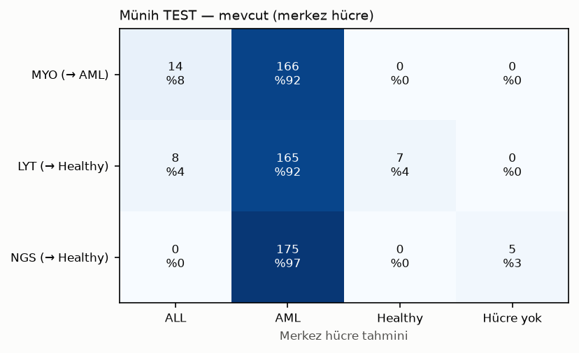
*Münih TEST görüntülerinde mevcut modelin merkez hücre tahminleri (görüntüler: Matek ve ark. 2019, CC BY 3.0).*

### Çok merkezli eğitim ve laboratuvar dışarıda bırakma

Kaggle, ALL-IDB ve Münih birlikte kullanıldı ve başarı **laboratuvar dışarıda bırakma (LOSO)** ile ölçüldü: her katta
test laboratuvarı eğitime hiç girmez (kodla doğrulandı). Mevcut 58 özniteliğe 15 biyolojik öznitelik eklendi (nükleol,
sitoplazma granülerliği, çok ölçekli kromatin dokusu, çekirdek kenar düzensizliği). Kaynak dengesi için kaynak × sınıf
başına ağırlık tavanı (1000 hücre) kullanıldı. Hiperparametreler her katın kendi eğitim verisinde seçildi; seçim
kuralı sonuçlardan önce sabitlendi.

| Yapılandırma | A: ALL-IDB ALL→ALL | A: Healthy özgüllük | B: Münih dengeli doğ. | C: Kaggle test görüntü F1 |
|---|---:|---:|---:|---:|
| Mevcut model | 0.027 | 0.435 | 0.320 | 0.967 |
| Çok merkezli, 58 öznitelik (seçilen) | 0.067 | 0.283 | 0.333 | 0.961 |
| Çok merkezli + biyolojik | 0.040 | 0.326 | 0.322 | 0.967 |
| + kaynak AUC ≥ 0.90 öznitelikler çıkarılmış | 0.027 | 0.717 | 0.337 | 0.956 |

*Kat A: Kaggle (ALL-IDB kaynaklılar hariç) + Münih → ALL-IDB. Kat B: Kaggle + ALL-IDB → Münih TEST. Kat C: üçü →
Kaggle kilitli test.*

- **Çok merkezli eğitim, laboratuvardan bağımsız bir ALL/AML ayrımı sağlamadı.** Görülmemiş laboratuvarda ALL
  görüntülerinin %93'ü hâlâ AML tipleniyor; Münih'te sonuç şans düzeyinde.
- Model laboratuvar içinde çalışıyor: iç CV'de her kaynak × sınıfta duyarlılık 0.88-0.98. Ama laboratuvarlar
  arasında genellenmiyor.
- **Laboratuvar kısayolu:** özniteliklerden hücrenin hangi laboratuvardan geldiği AUC 0.98-0.999 ile tahmin
  edilebiliyor, aynı sınıf içinde de 0.96-1.00. Yalnızca biyolojik özniteliklerle bile 0.89-0.94.
- Biyolojik öznitelikler kaynağı tek başına ele vermiyor (sınıf içi kaynak AUC'si ≤ 0.86), ama laboratuvarlar arası
  genellemeye ölçülebilir katkı da yapmıyor.
- Son model `losemi_siniflandirici_v3_kalibre` üç kaynağın tamamıyla eğitildi (temperature kalibrasyonu, yeni risk
  eşikleri). **Dış test seti kalmadı;** başarısı LOSO ile tahmin edilir. **Varsayılan yapılmadı.**
- Ayrıntılar: `docs/sunum_notlari.md` (Adım 9) ve `outputs/multicenter/`.

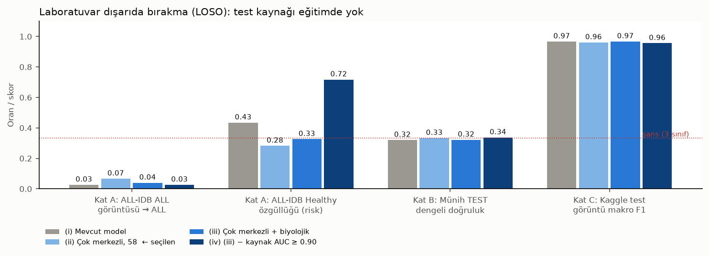

## Kısıtlar ve ileride yapılacaklar

**Kısıtlar**
- **Kaynak belirsizliği.** Veri setinin klinik kaynağı ve boyama protokolü bilinmiyor. Görüntülerin bağımsız
  hastalardan gelip gelmediği doğrulanamıyor.
- **Renk özniteliklerinin baskınlığı.** Ayrımın büyük kısmı renkten geliyor. Model hücre morfolojisinin yanında
  "boyanma tarzını" da öğreniyor olabilir.
- **Görüntü düzeyi etiketler.** Her hücre, bulunduğu görüntünün etiketini alıyor. Bir lösemi görüntüsündeki normal
  lenfosit de "ALL"/"AML" sayılıyor, dolayısıyla hücre düzeyi metrikler etiket gürültüsü içeriyor.
- **Dış veriye genellenmiyor.** [Dış doğrulamada](#dış-doğrulama) ALL-IDB'de özgüllük 0.43, Münih'te dengeli
  doğruluk şans düzeyinde. Kaggle'da AML ayrı bir çekim kaynağından geliyor ve model bu kaynak imzasını öğreniyor.
  Kilitli test sonuçları yalnızca Kaggle'a benzer görüntüler için geçerli. Üç laboratuvarla çok merkezli eğitim de görülmemiş laboratuvara
  genellenmedi ([LOSO](#çok-merkezli-eğitim-ve-laboratuvar-dışarıda-bırakma)).
- **Kalan sızıntı ölçülemez.** "Kaynağı bilinmiyor" ALL-IDB'de bulunamadı demektir. Kaynak tespitinin ve kopya
  tespitinin kaçırdığı türevler hâlâ farklı gruplarda olabilir.
- **Görüntü tipi dağılımı.** Normal sınıfta yakın çekim yok, AML'de çok az (test setinde 1 görüntü). Yakın çekimlerde
  normal / lösemi ayrımı bu veriyle doğrulanamıyor.
- **Segmentasyon kapsaması.** K-means, normal görüntülerin bir kısmında hiç çekirdek bulamıyor.

**İleride yapılacaklar**
- Daha çok laboratuvar: üç laboratuvarla yapılan LOSO genelleme göstermedi, çünkü ALL ve AML'nin her biri eğitimde
  tek bir laboratuvarla temsil ediliyor. Her sınıfın birden çok laboratuvardan geldiği veri ya da her yeni
  laboratuvar için küçük bir etiketli uyarlama kümesi gerekir.
- Hücre düzeyinde etiketlenmiş veriyle eğitim ve değerlendirme.
- Elle işaretlenmiş çekirdek maskeleriyle segmentasyonun doğrudan ölçülmesi.
- Kapsama sorununun segmentasyon tarafında çözülmesi. Şu an K-means hücre bulamazsa Otsu'ya geri dönülüyor ve az
  hücreli görüntüler düşük güvenle işaretleniyor; ancak model Otsu kırpımlarıyla eğitilmedi.

## Kurulum ve kullanım

**Gereksinimler:** Python 3.10 veya üzeri (3.13 ile test edildi). Bağımlılıklar: OpenCV, scikit-image,
scikit-learn, NumPy, pandas, Matplotlib, Streamlit, ReportLab, joblib, ImageHash.

```bash
git clone <repo-adresi>
cd Losemi-Tarama-ve-Tani-Destek-Sistemi
python -m venv .venv
source .venv/bin/activate          # Windows: .venv\Scripts\activate
pip install -r requirements.txt
```

**WSL (Ubuntu) üzerinde çalıştırma.** Windows'ta Smart App Control bazı derlenmiş paketleri (ör. scikit-image
DLL'leri) engelleyebilir. Bu durumda analizler WSL'de çalıştırılabilir. Proje Windows diskinde kalır, WSL `/mnt/c`
üzerinden erişir. Sanal ortam ise Linux ev dizininde tutulur, çünkü Windows'taki `.venv` WSL'de çalışmaz:

```bash
cd "/mnt/c/Users/<kullanıcı>/Desktop/Losemi-Tarama-ve-Tani-Destek-Sistemi"
python3 -m venv ~/losemi-venv           # bir kez
source ~/losemi-venv/bin/activate
pip install -r requirements.txt         # bir kez
python -m src.classifier                # komutlar Windows'takiyle aynı
```

- `data/processed/` ve `outputs/` altındaki CSV'lerde yollar proje köküne göre göreli ve ileri eğik çizgilidir
  (ör. `data/raw/ALL/acute_lymphocytic (1).jpg`). Aynı tablolar Windows'ta ve WSL'de değiştirilmeden kullanılır.
- ALL-IDB proje dışında tutulur (lisans gereği repoya girmez). Konumu `LOSEMI_ALLIDB_DIR` ortam değişkeniyle
  verilir, örneğin `export LOSEMI_ALLIDB_DIR=/mnt/c/Users/<kullanıcı>/Downloads`. Bu dizin `ALL_IDB1/` ve
  `ALL_IDB2/` klasörlerini içermelidir. Değişken yoksa `src/config.py`'deki platform varsayılanı kullanılır.

Veri setini [Veri seti](#veri-seti) bölümünde anlatıldığı gibi `data/raw/` altına yerleştirdikten sonra komutları
proje kökünden sırayla çalıştırın:

```bash
python -m src.dataset                  # veri seti indeksi, kopya tespiti, analiz (outputs/dataset/)
python -m src.preprocessing_analysis   # ön işleme karşılaştırmaları (outputs/preprocessing/)
python -m src.segmentation_analysis    # segmentasyon karşılaştırması (outputs/segmentation/)
python -m src.segmentation             # hücre çıkarma, seçilen yöntem (data/processed/cells/)
python -m src.segmentation --hepsi     # üç yöntemle hücre çıkarma (karşılaştırma için)
python -m src.features                 # öznitelik tabloları (data/processed/features_<yöntem>.csv)
python -m src.features_analysis        # kısayol testi, öznitelik önemi (outputs/features/)
python -m src.allidb_overlap --allidb-dir <dizin>  # Kaggle ↔ ALL-IDB eşleşmesi (ALL-IDB ayrıca indirilir)
python -m src.source_groups            # kaynak grupları + sızıntısız kilitli ayrım (data/processed/veri_bolumu_v2.csv)
python -m src.classification_analysis  # model/segmentasyon karşılaştırması, ablasyon, kısayol (outputs/classification/)
python -m src.classifier               # son model (models/) ve kilitli test seti değerlendirmesi (outputs/evaluation/)
python -m src.leakage_analysis         # eski modelin temiz değerlendirmesi, kaynak kısayolu testi, karşılaştırma
python -m src.risk_analysis            # risk eşikleri (outputs/risk/) ve örnek PDF raporlar (reports/ornekler/)
python -m src.pipeline --goruntu <yol> --pdf   # tek görüntü: uçtan uca analiz ve PDF rapor (reports/)
python -m tests.test_arayuz            # arayüz testi: tüm sayfalar, 7 hazır örnek, PDF indirme
# Dış doğrulama (ALL-IDB ve Münih veri seti ayrıca indirilir; LOSEMI_ALLIDB_DIR / LOSEMI_MUNICH_DIR)
python -m src.external_validation allidb segmentasyon allidb2_teshis   # ALL-IDB (outputs/external/)
python -m src.munich_overlap && python -m src.munich_overlap kapsamli  # Münih ↔ Kaggle kaynak ön kontrolü
python -m src.external_validation munich_bolum munich_teshis           # kilitli Münih AYAR/TEST ayrımı, teşhis
python -m src.domain_shift denemeler && python -m src.domain_shift sonuc  # düzeltme denemeleri, son değerlendirme
# Çok merkezli eğitim ve LOSO (outputs/multicenter/; sırayla, kural LOSO'dan ÖNCE yazılır)
python -m src.multicenter oznitelik    # üç kaynağın 58 + 15 biyolojik özniteliği (data/processed/multicenter/)
python -m src.multicenter kisayol      # öznitelik başına kaynak / görüntü tipi AUC'si
python -m src.multicenter kural        # ön kayıtlı seçim kuralı
python -m src.multicenter loso && python -m src.multicenter ozet   # katlar A, A_idb_dahil, B, C
python -m src.multicenter laboratuvar  # laboratuvar kısayolu testi
python -m src.multicenter son_model    # v3 (models/losemi_siniflandirici_v3_kalibre; varsayılan DEĞİL)
python -m src.multicenter gorseller
```

### Arayüz

Streamlit arayüzü pipeline'ın her aşamasını gösterir. WSL'de başlatmak için (`losemi` kısayolu proje klasörüne
geçip sanal ortamı etkinleştirir):

```bash
# ~/.bashrc içinde bir kez tanımlanır:
alias losemi='cd /mnt/c/Users/<kullanıcı>/Desktop/Losemi-Tarama-ve-Tani-Destek-Sistemi && source ~/losemi-venv/bin/activate'

losemi
streamlit run app/streamlit_app.py
```

Ardından Windows'taki tarayıcıda **http://localhost:8501** açılır. Durdurmak için terminalde `Ctrl+C`.

| Sayfa | İçerik |
|---|---|
| **Analiz** | Görüntü yükleme (JPG, PNG, TIF) veya 7 hazır örnekten seçim; ön işleme, segmentasyon (üç yöntemin karşılaştırması dahil), hücre ızgarası (seçilen hücrenin öznitelikleri ve sınıf olasılıkları), sonuç ve PDF rapor indirme |
| **Model Performansı** | Model karşılaştırması, kilitli test, risk seviyesi, ablasyon, öğrenme eğrisi, kalibrasyon ve sızıntı düzeltmesi |
| **Yöntem** | Akış şeması ve ön işleme, segmentasyon ve öznitelik aşamalarının karşılaştırma figürleri |
| **Hakkında** | Proje özeti, veri kaynakları, kısıtlar ve kaynakça |


*Analiz sayfası: sınıf renkli hücre konturları, risk seviyesi ve baskın lösemi tipi.*


*Hücre ızgarası ve seçilen hücrenin öznitelikleri ile sınıf olasılıkları.*


*Model performansı sayfası.*

## Proje yapısı

```
├── app/
│   ├── streamlit_app.py         Streamlit arayüzü (giriş noktası, sayfa gezinmesi)
│   ├── sayfa_*.py               Analiz, Model Performansı, Yöntem, Hakkında sayfaları
│   └── ortak.py                 Önbellekli analiz, PDF, görsel ve tablo yardımcıları
├── data/
│   ├── raw/                     Ham görüntüler (repoya eklenmez)
│   └── processed/               İndeksler, hücre kırpımları, öznitelik tabloları, veri ayrımı
├── docs/
│   ├── sunum_notlari.md         Her adımın ayrıntılı yöntem ve sonuç notları
│   └── ekranlar/                Arayüz ekran görüntüleri
├── models/                      Eğitilmiş model (.joblib, repoya eklenmez) ve meta verisi (.json)
├── notebooks/                   Deneme notebook'ları
├── outputs/<aşama>/             Her aşamanın figürleri ve sonuç tabloları
├── reports/                     Üretilen PDF raporlar (ornekler/: 7 örnek rapor)
├── src/
│   ├── config.py                Yollar ve tüm parametreler (seçim gerekçeleriyle)
│   ├── utils.py                 Görüntü okuma, figür kaydetme
│   ├── dataset.py               Veri indeksi, kopya tespiti (MD5, pHash, ORB/RANSAC), grup_id, görüntü tipi
│   ├── preprocessing.py         Boyutlandırma, dolgu maskesi, renk normalizasyonu, Lab b*, medyan, CLAHE
│   ├── preprocessing_analysis.py  Ön işleme yöntem ve parametre karşılaştırmaları
│   ├── segmentation.py          Otsu, K-means, Watershed; eritrosit çapı tahmini; hücre çıkarma
│   ├── segmentation_analysis.py   Segmentasyon karşılaştırması (etiket gerektirmeyen ölçütler)
│   ├── features.py              58 şekil, renk ve GLCM doku özniteliği
│   ├── features_analysis.py     Kısayol testi, öznitelik önemi, korelasyon
│   ├── bio_features.py          15 biyolojik öznitelik (nükleol, granülerlik, kromatin, kenar düzensizliği)
│   ├── classifier.py            Veri ayrımı, modeller, değerlendirme, son model ve test
│   ├── classification_analysis.py Model/segmentasyon karşılaştırması, ablasyon, kısayol, kenar deneyleri
│   ├── allidb_overlap.py        Kaggle ↔ ALL-IDB kaynak tespiti
│   ├── source_groups.py         Kaynak grupları (kaynak_grup_id) ve sızıntısız kilitli ayrım
│   ├── leakage_analysis.py      Eski modelin temiz değerlendirmesi, kaynak kısayolu testi
│   ├── external_validation.py   Dış doğrulama: ALL-IDB, Münih ayrımı ve teşhis
│   ├── domain_shift.py          Alan kayması düzeltme denemeleri
│   ├── multicenter.py           Çok merkezli eğitim, LOSO, laboratuvar kısayolu testi, v3
│   ├── risk_report.py           Risk skoru, risk seviyesi, güven bayrağı ve PDF rapor
│   ├── risk_analysis.py         Risk eşiklerinin seçimi, örnek raporlar, pipeline tutarlılık kontrolü
│   └── pipeline.py              Uçtan uca pipeline (tek görüntü → risk ve PDF)
├── tests/
│   └── test_arayuz.py           Arayüz testi (streamlit AppTest)
├── .streamlit/config.toml       Arayüz teması ve sunucu ayarları
└── requirements.txt
```

Her adımın ayrıntılı gerekçeleri, ara sonuçları ve tüm tabloları [docs/sunum_notlari.md](docs/sunum_notlari.md) dosyasındadır.

## Kaynakça

1. N. Otsu, "A Threshold Selection Method from Gray-Level Histograms," *IEEE Transactions on Systems, Man, and Cybernetics*, vol. 9, no. 1, pp. 62–66, 1979.
2. R. M. Haralick, K. Shanmugam, I. Dinstein, "Textural Features for Image Classification," *IEEE Transactions on Systems, Man, and Cybernetics*, vol. SMC-3, no. 6, pp. 610–621, 1973.
3. E. Reinhard, M. Ashikhmin, B. Gooch, P. Shirley, "Color Transfer between Images," *IEEE Computer Graphics and Applications*, vol. 21, no. 5, pp. 34–41, 2001.
4. K. Zuiderveld, "Contrast Limited Adaptive Histogram Equalization," *Graphics Gems IV*, P. S. Heckbert (ed.), Academic Press, pp. 474–485, 1994.
5. S. Lloyd, "Least Squares Quantization in PCM," *IEEE Transactions on Information Theory*, vol. 28, no. 2, pp. 129–137, 1982.
6. S. Beucher, F. Meyer, "The Morphological Approach to Segmentation: The Watershed Transformation," *Mathematical Morphology in Image Processing*, E. R. Dougherty (ed.), Marcel Dekker, pp. 433–481, 1993.
7. L. Vincent, P. Soille, "Watersheds in Digital Spaces: An Efficient Algorithm Based on Immersion Simulations," *IEEE Transactions on Pattern Analysis and Machine Intelligence*, vol. 13, no. 6, pp. 583–598, 1991.
8. E. Rublee, V. Rabaud, K. Konolige, G. Bradski, "ORB: An Efficient Alternative to SIFT or SURF," *Proc. IEEE International Conference on Computer Vision (ICCV)*, pp. 2564–2571, 2011.
9. M. A. Fischler, R. C. Bolles, "Random Sample Consensus: A Paradigm for Model Fitting with Applications to Image Analysis and Automated Cartography," *Communications of the ACM*, vol. 24, no. 6, pp. 381–395, 1981.
10. C. Zauner, "Implementation and Benchmarking of Perceptual Image Hash Functions," Yüksek lisans tezi, Upper Austria University of Applied Sciences, 2010.
11. J. H. Friedman, "Greedy Function Approximation: A Gradient Boosting Machine," *Annals of Statistics*, vol. 29, no. 5, pp. 1189–1232, 2001.
12. L. Breiman, "Random Forests," *Machine Learning*, vol. 45, no. 1, pp. 5–32, 2001.
13. C. Cortes, V. Vapnik, "Support-Vector Networks," *Machine Learning*, vol. 20, no. 3, pp. 273–297, 1995.
14. J. Platt, "Probabilistic Outputs for Support Vector Machines and Comparisons to Regularized Likelihood Methods," *Advances in Large Margin Classifiers*, MIT Press, pp. 61–74, 1999.
15. F. Pedregosa ve ark., "Scikit-learn: Machine Learning in Python," *Journal of Machine Learning Research*, vol. 12, pp. 2825–2830, 2011.
16. R. Donida Labati, V. Piuri, F. Scotti, "ALL-IDB: The Acute Lymphoblastic Leukemia Image Database for Image Processing," *Proc. IEEE International Conference on Image Processing (ICIP)*, pp. 2045–2048, 2011.
17. C. Matek, S. Schwarz, K. Spiekermann, C. Marr, "Human-level recognition of blast cells in acute myeloid leukaemia with convolutional neural networks," *Nature Machine Intelligence*, vol. 1, pp. 538–544, 2019 (veri seti: "AML-Cytomorphology_LMU", The Cancer Imaging Archive, CC BY 3.0).
18. M. Macenko ve ark., "A Method for Normalizing Histology Slides for Quantitative Analysis," *Proc. IEEE International Symposium on Biomedical Imaging (ISBI)*, pp. 1107–1110, 2009.
19. A. Rehman, T. Meraj, A. M. Minhas, A. Imran, M. Ali, W. Sultani, "A Large-scale Multi Domain Leukemia Dataset for the White Blood Cells Detection with Morphological Attributes for Explainability (LeukemiaAttri)," *Medical Image Computing and Computer Assisted Intervention (MICCAI)*, 2024; ayrıca arXiv:2504.02602 (veri seti: ITU Lahore, Chughtai Lab; H_100X_C1 alt kümesi kullanıldı; lisansı belirtilmemiş, görüntüler repoya eklenmedi).
20. B. Sun, J. Feng, K. Saenko, "Return of Frustratingly Easy Domain Adaptation," *Proc. AAAI Conference on Artificial Intelligence*, pp. 2058–2065, 2016 (CORAL).
