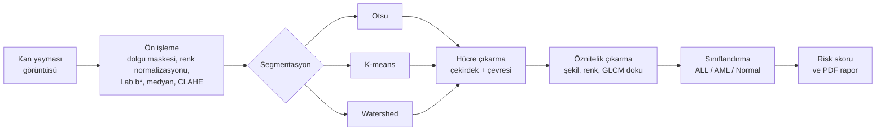
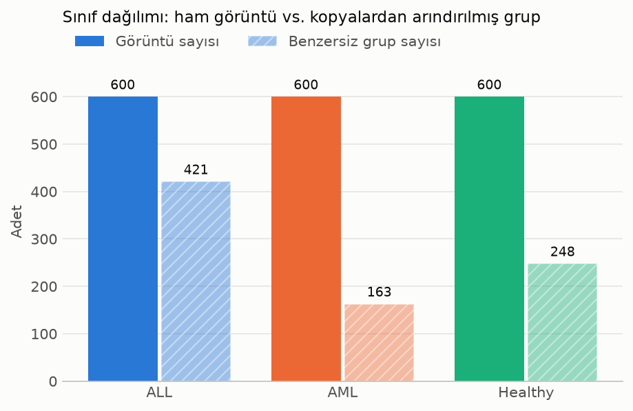
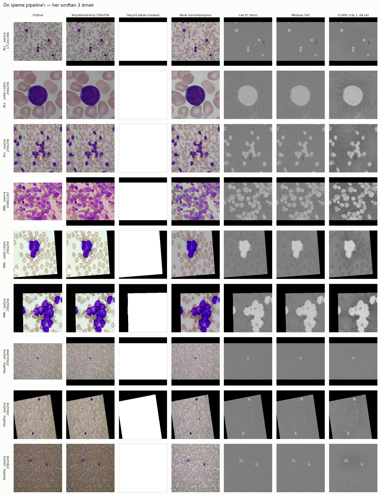
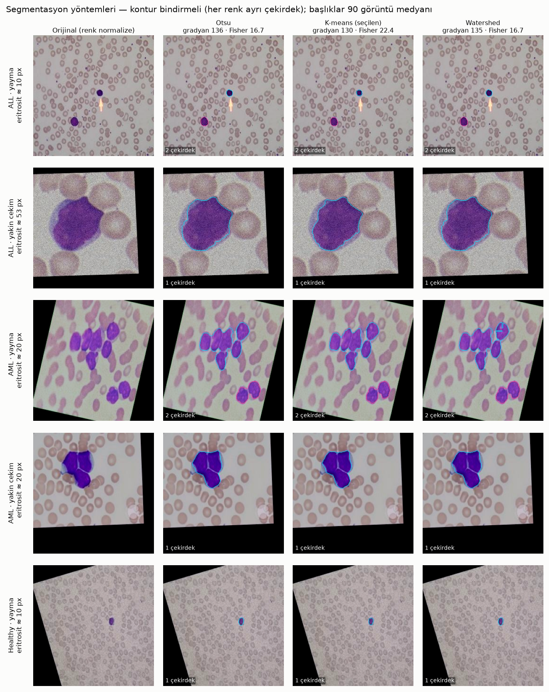
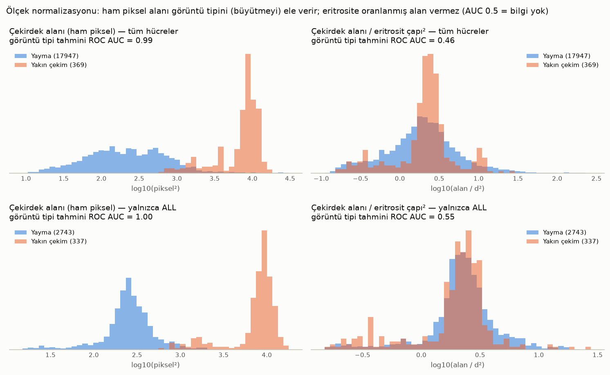
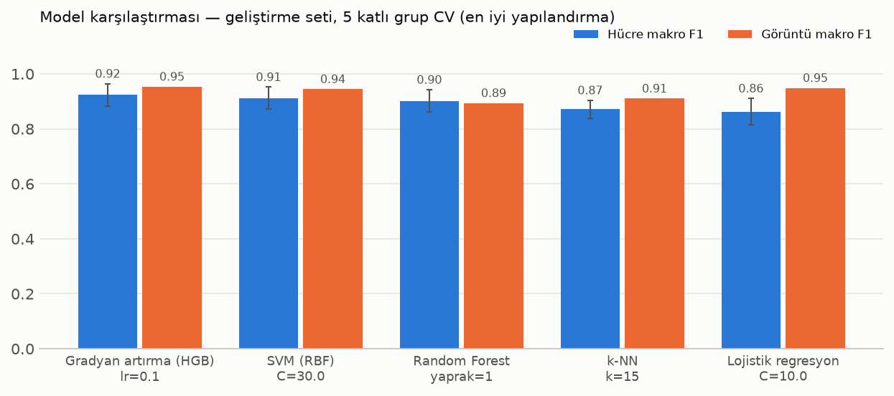
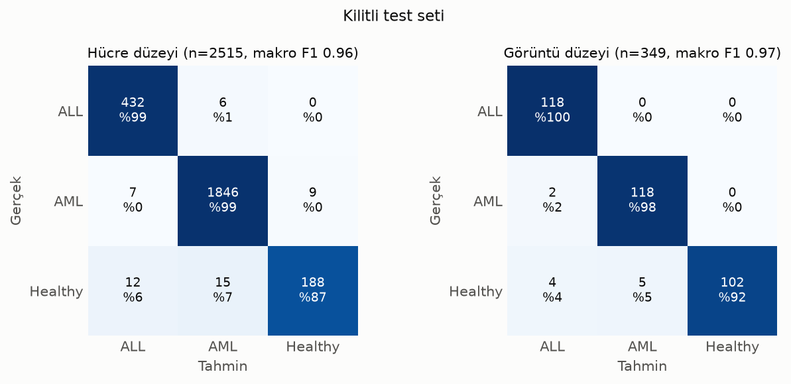
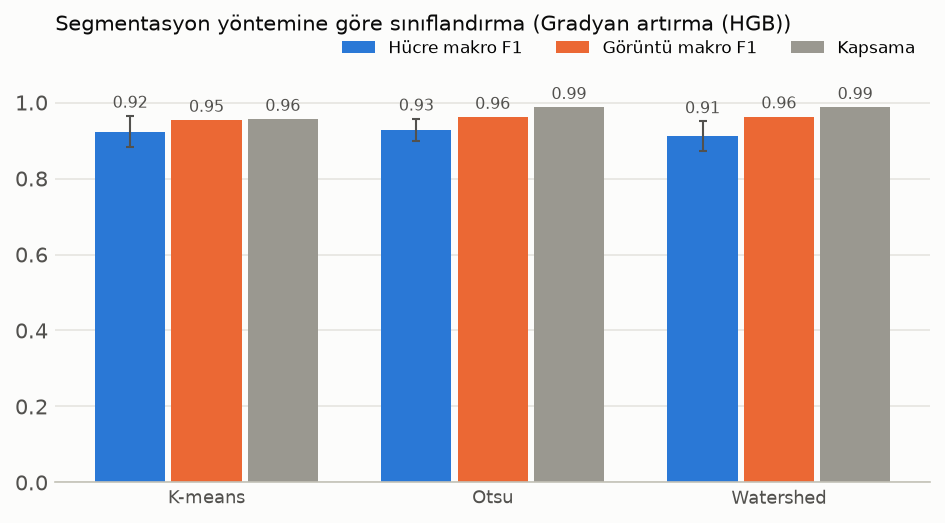
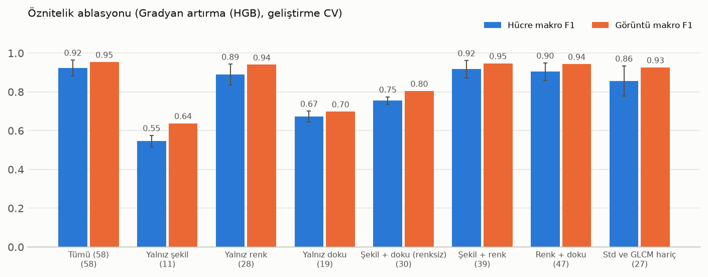

# Görüntü İşleme Tabanlı Akıllı Lösemi Tarama ve Tanı Destek Sistemi

Mikroskobik kan yayması görüntülerinden beyaz kan hücresi çekirdeklerini bulan ve her hücreyi
**ALL** (akut lenfoblastik lösemi), **AML** (akut miyeloid lösemi) veya **Normal** olarak sınıflandıran
bir tarama ve tanı destek sistemi. Sistem yalnızca klasik görüntü işleme ve klasik makine öğrenmesi
yöntemleriyle çalışır; derin öğrenme kullanılmaz. Her aşamada alternatif yöntemler ölçülerek karşılaştırılmış,
seçimler sayısal gerekçelere dayandırılmıştır.

| Öne çıkan sonuç (kilitli test seti) | Değer |
|---|---:|
| Görüntü düzeyi makro F1 | **0.968** |
| Lösemi hücresi (ALL + AML) duyarlılığı | **%99.6** |
| Hücre düzeyi makro F1 | 0.958 |

> [!WARNING]
> **Bu sistem araştırma ve eğitim amaçlı bir prototiptir; klinik teşhis aracı değildir.**
> Ürettiği sınıflandırma, risk skoru ve raporlar tıbbi karar için kullanılamaz.

## İçindekiler

- [Pipeline](#pipeline)
- [Veri seti](#veri-seti)
- [Yöntem](#yöntem)
- [Sonuçlar](#sonuçlar)
- [Kısıtlar ve ileride yapılacaklar](#kısıtlar-ve-ileride-yapılacaklar)
- [Kurulum ve kullanım](#kurulum-ve-kullanım)
- [Proje yapısı](#proje-yapısı)
- [Kaynakça](#kaynakça)

## Pipeline



- Sınıflandırma hücre düzeyinde yapılır. Görüntünün sonucu, hücre olasılıklarının ortalamasından elde edilir.
- **Risk skoru**, görüntüdeki anormal (ALL veya AML) hücre oranıdır. Raporda baskın lösemi tipi de yer alır.
- Sistem hastanın yaşını tahmin etmez. ALL'ın çoğunlukla çocuklarda, AML'nin yetişkinlerde görülmesi
  yalnızca klinik arka plan bilgisidir.

## Veri seti

- **Kaynak:** Kaggle — [Leukemia Types](https://www.kaggle.com/datasets/sheikhlubna/leukemia-types) (`sheikhlubna/leukemia-types`).
  Veri setinden yalnızca üç klasör kullanılır:

  | Kaggle klasörü | Projedeki klasör | Sınıf |
  |---|---|---|
  | `acute_lymphocytic` | `data/raw/ALL` | ALL |
  | `acute_myeloid` | `data/raw/AML` | AML |
  | `healthy_blood_cell` | `data/raw/Healthy` | Normal (Healthy) |

- **Kopya tespiti.** Veri setinde aynı kaynak görüntünün augmentasyonları (döndürme, aynalama, renk kaydırma,
  kırpma) ve birebir kopyaları var.
  - Birebir kopyalar MD5 ile bulundu.
  - Neredeyse aynı kopyalar için önce döndürme ve aynalamaya dayanıklı pHash ile aday çiftler seçildi, sonra
    bu adaylar ORB + RANSAC eşleştirmesiyle doğrulandı.
  - Kopyalar aynı `grup_id` altında toplandı. Eğitim/test ayrımı bu gruplara göre yapılır.

  | Sınıf | Görüntü | Birebir fazlalık (MD5) | Kopyası olan görüntü | **Benzersiz grup** | En büyük grup |
  |---|---:|---:|---:|---:|---:|
  | ALL | 600 | 19 | 268 | **421** | 11 |
  | AML | 600 | 112 | 477 | **163** | 38 |
  | Normal | 600 | 84 | 451 | **248** | 24 |
  | Toplam | 1800 | 215 | 1196 | **832** | — |

  - Toplam 354 birebir ve 5 566 neredeyse aynı kopya çifti bulundu. Hiçbiri sınıflar arası değil.
  - Sınıflar 600'er görüntüyle dengeli görünüyor, ama AML'de yalnızca 163 benzersiz kaynak var.

- **Görüntü tipi.** Görüntüler iki büyütmede çekilmiş: çok hücreli yayma ve tek hücreli yakın çekim.
  - Yakın çekim sayıları: ALL 290, AML 30, Normal 0.
  - Bu dağılım bir kısayol riski taşır: model lösemi tipi yerine büyütmeyi öğrenebilir. Bu risk öznitelik
    ve sınıflandırma aşamalarında ayrıca test edildi.


*Her sınıfta 600 görüntü var, ama kopyalar gruplandığında benzersiz kaynak sayısı 163 ile 421 arasına düşüyor.*

**Veriyi edinme:** Veri dosyaları lisans ve boyut nedeniyle repoya eklenmemiştir (`data/` klasörü `.gitignore`
içindedir). Veri setini Kaggle sayfasından indirip yukarıdaki üç klasörü `data/raw/` altına yerleştirin. Kaggle
CLI ile:

```bash
kaggle datasets download -d sheikhlubna/leukemia-types --unzip -p indirilen/
# acute_lymphocytic → data/raw/ALL, acute_myeloid → data/raw/AML, healthy_blood_cell → data/raw/Healthy
```

> **Kısıt:** Veri setinin klinik kaynağı (hastane, mikroskop, boyama protokolü, hasta sayısı) belirtilmemiştir.
> Görüntülerin bağımsız hastalardan gelip gelmediği doğrulanamaz.

## Yöntem

### 1. Ön işleme

Görüntüler en-boy oranı korunarak 256x256'ya getirilir. Döndürme augmentasyonlarından kalan siyah ve koyu renkli
köşeler bir **dolgu maskesiyle** tüm hesaplardan dışlanır. Renk normalizasyonu yalnızca **zemin**
(eritrosit + plazma) istatistiklerine dayanır: L\* çarpımsal, a\*/b\* toplamsal olarak hizalanır. Bu sayede zemin
rengi tutarlı hâle gelir (zemin b\* std 7.4 → 1.3), ama çekirdek−zemin farkı değişmez.

Klasik Reinhard yöntemi (tüm piksellerin ortalaması ve std'si) bu veri setinde uygun değil. Bir görüntünün renk
std'si boyadan çok içerikten etkileniyor: AML yaymaları çekirdekle dolu, normal yaymalarda neredeyse hiç
çekirdek yok. Bu yüzden Reinhard normal görüntülerin rengini ×4.7 geriyor ve bu görüntülerdeki çekirdek
piksellerinin %100'ü RGB gamutunda kırpılıyor. Sonuçta sınıfa bağlı, yapay bir ipucu oluşuyor.

Çekirdek kanalı 11 aday arasından seçildi. Ölçüt, çekirdek ile arka plan arasındaki Fisher oranı
(89 görüntünün medyanı):

| Kanal | Fisher | Fisher ALL | Fisher AML | Fisher Normal |
|---|---:|---:|---:|---:|
| **Lab b\* (ters, seçilen)** | **22.9** | **23.6** | **17.9** | **36.9** |
| B−G | 18.9 | 21.7 | 14.9 | 29.5 |
| Lab a\* | 14.7 | 15.1 | 11.1 | 19.8 |
| HSV S | 14.2 | 14.0 | 10.1 | 24.5 |
| Gri | 8.8 | 10.1 | 5.3 | 13.6 |

Mor çekirdek b\* kanalında mavidir. Pembe eritrosit ve plazma bu kanalda nötrdür, yani kanal yalnızca çekirdeğe
tepki verir. Kanala sonra **medyan 5x5** filtre uygulanır: gürültüyü %38 azaltır ve sınır gradyanının %94'ünü
korur. Ardından **CLAHE** gelir (clipLimit 1.0, 64 px karo). Bu ayar, gürültüyü düşük tutarken genel ayrışmayı
korudu (Fisher 18.2). 16 px karo genel ölçümde başa baş çıktı (18.3), ama yakın çekimlerde ayrışmayı daha çok
düşürdü (20.4'e karşı 30.3).


*Her sınıftan üç örnekte ön işleme aşamaları: orijinal → 256x256 → geçerli piksel maskesi → renk normalizasyonu → ters Lab b\* → medyan → CLAHE.*

### 2. Segmentasyon

Üç yöntem uygulandı: **Otsu** eşikleme, Lab uzayında **K-means** (k = 3) ve marker kontrollü **Watershed**.
Görüntüler farklı büyütmelerde olduğu için tüm boyut parametreleri, her görüntüde tahmin edilen **eritrosit
çapına** oranlandı. Elle işaretlenmiş maske olmadığından yöntemler etiket gerektirmeyen altı ölçütle karşılaştırıldı
(her sınıftan 30 farklı gruptan görüntü):

| Yöntem | Sınır gradyanı ↑ (yayma) | Fisher ↑ (yayma) | Birleşik çekirdek ↓ (yayma) | Boş görüntü ↓ (yayma) | Sınıf tutarsızlığı ↓ (yayma) | **Nihai sıra skoru** ↓ |
|---|---:|---:|---:|---:|---:|---:|
| Otsu | **144.5** | 16.0 | 0.072 | **%0** | 0.161 | 2.12 |
| **K-means (seçilen)** | 135.8 | **20.7** | 0.069 | %2.6 | **0.134** | **1.75** |
| Watershed | **144.5** | 16.0 | **0.067** | **%0** | 0.163 | 2.12 |

Nihai skor, yayma ve yakın çekim için ayrı ayrı hesaplanan ortalama sıraların ortalamasıdır. K-means bu skorda
öne çıktı. Asıl üstünlüğü yoğun AML yaymalarında görülüyor: Otsu ve Watershed yalnızca b\* kanalına dayandığı için
blastların mavimsi sitoplazması üzerinden çekirdekleri birleştiriyor. K-means parlaklık bilgisini de kullandığı
için koyu çekirdeği daha açık sitoplazmadan ayırabiliyor. Zayıf yanı ise çekirdeğin görüntünün çok küçük bir kısmını
kapladığı normal yaymalarda bazen hiç hücre bulamaması.


*Üç yöntemin bulduğu çekirdek konturları; her renk ayrı bir çekirdeği gösteriyor.*

### 3. Öznitelik çıkarma

Her hücreden **58 öznitelik** çıkarıldı:

| Grup | Sayı | İçerik |
|---|---:|---|
| Şekil | 11 | alan/d², çevre/d, dairesellik, eksantrisite, solidity, extent, eksenler, eksen oranı, lob sayısı, girinti derinliği |
| Renk | 28 | Çekirdek ve çekirdek çevresi halkası için Lab/HSV ortalama ve std (H dairesel), çekirdek − halka farkı (ΔL\*, Δa\*, Δb\*, ΔE) |
| Doku | 19 | GLCM: contrast, dissimilarity, homogeneity, energy, correlation, ASM (d = 1, 2, 3; 4 açının ortalaması), entropi |

**Ölçek normalizasyonu.** Yakın çekimlerde aynı çekirdek yaymadakinden ~40 kat fazla piksel kaplar ve yakın
çekimlerin neredeyse tamamı ALL sınıfındadır. Bu yüzden ham piksel ölçüleri "ALL"ı değil, "büyütmeyi" öğretir.
Bunu önlemek için boyut ölçüleri eritrosit çapına (d) oranlandı. Ayrıca her hücre, eritrosit çapı 10 px olacak
şekilde ortak bir ölçeğe yeniden örneklendi. Ham piksel ölçüleri, görüntü tipi, konum ve N/C oranı öznitelik olarak
kullanılmadı.

Kısayol testinde, tek bir ölçüyle görüntü tipini tahmin eden bir model kuruldu (grup bazlı çapraz doğrulama):

| Ölçü | Görüntü tipi tahmini ROC AUC |
|---|---:|
| Çekirdek alanı (ham piksel) | 0.99 |
| Çekirdek alanı / eritrosit çapı² | **0.46** |
| GLCM contrast, yerel ölçek | 0.95 |
| GLCM contrast, referans ölçek | **0.57** |


*Ham piksel alanı yayma ve yakın çekimi neredeyse kusursuz ayırıyor (AUC 0.99); eritrosit çapına oranlanmış alan bu bilgiyi taşımıyor (AUC 0.46).*

### 4. Sınıflandırma

- **Grup bazlı ayrım.** Görüntüler `StratifiedGroupKFold` ile ayrıldı (grup = `grup_id`). Aynı kaynağın
  augmentasyonları hiçbir zaman hem eğitimde hem testte bulunmaz.
- **Kilitli test seti.** Görüntülerin %20'si (sınıf başına 120 görüntü, toplam 360) bir kez ayrılıp dosyaya yazıldı.
  - Model, hiperparametre, öznitelik kümesi ve segmentasyon seçimlerinin tamamı yalnızca geliştirme setinde
    (1 440 görüntü), 5 katlı grup çapraz doğrulamayla yapıldı.
  - Test seti yalnızca son değerlendirmede, bir kez kullanıldı.
- **Modeller.** Yalnızca klasik makine öğrenmesi (scikit-learn) kullanıldı: lojistik regresyon, k-NN, SVM (RBF),
  Random Forest ve gradyan artırma (HistGradientBoosting).
  - Hücrelerin %77'si AML olduğu için sınıf ağırlıkları dengelendi.
  - Birincil ölçüt makro F1.
- **Görüntü düzeyi karar.** Hücre olasılıkları ortalanır. Görüntüde tam hücre varsa, görüntü kenarına değen
  (kesik) hücreler bu ortalamaya katılmaz.

## Sonuçlar

### Model karşılaştırması

Geliştirme seti, 5 katlı grup çapraz doğrulama. Tabloda her modelin en iyi yapılandırması var:

| Model | En iyi parametre | Hücre makro F1 (± kat std) | Dengeli doğruluk | Normal duyarlılığı | Görüntü makro F1 |
|---|---|---:|---:|---:|---:|
| **Gradyan artırma (HGB)** | lr 0.1, 300 iterasyon | **0.924 ± 0.041** | **0.948** | 0.919 | **0.954** |
| SVM (RBF) | C = 30 | 0.912 ± 0.041 | 0.939 | 0.905 | 0.945 |
| Random Forest | yaprak ≥ 1 | 0.902 ± 0.041 | 0.886 | 0.762 | 0.894 |
| k-NN | k = 15 | 0.872 ± 0.032 | 0.889 | 0.790 | 0.911 |
| Lojistik regresyon | C = 10 | 0.863 ± 0.048 | 0.935 | 0.950 | 0.949 |


*Her modelin en iyi yapılandırması; hata çubukları hücre makro F1'in katlar arası standart sapması.*

Seçilen model gradyan artırma (HGB). SVM ile farkı katlar arası sapmadan küçük, ama HGB hem hücre hem görüntü
düzeyinde en üst grupta. Random Forest ve k-NN, normal hücreleri çoğunluk sınıfı AML'ye kaydırıyor.

### Kilitli test seti

| Düzey | n | Doğruluk | Makro F1 | Duyarlılık ALL | Duyarlılık AML | Duyarlılık Normal |
|---|---:|---:|---:|---:|---:|---:|
| Hücre (kenara değmeyen) | 2 515 | 0.981 | **0.958** | 0.986 | 0.991 | 0.874 |
| Hücre (tümü) | 3 196 | 0.980 | 0.955 | 0.974 | 0.991 | 0.874 |
| Görüntü (hücre bulunan) | 349 | 0.968 | **0.968** | 1.000 | 0.983 | 0.919 |
| Görüntü (tümü; hücre bulunamayan = hata) | 360 | 0.939 | 0.952 | 0.983 | 0.983 | 0.850 |

- Lösemi hücrelerinin %99.6'sı anormal olarak işaretlendi. ALL ile AML'nin birbirine karışması hücrelerin yaklaşık %1'inde görüldü.
- Test sonuçları geliştirme setindeki çapraz doğrulamayla tutarlı: hücre makro F1 0.924 → 0.958, görüntü (tümü) 0.954 → 0.952.
- Başlıca zayıflık normal hücreler: %13'ü lösemi olarak etiketlendi. Yanlış sınıflanan 9 normal görüntünün
  hepsinde yalnızca 1 hücre vardı.


*Kilitli test setinde hücre ve görüntü düzeyi karışıklık matrisleri (satır gerçek sınıf, sütun tahmin; hücrelerde sayı ve satır yüzdesi).*

### Segmentasyon yönteminin sınıflandırmaya etkisi

Aynı model ve aynı çapraz doğrulama katlarıyla üç segmentasyon yönteminin öznitelikleri karşılaştırıldı:

| Yöntem | Hücre makro F1 | Görüntü makro F1 (hücre bulunan) | Kapsama | Görüntü makro F1 (tümü) |
|---|---:|---:|---:|---:|
| K-means | 0.924 ± 0.041 | **0.976** | 0.956 | 0.954 |
| Otsu | **0.928 ± 0.029** | 0.968 | **0.988** | 0.962 |
| Watershed | 0.912 ± 0.038 | 0.969 | **0.988** | **0.963** |


*Kapsama: en az bir hücre bulunan görüntülerin oranı.*

Farkın kaynağı kapsama. K-means, geliştirme setindeki normal görüntülerin %11'inde hiç çekirdek bulamıyor.
İki yöntemin de hücre bulduğu görüntülerde ise K-means biraz önde. Farklar katlar arası sapma düzeyinde olduğundan
K-means korundu.

### Öznitelik ablasyonu

| Öznitelik kümesi | Sayı | Hücre makro F1 | Görüntü makro F1 |
|---|---:|---:|---:|
| Tümü | 58 | **0.924** | **0.954** |
| Yalnız şekil | 11 | 0.546 | 0.638 |
| Yalnız renk | 28 | 0.890 | 0.940 |
| Yalnız doku | 19 | 0.673 | 0.698 |
| Şekil + doku (renksiz) | 30 | 0.755 | 0.805 |


*Seçilen modelin farklı öznitelik gruplarıyla geliştirme setindeki başarısı (birleşimler dahil).*

Bilginin çoğu renk özniteliklerinde. Şekil ve doku tek başına zayıf, ama renge eklendiklerinde başarıyı
0.890'dan 0.924'e çıkarıyor. Renk baskınlığı kısmen biyolojik farklardan kaynaklanabilir: ALL çekirdekleri
belirgin şekilde daha koyu. Ancak sınıfların farklı laboratuvar ya da boyama protokollerinden gelmesinden de
kaynaklanıyor olabilir; bu ihtimal dışlanamaz.

**Kısayol kontrolü.** 58 öznitelik birlikte kullanıldığında görüntü tipi hâlâ okunabiliyor (ALL içinde ROC AUC 0.97-0.98).
Ancak yakın çekimler hiç görülmeden eğitilen bir model, yayma görüntülerinde aynı başarıyı verdi (makro F1 0.920'ye
karşı 0.922). Yani model yayma görüntülerinde büyütme ipucuna dayanmıyor.

## Kısıtlar ve ileride yapılacaklar

**Kısıtlar**
- **Kaynak belirsizliği.** Veri setinin klinik kaynağı ve boyama protokolü bilinmiyor. Görüntülerin bağımsız
  hastalardan gelip gelmediği doğrulanamıyor.
- **Renk özniteliklerinin baskınlığı.** Ayrımın büyük kısmı renkten geliyor. Model hücre morfolojisinin yanında
  "boyanma tarzını" da öğreniyor olabilir.
- **Görüntü düzeyi etiketler.** Her hücre, bulunduğu görüntünün etiketini alıyor. Bir lösemi görüntüsündeki normal
  lenfosit de "ALL"/"AML" sayılıyor, dolayısıyla hücre düzeyi metrikler etiket gürültüsü içeriyor.
- **Dış doğrulama yok.** Sonuçlar aynı veri setinden ayrılmış bir test setine ait; başka bir laboratuvarın
  görüntülerinde başarı düşebilir.
- **Görüntü tipi dağılımı.** Normal sınıfta yakın çekim yok, AML'de çok az (test setinde 1 görüntü). Yakın çekimlerde
  normal / lösemi ayrımı bu veriyle doğrulanamıyor.
- **Segmentasyon kapsaması.** K-means, normal görüntülerin bir kısmında hiç çekirdek bulamıyor.

**İleride yapılacaklar**
- Farklı laboratuvar ve mikroskoplardan gelen verilerle dış doğrulama.
- Hücre düzeyinde etiketlenmiş veriyle eğitim ve değerlendirme.
- Elle işaretlenmiş çekirdek maskeleriyle segmentasyonun doğrudan ölçülmesi.
- K-means hücre bulamadığında Otsu'ya geri dönülmesi; hücre sayısı az olan görüntülerin düşük güvenle işaretlenmesi.

## Kurulum ve kullanım

**Gereksinimler:** Python 3.10 veya üzeri (3.13 ile test edildi). Bağımlılıklar: OpenCV, scikit-image,
scikit-learn, NumPy, pandas, Matplotlib, Streamlit, ReportLab, joblib, ImageHash.

```bash
git clone <repo-adresi>
cd Losemi-Tarama-ve-Tani-Destek-Sistemi
python -m venv .venv
source .venv/bin/activate          # Windows: .venv\Scripts\activate
pip install -r requirements.txt
```

Veri setini [Veri seti](#veri-seti) bölümünde anlatıldığı gibi `data/raw/` altına yerleştirdikten sonra komutları
proje kökünden sırayla çalıştırın:

```bash
python -m src.dataset                  # veri seti indeksi, kopya tespiti, analiz (outputs/dataset/)
python -m src.preprocessing_analysis   # ön işleme karşılaştırmaları (outputs/preprocessing/)
python -m src.segmentation_analysis    # segmentasyon karşılaştırması (outputs/segmentation/)
python -m src.segmentation             # hücre çıkarma, seçilen yöntem (data/processed/cells/)
python -m src.segmentation --hepsi     # üç yöntemle hücre çıkarma (karşılaştırma için)
python -m src.features                 # öznitelik tabloları (data/processed/features_<yöntem>.csv)
python -m src.features_analysis        # kısayol testi, öznitelik önemi (outputs/features/)
python -m src.classification_analysis  # model/segmentasyon karşılaştırması, ablasyon, kısayol (outputs/classification/)
python -m src.classifier               # son model (models/) ve kilitli test seti değerlendirmesi (outputs/evaluation/)
```

> **Geliştirme aşamasında:** Risk skoru, PDF rapor (`src/risk_report.py`), uçtan uca pipeline (`src/pipeline.py`)
> ve Streamlit arayüzü (`streamlit run app/streamlit_app.py`) henüz tamamlanmadı.

## Proje yapısı

```
├── app/
│   └── streamlit_app.py         Streamlit arayüzü (geliştirme aşamasında)
├── data/
│   ├── raw/                     Ham görüntüler (repoya eklenmez)
│   └── processed/               İndeksler, hücre kırpımları, öznitelik tabloları, veri ayrımı
├── docs/
│   └── sunum_notlari.md         Her adımın ayrıntılı yöntem ve sonuç notları
├── models/                      Eğitilmiş model (.joblib, repoya eklenmez) ve meta verisi (.json)
├── notebooks/                   Deneme notebook'ları
├── outputs/<aşama>/             Her aşamanın figürleri ve sonuç tabloları
├── reports/                     Üretilen PDF raporlar
├── src/
│   ├── config.py                Yollar ve tüm parametreler (seçim gerekçeleriyle)
│   ├── utils.py                 Görüntü okuma, figür kaydetme
│   ├── dataset.py               Veri indeksi, kopya tespiti (MD5, pHash, ORB/RANSAC), grup_id, görüntü tipi
│   ├── preprocessing.py         Boyutlandırma, dolgu maskesi, renk normalizasyonu, Lab b*, medyan, CLAHE
│   ├── preprocessing_analysis.py  Ön işleme yöntem ve parametre karşılaştırmaları
│   ├── segmentation.py          Otsu, K-means, Watershed; eritrosit çapı tahmini; hücre çıkarma
│   ├── segmentation_analysis.py   Segmentasyon karşılaştırması (etiket gerektirmeyen ölçütler)
│   ├── features.py              58 şekil, renk ve GLCM doku özniteliği
│   ├── features_analysis.py     Kısayol testi, öznitelik önemi, korelasyon
│   ├── classifier.py            Veri ayrımı, modeller, değerlendirme, son model ve test
│   ├── classification_analysis.py Model/segmentasyon karşılaştırması, ablasyon, kısayol, kenar deneyleri
│   ├── risk_report.py           Risk skoru ve PDF rapor (geliştirme aşamasında)
│   └── pipeline.py              Uçtan uca pipeline (geliştirme aşamasında)
└── requirements.txt
```

Her adımın ayrıntılı gerekçeleri, ara sonuçları ve tüm tabloları [docs/sunum_notlari.md](docs/sunum_notlari.md) dosyasındadır.

## Kaynakça

1. N. Otsu, "A Threshold Selection Method from Gray-Level Histograms," *IEEE Transactions on Systems, Man, and Cybernetics*, vol. 9, no. 1, pp. 62–66, 1979.
2. R. M. Haralick, K. Shanmugam, I. Dinstein, "Textural Features for Image Classification," *IEEE Transactions on Systems, Man, and Cybernetics*, vol. SMC-3, no. 6, pp. 610–621, 1973.
3. E. Reinhard, M. Ashikhmin, B. Gooch, P. Shirley, "Color Transfer between Images," *IEEE Computer Graphics and Applications*, vol. 21, no. 5, pp. 34–41, 2001.
4. K. Zuiderveld, "Contrast Limited Adaptive Histogram Equalization," *Graphics Gems IV*, P. S. Heckbert (ed.), Academic Press, pp. 474–485, 1994.
5. S. Lloyd, "Least Squares Quantization in PCM," *IEEE Transactions on Information Theory*, vol. 28, no. 2, pp. 129–137, 1982.
6. S. Beucher, F. Meyer, "The Morphological Approach to Segmentation: The Watershed Transformation," *Mathematical Morphology in Image Processing*, E. R. Dougherty (ed.), Marcel Dekker, pp. 433–481, 1993.
7. L. Vincent, P. Soille, "Watersheds in Digital Spaces: An Efficient Algorithm Based on Immersion Simulations," *IEEE Transactions on Pattern Analysis and Machine Intelligence*, vol. 13, no. 6, pp. 583–598, 1991.
8. E. Rublee, V. Rabaud, K. Konolige, G. Bradski, "ORB: An Efficient Alternative to SIFT or SURF," *Proc. IEEE International Conference on Computer Vision (ICCV)*, pp. 2564–2571, 2011.
9. M. A. Fischler, R. C. Bolles, "Random Sample Consensus: A Paradigm for Model Fitting with Applications to Image Analysis and Automated Cartography," *Communications of the ACM*, vol. 24, no. 6, pp. 381–395, 1981.
10. C. Zauner, "Implementation and Benchmarking of Perceptual Image Hash Functions," Yüksek lisans tezi, Upper Austria University of Applied Sciences, 2010.
11. J. H. Friedman, "Greedy Function Approximation: A Gradient Boosting Machine," *Annals of Statistics*, vol. 29, no. 5, pp. 1189–1232, 2001.
12. L. Breiman, "Random Forests," *Machine Learning*, vol. 45, no. 1, pp. 5–32, 2001.
13. C. Cortes, V. Vapnik, "Support-Vector Networks," *Machine Learning*, vol. 20, no. 3, pp. 273–297, 1995.
14. J. Platt, "Probabilistic Outputs for Support Vector Machines and Comparisons to Regularized Likelihood Methods," *Advances in Large Margin Classifiers*, MIT Press, pp. 61–74, 1999.
15. F. Pedregosa ve ark., "Scikit-learn: Machine Learning in Python," *Journal of Machine Learning Research*, vol. 12, pp. 2825–2830, 2011.
