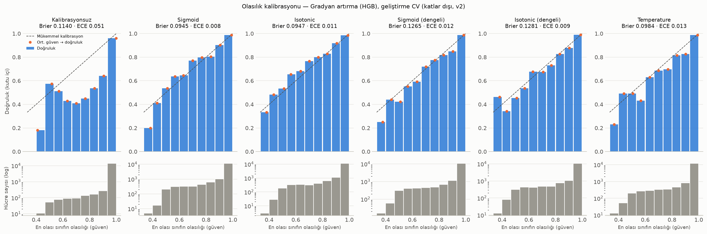
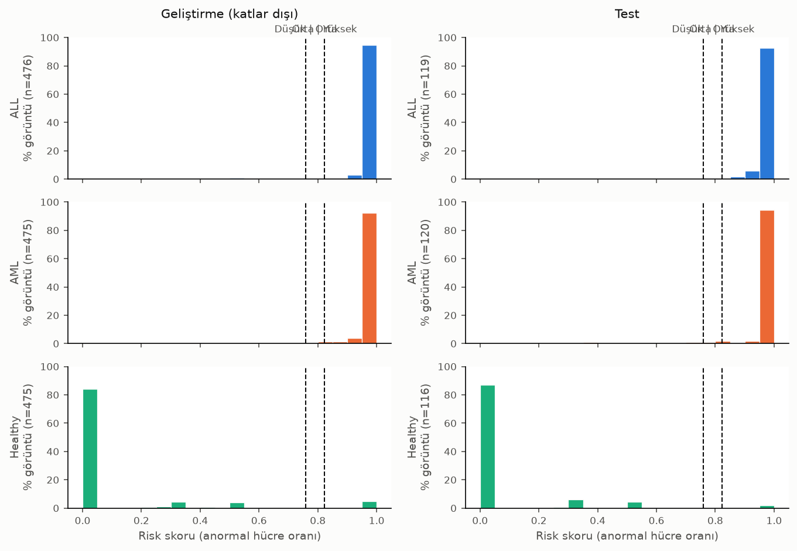
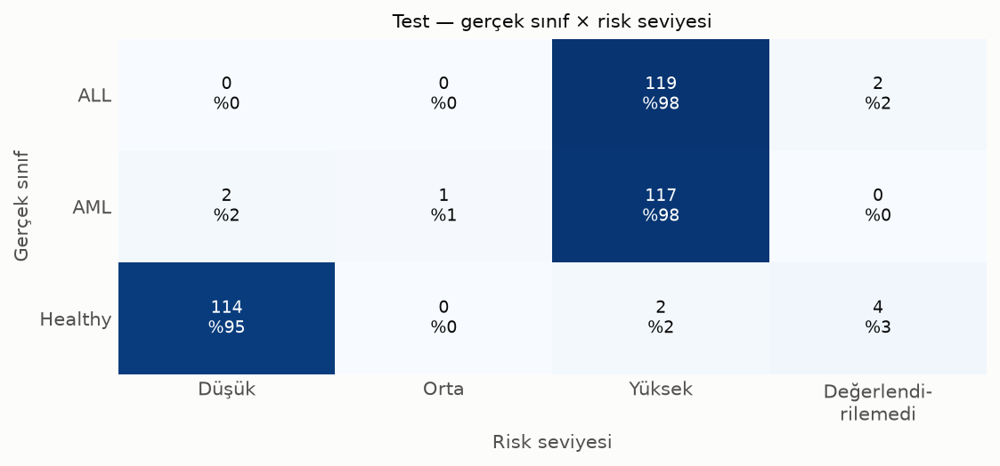

# Sunum Notları — Görüntü İşleme Tabanlı Akıllı Lösemi Tarama ve Tanı Destek Sistemi

Bu dosya her geliştirme adımı tamamlandığında güncellenir. Her adım için
**Ne yapıldı**, **Yöntemin teorisi** ve **Elde edilen sonuçlar** başlıkları yer alır.

---

## Adım 0 — Proje İskeleti

**Proje kapsamı:**
- Sistem 3 sınıflı sınıflandırma yapar: **ALL** (akut lenfoblastik lösemi, çoğunlukla çocuklarda),
  **AML** (akut miyeloid lösemi, çoğunlukla yetişkinlerde), **Healthy** (normal hücre).
- Sistem hastanın **yaşını tahmin ETMEZ**; yalnızca lösemi tipini sınıflandırır. ALL/AML'nin yaş
  gruplarıyla ilişkisi yalnızca klinik arka plan bilgisidir.
- **Risk skoru:** görüntüdeki anormal hücre (ALL veya AML) oranı. PDF raporda risk skoruna ek
  olarak baskın lösemi tipi (ALL veya AML) de yazılır.
- Sistem araştırma ve eğitim amaçlı bir prototiptir; **klinik teşhis aracı değildir**.

**Ne yapıldı:**
- Klasör yapısı oluşturuldu: `data/`, `src/`, `app/`, `notebooks/`, `outputs/`, `reports/`, `docs/`, `models/`.
- `src/` altında her pipeline aşaması için ayrı modül tanımlandı (yalnızca fonksiyon imzaları ve Türkçe docstring'ler).
- `requirements.txt` ve Streamlit arayüz iskeleti hazırlandı.

**Yöntemin teorisi:** — (bu adımda algoritma yok)

**Elde edilen sonuçlar:** — (bu adımda sonuç yok)

---

## Adım 1 — Veri Seti

**Ne yapıldı:**
- Kaggle "leukemia types" (`sheikhlubna/leukemia-types`) veri setinden `acute_lymphocytic`,
  `acute_myeloid` ve `healthy_blood_cell` klasörleri `data/raw/ALL`, `data/raw/AML`,
  `data/raw/Healthy` olarak alındı. Veri setinin klinik kaynağı belirtilmemiştir (kısıt).
- `src/dataset.py` yazıldı: görüntü listesi (`dosya_yolu`, `etiket`), temel özellikler, kopya
  tespiti, `grup_id` ataması ve görüntü tipi tespiti. Çıktılar:
  `data/processed/dataset_index.csv` (görüntü başına bir satır) ve
  `data/processed/kopya_ciftleri.csv` (kopya çiftleri, yöntem ve kapsam bilgisiyle).
- Hiçbir görüntü silinmedi veya değiştirilmedi; kopyalar yalnızca listelendi.
- Analiz bellek dostu çalışır: görüntüler tek tek okunur, bellekte yalnızca hash ve sayısal
  özellikler tutulur (1800 görüntü için ~1 MB), ilerleme her 100 görüntüde bir yazdırılır.

**Yöntemin teorisi:**
- **Birebir kopya (MD5):** Dosya baytlarının MD5 özeti aynıysa dosyalar bit düzeyinde aynıdır.
- **Algısal hash (pHash):** Görüntü 32x32'ye küçültülür, 2B DCT alınır, düşük frekanslı 8x8
  katsayıların medyana göre işaretinden 64 bitlik bir parmak izi çıkar. Renk/parlaklık/JPEG
  değişimlerine dayanıklıdır; iki hash arasındaki Hamming mesafesi görsel benzerliği ölçer.
- **Döndürmeye dayanıklı pHash:** pHash döndürmeye dayanıklı değildir. Bu yüzden her görüntünün
  aynasız ve aynalı hâli 10° adımlarla 36 açıda döndürülüp (72 varyant) merkezdeki 180x180
  bölgenin (256/√2; hangi açıda olursa olsun siyah dolgu köşelerini içermez) hash'i alınır.
  d(i, j) = i'nin orijinal hash'i ile j'nin 72 varyantı arasındaki en küçük mesafe.
- **ORB + RANSAC doğrulama:** pHash tek başına yetersiz kaldı — Healthy yaymalarındaki tekdüze
  eritrosit dokusu yüzünden mesafe ≤ 4'te bile zincirleme eşleşmeyle 198 farklı görüntü tek
  gruba düşüyordu. Bu nedenle hash mesafesi ≤ 14 olan 45 358 aday çift ORB anahtar noktaları
  (döndürme/ölçek değişmez ikili tanımlayıcılar) ile eşleştirildi, Lowe oran testi (0.75) ve
  RANSAC ile benzerlik dönüşümü uyduruldu. ORB aynalamaya değişmez olmadığı için j'nin aynalı
  hâli de denendi (ilk denemede aynalı kopyaların çoğu bu yüzden kaçıyordu).
  Kabul kuralı: *(hash ≤ 10 ve inlier ≥ 15) veya inlier ≥ 30*. Hash 12–14 bandında tekrarlayan
  eritrosit dokusu 25 inlier'e kadar yanlış eşleşme üretti (ör. ALL yayması ↔ Healthy yayması);
  eşikler bu çiftlerin görsel incelemesiyle seçildi.
- **Gruplama:** Kabul edilen çiftler bir grafiğin kenarları kabul edilip bağlantılı bileşenler
  (union-find) bulundu; her bileşen bir `grup_id`'dir (A~B, B~C ⇒ A, B, C aynı kaynak).
  Train/test ayrımı bu gruplara göre yapılacak (`StratifiedGroupKFold`), aksi hâlde aynı
  görüntünün döndürülmüş hâli hem eğitimde hem testte bulunur ve başarı yapay olarak şişer.
- **Görüntü tipi:** Mor lökosit çekirdekleri B kanalında yüksek, G kanalında düşüktür; B−G
  indeksine Otsu eşiği uygulanarak kaba çekirdek maskesi çıkarıldı. En büyük çekirdek görüntü
  alanının ≥ %3'ü, toplam çekirdek alanının ≥ %60'ı ve solidity ≥ 0.85 ise "tek hücre yakın
  çekim", aksi hâlde "çok hücreli yayma" sayıldı.

**Elde edilen sonuçlar:**

| Sınıf   | Görüntü | Format / kanal | Çözünürlük (en yaygın; min–max; ort.) | Siyah dolgulu (döndürülmüş) |
|---------|--------:|----------------|----------------------------------------|----------------------------:|
| ALL     | 600 | JPEG, 3 kanal RGB | 256x256 (513); 256x253 – 1712x1368; ort. 375x347 | 365 |
| AML     | 600 | JPEG, 3 kanal RGB | 256x256 (554); 256x256 – 1600x1200; ort. 314x293 | 145 |
| Healthy | 600 | JPEG, 3 kanal RGB | 256x256 (535); 256x256 – 2592x1944; ort. 509x439 | 323 |

Kopyalar (tümü sınıf içi):

| Sınıf   | Birebir fazlalık dosya (MD5) | Kopyası olan görüntü | Benzersiz grup | En büyük grup |
|---------|-----------------------------:|---------------------:|---------------:|--------------:|
| ALL     | 19  | 268 | **421** | 11 |
| AML     | 112 | 477 | **163** | 38 |
| Healthy | 84  | 451 | **248** | 24 |
| Toplam  | 215 | 1196 | **832** | — |

- 354 birebir (MD5) + 5 566 neredeyse aynı (pHash + ORB) kopya çifti bulundu.
- **Sınıflar arası kopya yok:** 13 807 sınıflar arası hash adayının hiçbiri ORB doğrulamasını
  geçmedi; MD5 düzeyinde de sınıflar arası kopya yok. Hiçbir grup birden fazla sınıf içermiyor.
- 600'er görüntülük dengeli görünen sınıflar aslında dengesizdir: AML'de yalnızca 163 benzersiz
  kaynak var (görüntülerin %80'i bir augmentasyon grubunda).

Görüntü tipi:

| Sınıf   | Yayma | Yakın çekim | Benzersiz grup: yayma / yakın çekim |
|---------|------:|------------:|------------------------------------:|
| ALL     | 310 | 290 | 185 / 236 |
| AML     | 570 | 30  | 153 / 10  |
| Healthy | 600 | 0   | 248 / 0   |

- **Önemli kısıt:** Yakın çekimlerin neredeyse tamamı ALL sınıfında, Healthy'de hiç yok. Bir
  sınıflandırıcı lösemi tipi yerine "büyütme/görüntü tipi"ni öğrenebilir (kısayol öğrenmesi).
  Hücre bazlı öznitelikler (segmentasyon sonrası tek tek hücreler) ve tip bazlı ayrı
  değerlendirme bu riski azaltmak için kullanılacak.
- Not: Görüntü tipi ve kopya tespiti sezgisel yöntemlerdir; birkaç hatalı atama olabilir.
  Hash adayı olmayan ağır kırpma/ölçek augmentasyonları kaçmış olabilir.

Görseller (`outputs/dataset/`):
- [Sınıf dağılımı (ham vs. benzersiz grup)](../outputs/dataset/sinif_dagilimi.png)
- [Görüntü tipi dağılımı](../outputs/dataset/goruntu_tipleri.png)
- [Her sınıftan örnekler](../outputs/dataset/ornek_goruntuler.png)
- [Kopya grubu örnekleri](../outputs/dataset/kopya_grup_ornekleri.png)
- [Yayma ve yakın çekim örnekleri](../outputs/dataset/yayma_ve_yakin_cekim.png)

---

## Adım 2 — Ön İşleme

**Ne yapıldı:**
- `src/preprocessing.py` dolduruldu. `preprocess(goruntu)` aşağıdaki adımları sırayla uygular ve
  `(son_görüntü, ara_çıktılar)` döndürür. Sözlükteki her anahtar arayüzde bir aşama olarak gösterilecek:

  | Anahtar | İçerik |
  |---------|--------|
  | `orijinal` | Giriş görüntüsü (RGB, orijinal boyut) |
  | `boyutlandirilmis` | 256x256, en-boy oranı korunmuş, siyah kenar dolgulu RGB |
  | `gecerli_maske` | Dolgu olmayan pikseller (bool); sonraki aşamalar bu maskeyi kullanır |
  | `renk_normalize` | Zemin hizalama sonrası RGB (segmentasyon ve Adım 4'teki renk öznitelikleri için) |
  | `kanal` | Lab b\*, ters çevrilmiş (çekirdek parlak) |
  | `filtreli` | Medyan 5x5 |
  | `kontrast` | CLAHE (clipLimit 1.0, 64 px karo) = son görüntü |

- Tüm parametreler gerekçeleriyle birlikte `src/config.py` içinde.
- `src/preprocessing_analysis.py` her tekniği karşılaştırır ve figürleri üretir (`python -m src.preprocessing_analysis`, ~30 sn).
  Her sınıftan 30 görüntü (toplam 90) seçildi; her biri **farklı kopya grubundan** (augmentasyonlar
  sonucu şişirmesin diye). Görüntüler tek tek işlendi. Bir Healthy görüntüsünde referans çekirdek
  bulunamadığı (< 20 px) için ölçümler **89 görüntüde** yapıldı.

**Ölçütler:**
- **Fisher oranı** `(μ_çekirdek − μ_arka plan)² / (σ²_çekirdek + σ²_arka plan)`: iki piksel kümesinin
  eşiklemeyle ne kadar ayrılabildiğini ölçer; büyük olması iyidir. Doğrusal yoğunluk dönüşümlerinden
  (kaydırma, ölçekleme) etkilenmez.
- **Otsu ayrışabilirliği** `η = σ²_sınıflar arası / σ²_toplam`: etiket gerektirmez, yalnızca histogramın
  iki moda ne kadar iyi bölündüğünü ölçer.
- Elle işaretlenmiş maske olmadığı için iki bağımsız kaba **referans çekirdek maskesi** kullanıldı:
  B−G + Otsu (Adım 1) ve HSV-S + Otsu. Çekirdeğin 2 px'lik geçiş halkası arka plana dahil edilmedi.
- **Gürültü:** düz arka planda ortalama |Laplace| değeri. **Kenar koruma:** referans çekirdek sınırındaki
  Sobel gradyanı, filtresiz görüntüye oranlanarak. **Canny:** kenar pikselleri içinde sınıra yakın
  olanların oranı (hassasiyet) ve sınırın yakalanan oranı (duyarlılık).

### 2.1 Boyut standartlaştırma

- **Seçim:** 256x256. En-boy oranı korunur, kısa kenar ortalanıp siyah (0) dolguyla tamamlanır.
  Küçültmede `INTER_AREA` (piksel ortalaması, örtüşme yapmaz), büyütmede `INTER_CUBIC` kullanılır.
- **Gerekçe:**
  - Görüntülerin %91'i zaten ~256 px.
  - Büyük görüntü içeren 86 grubun 43'ünde aynı alanın 256 px'lik kopyası da var. Healthy'de çekirdeğin
    görüntüdeki alan oranı her iki boyutta da 0.0018; yani 256 px'lik görüntüler büyük orijinallerin
    aynı görüş alanının küçültülmüş hâli.
  - 512'ye çıkmak görüntülerin %91'ini büyütmek olurdu: yeni bilgi eklemez, yalnızca enterpolasyon ve
    4 kat hesaplama getirir.

### 2.2 Dolgu maskesi

[dolgu_maskesi.png](../outputs/preprocessing/dolgu_maskesi.png)

- **Sorun:** Görüntülerin 833'ünde döndürme augmentasyonundan kalan köşeler var; boyutlandırma da siyah
  kenar ekliyor. Bu pikseller histogram, Otsu eşiği, CLAHE ve renk istatistiklerini bozar
  (ör. Otsu dolguyu "arka plan" sanar).
- **Siyah dolgu:**
  - Her kanalı < 15 olan pikseller dolgu sayılır. JPEG saf siyahı 0-10 aralığına dağıtır; boyanmış
    yaymada bu kadar koyu doku yoktur.
  - Bazı augmentasyonlar siyah köşelere gürültü de eklemiş. Figürün ilk satırındaki örnekte ham eşik
    dolgu bölgesinde 5437 benek piksel bırakıyor. **5x5 morfolojik açma** bu benekleri siler.
- **Koyu renkli dolgu** (Adım 3 sırasında fark edildi):
  - Görüntülerin ~%3'ünde (ALL 25, AML 13, Healthy 22; 54 farklı grup) döndürme köşeleri siyah yerine
    koyu gri/mor sabit renkle (ör. RGB ≈ 70, 60, 80) doldurulmuş. Bu renk 15 eşiğini geçtiği için
    "doku" sayılıyordu ve eritrosit tahmini ile renk istatistiklerini bozuyordu.
  - Ek kural: **koyu** (her kanal < 100), **dokusuz** (5x5 yerel std < 3), **nötr renkli**
    (maks − min kanal < 30) ve **görüntü kenarına bağlı büyük** (alanın ≥ %1'i) bölgeler dolgu sayılır.
  - Renk koşulu olmadan kenara değen 2 koyu, pürüzsüz çekirdek siyah dolguyla birleşip dolgu
    sayılıyordu. Renk koşuluyla dolguya düşen çekirdek pikseli 0, 60 adaydan 57'si yakalanıyor.
  - Kural toplam 71 görüntüde ek alan dışlıyor; bunların 14'ü siyah dolgudaki gürültü benekleri.
- **Kullanım:** Filtre ve CLAHE dolgu sınırında sahte, çok güçlü bir kenar görmesin diye dolgu önce
  geçerli piksellerin medyanıyla doldurulur, işlem sonunda yeniden 0'a çekilir.

### 2.3 Renk normalizasyonu (Reinhard)

[renk_normalizasyonu.png](../outputs/preprocessing/renk_normalizasyonu.png),
[renk_dagilimi.png](../outputs/preprocessing/renk_dagilimi.png),
[renk_normalizasyonu_skorlari.csv](../outputs/preprocessing/renk_normalizasyonu_skorlari.csv),
[normalizasyon_fisher.csv](../outputs/preprocessing/normalizasyon_fisher.csv)

**Teori:**
- Reinhard (2001) yöntemi bir görüntünün renk dağılımını hedef bir dağılıma taşır. Lab gibi kanalları
  birbirinden az bağımlı bir uzayda her kanal için `x' = (x − μ_görüntü) / σ_görüntü · σ_hedef + μ_hedef`
  uygulanır, yani birinci ve ikinci momentler hizalanır.
- Mikroskopide boya yoğunluğu, ışık ve kamera farklarını gidermek için kullanılır.
- Hedef istatistikler 832 farklı kopya grubundan **sınıf dengeli** olarak hesaplandı: önce sınıf içinde,
  sonra sınıflar arasında ortalandı.

**Problem — sınıfa göre farklı zemin rengi ve parlaklığı:** Normalizasyon öncesi Healthy'nin b\* dağılımı
136 civarında, ALL ve AML'ninki 128 civarında tepe yapıyor
([renk_dagilimi.png](../outputs/preprocessing/renk_dagilimi.png), sol sütun). Zemin parlaklığı da sınıfa
göre farklı (L\*: AML ≈ 206, Healthy ≈ 142). Bu, büyük olasılıkla farklı çekim kaynağından gelen bir
farktır. Böyle bir fark sınıflandırıcıya hücre morfolojisi yerine **zemin rengini** öğretebilir.

**Beş varyant karşılaştırıldı** (b\* = ters b\* kanalı; std = 89 görüntü arasında b\* medyanlarının yayılımı, düşük = tutarlı):

| Yöntem | Fisher (b\*) | Zemin b\* std | Çekirdek b\* std | Çekirdek−zemin farkı ALL / AML / Healthy | b\* germe ALL / AML / Healthy |
|--------|------:|------:|------:|:------:|:------:|
| Normalizasyonsuz | 22.9 | 7.4 | 12.3 | 44 / 49 / 39 | 1 / 1 / 1 |
| Klasik Reinhard (tüm pikseller) | 44.1 | 5.4 | 28.0 | 38 / 34 / 82 | 0.92 / 0.67 / **4.71** |
| Arka plan Reinhard (ortalama+std) | 26.3 | **0.8** | 20.2 | 52 / 31 / 70 | 1.26 / 0.61 / 2.15 |
| Arka plan kaydırma (Lab toplamsal) | 23.3 | 1.3 | 9.4 | 44 / 47 / 39 | 1 / 1 / 1 |
| **Zemin hizalama (seçilen)** | **22.9** | **1.3** | **9.9** | **44 / 49 / 39** | 1 / 1 / 1 |

- **Klasik Reinhard'ın sorunu:**
  - Bir görüntünün renk std'sini boyadan çok **içerik** belirliyor: AML yaymaları mor çekirdekle dolu
    (b\* std 18.6), Healthy'de neredeyse hiç çekirdek yok (2.8).
  - Bu yüzden Healthy'nin rengi ×4.7 geriliyor; [renk_normalizasyonu.png](../outputs/preprocessing/renk_normalizasyonu.png)
    dosyasında Healthy örneklerinde tuz-biber renk gürültüsü ve mavi çekirdekler görülüyor.
  - Dönüşüm sınıfa bağlı olduğu için yeni bir sahte sınıf ipucu üretiyor.
- **Arka plan Reinhard:** İstatistikleri yalnızca zeminden (eritrosit + plazma, kaba çekirdek maskesi
  dışı) almak zemini mükemmel hizalıyor. Ancak std ölçeklemesi hâlâ sınıfa bağlı (Healthy ×2.2,
  AML ×0.6) ve çekirdek−zemin farkını sınıfa göre bozuyor (44/49/39 → 52/31/70).
- **Arka plan kaydırma:** Yalnızca ortalamayı hizalamak (`x' = x − μ_zemin + μ_hedef`, üç kanal toplamsal)
  sınıfa bağlı germeyi ortadan kaldırıyor. Ancak parlak AML zeminini hedefe indirmek koyu çekirdekleri 0'a
  dayıyor: AML çekirdek piksellerinin **%34'ü** RGB'de kırpılıyor (aşağıdaki tablo).
- **Seçilen: Zemin hizalama** — zemin ortalaması hizalanır; **L\* çarpımsal**, **a\*/b\* toplamsal**:
  `L' = L · μ_hedef / μ_zemin`, `a' = a − μ_zemin + μ_hedef`, `b' = b − μ_zemin + μ_hedef`.
  - Fiziksel gerekçe: pozlama/aydınlatma farkı bir ölçek etkisidir (siyah siyah kalır), renk kayması
    ise toplamsaldır.
  - Zemin b\* tutarlılığı 7.4 → 1.3, zemin L\* tutarlılığı 41.9 → 5.4. Çekirdek−zemin farkı her sınıfta
    birebir korunuyor (44/49/39), AML çekirdek kırpması %34'ten %17'ye iniyor.
  - [renk_dagilimi.png](../outputs/preprocessing/renk_dagilimi.png) sağ sütununda üç sınıfın b\* tepe
    noktaları aynı yere (≈129) oturuyor.
- **Hedef (zemin):** L, a\*, b\* = 168.36, 132.21, 129.43 (OpenCV 8 bit ölçeği).

**Ters b\* kanalında çekirdek−arka plan Fisher oranı** (aynı 89 görüntü, görüntü bazında medyan;
[normalizasyon_fisher.csv](../outputs/preprocessing/normalizasyon_fisher.csv)):

| Durum | Tümü | ALL | AML | Healthy | Yayma | Yakın çekim | Artan / azalan görüntü (±%5) | Çekirdekte RGB kırpma ALL / AML / Healthy |
|-------|-----:|----:|----:|--------:|------:|------------:|:------:|:------:|
| Normalizasyonsuz | 22.9 | 23.6 | 17.8 | 37.0 | 21.8 | 53.4 | — | %10 / %8 / %2 |
| Klasik Reinhard | 44.1 | 38.8 | 17.7 | **109.5** | 29.0 | 53.1 | 37 / 5 | %30 / %7 / **%100** |
| **Zemin hizalama (seçilen)** | **22.9** | **23.6** | **17.9** | **36.9** | **21.7** | **53.4** | 8 / 2 | %12 / %17 / %5 |

- **Seçilen yöntem ayrışmayı değiştirmiyor** (22.9 → 22.9). Beklenen de bu: kanal başına doğrusal dönüşüm
  Fisher oranını matematiksel olarak değiştirmez. Normalizasyonun amacı ayrışmayı artırmak değil,
  renkleri **görüntüler arasında tutarlı** yapmak.
- **Klasik Reinhard'ın artışı yapaydır.** Doğrulama:
  - Normalizasyon Lab'da (float) uygulanıp RGB'ye dönülmeden ölçülünce Fisher oranı **tam olarak aynı**
    kalıyor (22.88 → 22.88).
  - Artışın tamamı Lab→RGB dönüşümündeki **gamut kırpmasından** geliyor. Healthy'de ×4.7 gerilen çekirdek
    renkleri sRGB gamutunun dışına taşıyor ve çekirdek piksellerinin **%100'ü** RGB'de 0/255'e kırpılıyor.
    Kırpılan çekirdekler tek bir doygun maviye çöküyor, çekirdek varyansı sıfıra yaklaşıyor ve Fisher
    oranı 37'den 110'a fırlıyor.
  - Bu bir bilgi kaybıdır: çekirdek içi doku (kromatin deseni) silinir. Ayrıca yalnızca Healthy'yi
    etkilediği için sınıfa bağlı bir yapaylık üretir.

### 2.4 Çekirdek kanalı seçimi

[renk_kanallari.png](../outputs/preprocessing/renk_kanallari.png) (5 aday kanal + skor tablosu),
[renk_uzaylari.png](../outputs/preprocessing/renk_uzaylari.png) (RGB/HSV/Lab/gri'nin 10 kanalının tamamı),
[kanal_skorlari.csv](../outputs/preprocessing/kanal_skorlari.csv)

**Teori:**
- **RGB:** donanımın kanalları. Parlaklık ve renk bilgisi üç kanala karışık dağılmıştır.
- **HSV:** renk tonu (H, dairesel bir açı), doygunluk (S) ve parlaklık (V) birbirinden ayrılır.
- **CIE Lab:** algısal olarak düzgün bir uzaydır. L parlaklığı, a\* yeşil↔kırmızı eksenini, b\* mavi↔sarı
  eksenini taşır.
- **Gri seviye:** 0.299R + 0.587G + 0.114B ağırlıklı toplamı.
- **B−G:** mor çekirdekte mavi yüksek, yeşil düşük; eritrosit ve plazmada B ≈ G.

**Sonuç** (renk normalizasyonu sonrası, 89 görüntünün medyanları):

| Kanal | Fisher (B−G ref.) | Fisher (S ref.) | Otsu η | Fisher ALL | Fisher AML | Fisher Healthy |
|-------|------:|------:|-----:|-----:|-----:|-----:|
| **Lab-b** | **22.9** | **19.1** | 0.82 | **23.6** | **17.9** | **36.9** |
| B−G | 18.9\* | 15.8 | 0.83 | 21.7 | 14.9 | 29.5 |
| Lab-a | 14.7 | 13.7 | 0.75 | 15.1 | 11.1 | 19.8 |
| HSV-S | 14.2 | 16.2 | 0.83 | 14.0 | 10.1 | 24.5 |
| RGB-G | 11.2 | 12.5 | 0.71 | 11.3 | 7.3 | 16.6 |
| Lab-L | 9.4 | 10.2 | 0.71 | 10.2 | 5.1 | 14.7 |
| Gri | 8.8 | 9.9 | 0.71 | 10.1 | 5.3 | 13.6 |
| RGB-R | 5.9 | 5.3 | 0.68 | 9.1 | 3.2 | 10.2 |
| HSV-V | 1.8 | 1.3 | 0.66 | 3.4 | 0.3 | 2.5 |
| RGB-B | 1.0 | 1.4 | 0.70 | 1.5 | 0.3 | 1.2 |
| HSV-H | 0.4 | 0.4 | 0.96 | 0.4 | 0.8 | 0.2 |

\* B−G referans maskesi B−G kanalından üretildiği için bu değer daireseldir (kanal kendini ölçüyor).
Bağımsız S referansında B−G 15.8, b\* ise 19.1.

- **Seçilen kanal: Lab b\*, ters çevrilmiş** (`255 − b*`, çekirdek parlak görünsün diye). Her iki
  referans maskede ve her üç sınıfta da en yüksek Fisher oranını veriyor.
- **Neden b\*:** Mor çekirdek b\*'de negatif (mavi), pembe eritrosit ve plazma nötr/pozitif. b\* eritrositi
  plazmadan neredeyse hiç ayırmaz; yani **yalnızca çekirdeğe** tepki verir. Gri seviye ve L kanalı
  eritrositleri de koyu gösterir, bu da segmentasyonu zorlaştırır.
- **Otsu η yanıltıcıdır:** HSV-H en yüksek η'yı (0.96) verdi, çünkü kırmızı ton 0/179 sınırında ikiye
  bölünüyor. Histogram çekirdek/arka plan olarak değil, bu sınırda iki moda ayrılıyor; Fisher oranı ise 0.4.
  Bu yüzden karar Fisher oranına göre verildi.
  - Normalizasyon öncesi H, Healthy'de tek başına 129 çıkıyordu, normalizasyondan sonra 0.2'ye düştü.
    Healthy'nin zemin tonu bu dairesel sınıra göre farklı yerde duruyordu.

### 2.5 Kontrast iyileştirme

[kontrast.png](../outputs/preprocessing/kontrast.png) (orijinal, HE, CLAHE clipLimit 1/2/4 + histogramlar),
[clahe_parametre_izgarasi.png](../outputs/preprocessing/clahe_parametre_izgarasi.png),
[kontrast_skorlari.csv](../outputs/preprocessing/kontrast_skorlari.csv)

**Teori:**
- **Histogram eşitleme (HE):** Tüm görüntünün kümülatif dağılımı (CDF) dönüşüm fonksiyonu olarak
  kullanılır, histogram 0-255 aralığına düzgün yayılır. Global ve kırpmasız olduğu için kalabalık arka
  plan modunu açar, bu da arka plandaki küçük farkları (gürültüyü) büyütür.
- **CLAHE:** Görüntü karolara bölünür, her karoda ayrı histogram eşitlenir, karo sınırları bilineer
  enterpolasyonla birleştirilir. Her bin `clipLimit × (karo piksel sayısı / 256)` değerinde kırpılır,
  taşan kısım binlere eşit dağıtılır. Bu kırpma dönüşüm eğimini, yani gürültü büyütmeyi sınırlar.
  - OpenCV'de `tileGridSize` piksel değil **karo sayısıdır**: 256 px'de 4x4 = 64 px, 8x8 = 32 px, 16x16 = 16 px karo.
- Ölçümler medyan filtreden sonra yapıldı (pipeline sırası).

| Yöntem | Fisher | Çekirdek−arka plan farkı | En düşük %10 fark | Arka plan gürültüsü | Fisher yakın çekim | Fisher yayma |
|--------|------:|------:|------:|------:|------:|------:|
| Orijinal | 22.0 | 39.1 | 30.1 | 0.82 | 55.8 | 20.7 |
| Histogram eşitleme | 3.4 | 114.4 | 86.9 | 21.39 | 4.0 | 2.6 |
| **CLAHE c1, 64 px** | **18.2** | **51.8** | **37.1** | **1.70** | **30.3** | **17.6** |
| CLAHE c2, 64 px | 16.7 | 59.5 | 38.9 | 2.51 | 19.9 | 15.3 |
| CLAHE c4, 64 px | 14.1 | 65.1 | 40.9 | 3.96 | 12.0 | 15.1 |
| CLAHE c1, 16 px | 18.3 | 62.5 | 50.4 | 1.58 | 20.4 | 17.6 |
| CLAHE c2, 32 px | 12.2 | 56.4 | 42.2 | 2.61 | 14.0 | 12.1 |

- **Dürüst bulgu:** b\* kanalında çekirdek zaten çok iyi ayrışıyor ve **hiçbir** kontrast yöntemi Fisher
  oranını artırmadı. Kontrast artışı arka plan gürültüsünü de büyütüyor.
  - HE gürültüyü 26 kat artırıyor, Fisher oranı 3.4'e düşüyor. Histogramda arka plan modu 0-130 aralığına yayılıyor.
  - CLAHE'de clipLimit 1 → 2 → 4 arttıkça gürültü 2 → 3 → 5 katına çıkıyor, Fisher 18.2 → 16.7 → 14.1'e düşüyor.
- **Seçilen: CLAHE `clipLimit = 1.0`, karo 64 px (`tileGridSize = 4x4`).**
  - En az gürültü büyütmesiyle en az Fisher kaybını veren ayarlardan biri (18.2). 16 px karo genel
    ölçümde başa baş (18.3), ama çekirdeğin içini ayrı ayrı eşitlediği için **yakın çekimlerde** Fisher
    oranını 20.4'e düşürüyor (64 px: 30.3). Yakın çekimler ALL'ın yarısı.
  - En düşük kontrastlı görüntülerde çekirdek-arka plan farkını 30'dan 37 gri seviyeye çıkarıyor, yani
    görüntüler arası kontrast farkını bir ölçüde dengeliyor.
  - 64 px'lik karo yaymada çekirdeği (~10-25 px) ve eritrositleri (~10-20 px) birlikte içerir; yakın
    çekimde çekirdek (~100 px) en fazla 2-3 karoya yayılır.
  - Not: 16 px'lik karoda c1 ve c1.5 aynı sonucu verir; kırpma sınırı `int(clip × 256/256)` her ikisinde de 1'e yuvarlanıyor.

### 2.6 Gürültü azaltma

[gurultu_filtreleri.png](../outputs/preprocessing/gurultu_filtreleri.png) (filtre türleri + Canny),
[gurultu.png](../outputs/preprocessing/gurultu.png) (çekirdek boyutu 3/5/7 + Canny),
[gurultu_skorlari.csv](../outputs/preprocessing/gurultu_skorlari.csv)

**Teori:**
- **Gaussian:** komşuları uzaklığa göre Gauss ağırlıklarıyla ortalar (doğrusal alçak geçiren filtre).
  Gürültüyle birlikte kenarı da yumuşatır.
- **Medyan:** komşuluğun medyanını alır (doğrusal olmayan bir filtredir). Tuz-biber ve JPEG gürültüsünü
  siler, basamak kenarları kaydırmadan korur. Çekirdek alanının yarısından küçük yapıları yok eder.
- **Bilateral:** uzamsal ağırlığı yoğunluk farkı ağırlığıyla çarpar. Yoğunluk farkı `sigmaColor`'dan
  büyük kenarlar korunur; bu yüzden σc kanalın dinamik aralığına göre ayarlanmalıdır.
- **Sıra:** Filtre CLAHE'den **önce** uygulanır, çünkü CLAHE önceden var olan gürültüyü de büyütür.

| Filtre | Gürültü (düşük iyi) | Kenar koruma (1'e yakın iyi) | Canny hassasiyet | Canny duyarlılık |
|--------|------:|------:|------:|------:|
| Filtresiz | 1.00 | 1.00 | 0.94 | 0.93 |
| Gaussian 3x3 | 0.65 | 0.94 | 0.97 | 0.91 |
| Gaussian 5x5 | 0.62 | 0.89 | 0.98 | 0.89 |
| Medyan 3x3 | 0.75 | 0.98 | 0.95 | 0.93 |
| **Medyan 5x5** | **0.62** | **0.94** | **0.97** | **0.90** |
| Medyan 7x7 | 0.55 | 0.89 | 0.99 | 0.86 |
| Bilateral d5 σc10 | 0.66 | 0.97 | 0.98 | 0.93 |
| Bilateral d5 σc25 | 0.66 | 0.91 | 0.98 | 0.89 |
| Bilateral d7 σc15 | 0.58 | 0.92 | 0.99 | 0.90 |
| Bilateral d7 σc50 | 0.58 | 0.80 | 1.00 | 0.79 |

- **Seçilen: Medyan 5x5.**
  - Gaussian 5x5 ile aynı oranda gürültü siliyor (%38), ama kenarı daha iyi koruyor (0.94'e karşı 0.89).
  - Kenar haritalarında filtresiz görüntüdeki arka plan kırıntıları kayboluyor, çekirdek konturları kalıyor.
- **Neden 3x3 değil:** 3x3 kenarı en iyi koruyan filtre (0.98), ama gürültünün yalnızca %25'ini siliyor.
  [gurultu_filtreleri.png](../outputs/preprocessing/gurultu_filtreleri.png) dosyasındaki AML örneğinde 3x3
  sonrası Canny haritası hâlâ filtresize yakın kırıntılı.
- **Çekirdek boyutu çözünürlüğe göre seçildi:**
  - 256 px'de en küçük çekirdek ~33 px alanlı (görüntünün %0.05'i, çapı ~6.5 px).
  - Medyan 5x5 yalnızca alanı < 13 px olan yapıları siler, yani çekirdekleri korur.
  - 7x7 kenar korumayı 0.89'a, Canny duyarlılığını 0.86'ya düşürüyor.
- **Bilateral:** Doğru ayarla (d5, σc10) medyana çok yakın sonuç verdi (gürültü 0.66, kenar 0.97).
  Ancak σc büyüdükçe sonuç çabuk bozuluyor (σc50'de kenar 0.80): b\*'de çekirdek-arka plan farkı yalnızca
  ~40 gri seviye, σc bu farka yaklaştığında filtre kenarın iki tarafını karıştırıyor. Renk
  augmentasyonları bu farkı görüntüden görüntüye değiştirdiği için parametresiz ve sağlam olan medyan tercih edildi.

### 2.7 Pipeline örnekleri

- [pipeline_ornekleri.png](../outputs/preprocessing/pipeline_ornekleri.png): her sınıftan 3 örneğin tüm aşamaları
  (orijinal → boyutlandırılmış → maske → renk normalizasyonu → b\* → medyan → CLAHE). Örnekler büyük
  çözünürlüklü (1712x1368, 1500x1167, 2592x1944), yakın çekim ve döndürülmüş görüntüleri de kapsıyor.
- b\* kanalında eritrositler neredeyse kayboluyor, çekirdekler parlak lekeler olarak öne çıkıyor.
  Healthy yaymalarında tek tük lenfosit/trombosit kalıyor.
- **Not:** Bazı görüntülerde preparat üzerindeki turuncu ok işaretleri b\*'de koyu leke olarak görünüyor.
  Ters kanalda koyu kaldıkları için çekirdekle karışmıyorlar.

### Özet: seçilen parametreler

| Adım | Seçim | Ana gerekçe |
|------|-------|-------------|
| Boyut | 256x256, siyah kenar dolgusu | Görüntülerin %91'i 256 px; büyük görüntüler aynı alanın yüksek çözünürlüklü hâli |
| Dolgu maskesi | her kanal ≥ 15 + koyu nötr dolgu kuralı + 5x5 açma | Siyah ve koyu renkli döndürme köşeleri ile gürültülü dolgu tüm hesaplardan dışlanır |
| Renk normalizasyonu | Zemin hizalama (L\* çarpımsal, a\*/b\* toplamsal) | Zemin hizalanır (b\* std 7.4 → 1.3), sınıfa bağlı germe yok, Fisher değişmez |
| Kanal | Lab b\* (ters) | En yüksek çekirdek/arka plan Fisher oranı (22.9), yalnızca çekirdeğe duyarlı |
| Gürültü | Medyan 5x5 | %38 gürültü azaltımı, %94 kenar koruma; parametresiz ve sağlam |
| Kontrast | CLAHE clipLimit 1.0, 64 px karo | En az gürültü büyütmesi; yakın çekimlerde en az ayrışma kaybı |

---

## Adım 3 — Segmentasyon

**Ne yapıldı:**
- `src/segmentation.py` dolduruldu. Üç yöntem de `preprocess()` ara çıktılarını alır ve **etiketli maske**
  döndürür (0 = arka plan, her çekirdek ayrı bir tam sayı):
  - `segment_otsu`: `kontrast` (ters b\*, CLAHE) üzerinde Otsu; eşik yalnızca `gecerli_maske` içindeki piksellerden.
  - `segment_kmeans`: `renk_normalize` görüntüsünde Lab K-means.
  - `segment_watershed`: Otsu maskesinden marker kontrollü watershed.
- **Ortak son işlem** (üç yöntemde aynı): açma → delik doldurma → küçük nesne temizliği.
- **Ölçek:** Görüntüler farklı büyütmelerde (yaymada eritrosit ~10 px, yakın çekimde ~62 px). Bu yüzden
  tüm boyut parametreleri sabit piksel yerine her görüntüdeki **tahmini eritrosit çapına** oranlanır.
- **Kontrast tabanı** (üç yöntemde ortak): bir piksel ancak normalize ters b\* değeri zeminden en az 15 gri
  seviye yüksekse çekirdek olabilir. Renk normalizasyonu zemini her görüntüde aynı değere taşıdığı için bu
  mutlak eşik anlamlıdır. Çekirdeği çok az olan Healthy yaymalarında Otsu ve K-means'in histogramı zemin
  içinde bölüp sahte "çekirdek" üretmesini engeller.
  - Seçim: zemin piksellerinin %99.9'u zeminin en fazla ~13 gri seviye üstünde; çekirdeklerin en koyu
    %10'u görüntülerin %95'inde 18.6'nın üstünde.
- `src/segmentation_analysis.py` karşılaştırmayı yapar ve figürleri üretir (`python -m src.segmentation_analysis`, ~1 dk).
- `python -m src.segmentation` tüm veri setinden hücreleri çıkarır (~2.5 dk).

### 3.1 Eritrosit boyutu (ölçek) tahmini

[eritrosit_boyutu.png](../outputs/segmentation/eritrosit_boyutu.png),
[eritrosit_capi_yedek.csv](../outputs/segmentation/eritrosit_capi_yedek.csv)

- **Yöntem (`estimate_rbc_diameter`):**
  1. Eritrosit maskesi: lökosit çekirdekleri (B−G maskesi, genişletilmiş) dışlanır, L kanalında Otsu
     uygulanır (eritrositler plazmadan koyu). Eritrositin soluk merkezi delik doldurmayla kapatılır.
  2. Her eritrosit bileşeninin **en büyük iç teğet çemberi** (mesafe dönüşümünün maksimumu × 2) ölçülür.
  3. Çaplar bileşen alanıyla ağırlıklandırılıp **medyanı** alınır.
- **Neden iç teğet çember:**
  - Birbirine yapışmış eritrositlerde bile tek hücrenin çapını verir.
  - Görüntü kenarında kesilmiş hücrede merkez görünüyorsa çapı doğru ölçer (görüntü sınırı ve dolgu
    mesafe dönüşümünde "arka plan" sayılmaz).
  - Yaymalarda eşdeğer çapla uyumlu (oran 0.94, korelasyon 0.88). Eşdeğer çap ise yakın çekimlerde hiç
    tahmin üretemedi, çünkü eritrositlerin hepsi kenara değiyordu.
- **Neden alan ağırlığı:** Kenarda kalan küçük eritrosit parçaları ağırlıksız medyanı yakın çekimlerde
  29 px'e çekiyordu; alan ağırlığıyla 62 px'e çıktı, gözle ölçülen değerle uyumlu.
- **Tahmin edilemeyen görüntüler:** En az 3 eritrosit bileşeni yoksa veya eritrosit kapsaması < %5 ise
  tahmin **güvenilmez** işaretlenir ve görüntü tipinin tipik çapı kullanılır: yayma **10 px**, yakın çekim
  **62 px**. Bu değerler 832 farklı grubun güvenilir tahminlerinin medyanıdır.
  - Güvenilir tahmin oranı: yayma %92, yakın çekim %94.
  - Tipik güvenilmez durumlar:
    - Çekirdekle dolu AML yaymaları: neredeyse hiç eritrosit yok, maske sitoplazma/plazma artıklarını
      yakalıyor (kapsama %1.6).
    - Dolgu sınırındaki geçiş şeridini eritrosit sanan yakın çekimler.
  - Görüntü tipi biliniyorsa indeksten alınır; yeni bir görüntüde (arayüz) `dataset.estimate_image_type` ile tahmin edilir.
  - Hücre indeksinde `eritrosit_tahmini_guvenilir` sütunu tutulur. Güvenilir hücre oranı: ALL %97,
    AML %82, Healthy %97.
- **Adım 4 için:** Alan ve çevre öznitelikleri bu çapa oranlanacak. Böylece sınıflandırıcı "büyütme oranı"
  kısayolunu (yakın çekimlerin neredeyse tamamı ALL) kullanamayacak.

### 3.2 Üç yöntemin teorisi

- **Otsu eşikleme** ([otsu_histogram.png](../outputs/segmentation/otsu_histogram.png)):
  - Histogramı t eşiğiyle iki sınıfa ayırır ve sınıflar arası varyansı en büyük yapan t'yi seçer:
    `σ²_B(t) = w₀(t) · w₁(t) · (μ₀(t) − μ₁(t))²`.
  - Sınıflar arası varyansı maksimize etmek, sınıf içi varyansı minimize etmekle eşdeğerdir.
  - Parametresizdir ve hızlıdır (~4 ms). Ama tek bir global eşik kullanır ve histogramın iki modlu olduğunu varsayar.
- **K-means renk kümeleme** ([kmeans_k_secimi.png](../outputs/segmentation/kmeans_k_secimi.png)):
  - Pikselleri renk uzayında k kümeye ayırır. Her piksel en yakın küme merkezine atanır, merkezler
    kümelerin ortalamasına güncellenir ve bu, küme içi kareler toplamı (SSE) azalmayı bırakana kadar tekrarlanır.
  - Gerçek CIE Lab ölçeği kullanılır (L\* 0-100). OpenCV'nin 8 bit Lab'ında L\*, 0-255'e gerildiği için
    Öklid mesafesinde a\*/b\*'ye göre 2.55 kat ağırlık kazanırdı. Lab'da Öklid mesafesi algısal renk farkına (ΔE) karşılık gelir.
  - **Çekirdek kümesi otomatik seçilir:** b\* merkezi en düşük (= ters b\* en yüksek, en mavi/mor) küme.
  - Model 4000 rastgele pikselle eğitilir, tüm piksellere uygulanır. `random_state = RANDOM_STATE`, `n_init = 3`.
- **Marker kontrollü Watershed** ([watershed_asamalari.png](../outputs/segmentation/watershed_asamalari.png)):
  - **Topografik benzetme:** Görüntü bir arazi yüzeyi gibi düşünülür. Yüzey en dip noktalardan suyla
    doldurulur; farklı havzalardan yükselen sular buluşacağı yerde bir set (watershed çizgisi) çekilir.
  - Burada yüzey **−mesafe dönüşümüdür**: Otsu maskesinde her pikselin arka plana uzaklığı çekirdek
    merkezlerinde tepe yapar; işaret çevrilince bu tepeler çukur olur. Birbirine değen iki yuvarlak çekirdeğin
    arasındaki dar boyun bir sırt oluşturur ve set oraya çekilir.
  - **Marker mantığı:** Her yerel minimumdan su basılırsa gürültü aşırı bölünmeye yol açar. Bu yüzden su
    yalnızca **markerlardan** basılır.
  - Markerlar mesafe dönüşümünün **h-maksimumlarıdır**, yani çevresinden en az `h = 0.15 × eritrosit çapı`
    yüksek tepeler. İki çekirdek ancak aralarındaki boyun yeterince darsa ayrılır.
  - Markersız kalan bileşene en yüksek noktasından bir marker eklenir, böylece hiçbir çekirdek kaybolmaz.

### 3.3 Parametre seçimleri

| Parametre | Değer | Gerekçe |
|-----------|-------|---------|
| Açma çekirdeği yarıçapı | 0.1 × eritrosit çapı (yayma 1 px, yakın çekim 6 px) | İnce köprüleri ve JPEG beneklerini siler, çekirdek şeklini bozmaz |
| Minimum çekirdek alanı | 0.2 × eritrosit alanı | Çap oranı ≈ 0.45 (eritrosit 7.5 µm ise ~3.4 µm): trombositler (2-3 µm) elenir, lenfosit çekirdeği (~eritrosit boyu) ve blastlar korunur |
| Kontrast tabanı | zemin + 15 (normalize ters b\*) | Zemin gürültüsünün (%99.9 ≈ +13) üstünde, çekirdeklerin en koyu %10'unun (görüntülerin %95'inde > 18.6) altında |
| K-means k | 3 | Aşağıdaki tablo |
| Watershed h | 0.15 × eritrosit çapı | Aşağıdaki tablo |
| Kırpım payı | 0.5 × eritrosit çapı (her yönde) | Blastların dar sitoplazması ve lökositlerin sitoplazma halkası kırpıma girer |

**K-means k seçimi** ([kmeans_k_karsilastirma.csv](../outputs/segmentation/kmeans_k_karsilastirma.csv); 90 görüntü):

| k | Sınır gradyanı | Fisher | Boş görüntü | Sınıf tutarsızlığı |
|---|------:|------:|------:|------:|
| 2 | 137.2 | 16.5 | %4.4 | 0.15 |
| **3** | **129.8** | **22.4** | **%3.3** | **0.12** |
| 4 | 119.9 | 25.8 | %2.2 | 0.19 |
| 5 | 107.9 | 27.5 | %1.1 | 0.28 |

- k = 2'de çekirdek kümesi sitoplazmayı da alıyor (düşük Fisher).
- k ≥ 4'te çekirdek kümesi yalnızca koyu çekirdek merkezine daralıyor: Fisher yükseliyor ama sınır gradyanı
  düşüyor, yani sınır çekirdeğin içine kayıyor.
- k = 3 (çekirdek / eritrosit + sitoplazma / plazma) en düşük sınıf tutarsızlığını ve gradyan/Fisher dengesini veriyor.

**Watershed marker ayarı** (ön ayar denemesi; 90 örnek + 30 ek yoğun AML yayması; dolgu ve normalizasyon
düzeltmelerinden önce ölçüldü). Ayırma çizgisi kontrastı = (medyan çekirdek içi − medyan çizgi) /
std_çekirdek içi; doğru bir bölme çizgisi daha soluk boşluktan geçer, tek çekirdeği bölen çizgi ise geçmez:

| Marker kuralı | Görüntü başına bölme (tümü / AML) | Çizgi kontrastı (tümü / AML) |
|---------------|:------:|:------:|
| min_distance = 0.5 × çap | 1.20 / 2.28 | 0.35 / 0.41 |
| h = 0.05 × çap | 0.68 / 1.27 | 0.32 / 0.50 |
| h = 0.10 × çap | 0.55 / 1.03 | 0.41 / 0.64 |
| **h = 0.15 × çap** | **0.47 / 0.88** | **0.35 / 0.72** |
| h = 0.20 × çap | 0.40 / 0.77 | 0.34 / 0.68 |
| h = 0.30 × çap | 0.29 / 0.57 | 0.46 / 0.60 |

- `min_distance` ile yapılan bölmelerin çoğu tek bir büyük blast çekirdeğinin içinden geçiyordu.
- h = 0.15, dokunan çekirdeklerin en sık olduğu AML'de en yüksek çizgi kontrastını verdi.

### 3.4 Karşılaştırma (etiket gerektirmeyen ölçütler)

[karsilastirma.csv](../outputs/segmentation/karsilastirma.csv),
[karsilastirma.md](../outputs/segmentation/karsilastirma.md),
[karsilastirma_sinif.csv](../outputs/segmentation/karsilastirma_sinif.csv),
[yontem_karsilastirma.png](../outputs/segmentation/yontem_karsilastirma.png),
[dokunan_cekirdekler.png](../outputs/segmentation/dokunan_cekirdekler.png)

Her sınıftan farklı kopya gruplarından 30'ar görüntü (76 yayma, 14 yakın çekim). Ölçütler:
- **Sınır gradyanı:** Çekirdek dış sınırı boyunca ortalama Lab renk gradyanı. Yüksek değer, sınırın gerçek
  kenara oturduğunu gösterir. Renk gradyanı kullanıldı ki b\* tabanlı yöntemler kendi kanallarında
  ölçülerek kayırılmasın.
- **Fisher oranı:** Çekirdek ile arka plan arasında, ters b\* üzerinde.
- **Küçük parça oranı** (aşırı segmentasyon): alanı < 0.5 eritrosit alanı olan nesnelerin oranı.
- **Birleşik oranı** (dokunan çekirdeklerin ayrılamaması): en az 0.5 eritrosit alanındaki nesnelerden
  solidity'si < 0.85 olanların oranı. Tek çekirdekler genelde > 0.9; birleşik çekirdekler girintili sınır oluşturur.
- **Boş görüntü oranı** (eksik segmentasyon): hiç çekirdek bulunamayan görüntüler. Her görüntüde en az bir lökosit var.
- **Sınıf tutarsızlığı:** Sınır gradyanı ve Fisher'ın sınıf medyanlarının değişim katsayısı (std / ortalama).
  0 = her sınıfta aynı başarı.
- **Süre:** görüntü başına medyan ms.

| Yöntem | Tip | Sınır gradyanı ↑ | Fisher ↑ | Küçük parça ↓ | Birleşik ↓ | Boş görüntü ↓ | Sınıf tutarsızlığı ↓ | Nesne/görüntü | Süre (ms) |
|--------|-----|------:|------:|------:|------:|------:|------:|------:|------:|
| Otsu | yayma | **144.5** | 16.0 | 0.050 | 0.072 | **%0** | 0.161 | 3.0 | **3.7** |
| K-means | yayma | 135.8 | **20.7** | **0.047** | 0.069 | %2.6 | **0.134** | 3.5 | 16.5 |
| Watershed | yayma | 144.5 | 16.0 | 0.048 | **0.067** | **%0** | 0.163 | 3.5 | 35.0 |
| Otsu | yakın çekim | 96.6 | 54.9 | **0.077** | 0 | %7.1 | 0.179 | 1.0 | **3.9** |
| K-means | yakın çekim | **98.2** | **59.4** | 0.115 | 0 | %7.1 | **0.141** | 1.0 | 16.3 |
| Watershed | yakın çekim | 96.6 | 54.9 | **0.077** | 0 | %7.1 | 0.179 | 1.0 | 38.2 |

**Sınıf bazında** (tümü):

| Yöntem | Sınıf | Sınır gradyanı | Fisher | Birleşik | Boş görüntü | Nesne/görüntü |
|--------|-------|------:|------:|------:|------:|------:|
| Otsu | ALL / AML / Healthy | 142.3 / 131.8 / 139.4 | 18.6 / 16.4 / 10.2 | 0.013 / 0.177 / 0 | %0 / %3.3 / %0 | 3 / 9.5 / 1 |
| K-means | ALL / AML / Healthy | 141.9 / 115.2 / 140.7 | 24.4 / 20.9 / 16.8 | 0.029 / 0.137 / 0.009 | %0 / %3.3 / %6.7 | 3 / 17 / 1 |
| Watershed | ALL / AML / Healthy | 142.3 / 131.8 / 139.4 | 18.5 / 16.5 / 10.1 | 0.013 / 0.164 / 0 | %0 / %3.3 / %0 | 3 / 12 / 1 |

**Seçim kuralı** ([secim_siralamasi.csv](../outputs/segmentation/secim_siralamasi.csv)):
1. Her görüntü tipinde (yayma, yakın çekim) üç yöntem altı ölçütün her birinde sıralanır (1 = en iyi;
   eşitlikte ortalama sıra). Ölçütler: sınır gradyanı, Fisher, küçük parça, birleşik, boş görüntü, sınıf tutarsızlığı.
2. Tipin ortalama sırası alınır.
3. Nihai skor = iki tipin ortalama sıralarının ortalaması. İki tip eşit ağırlıklıdır: yakın çekimler az
   olsa da ALL'ın yarısıdır.
4. En düşük skor kazanır; eşitlikte daha hızlı yöntem seçilir.
5. Süre ölçütlere girmez, yalnızca eşitlik bozucudur. Hepsi < 40 ms ve segmentasyon bir kez yapılıyor.

| Yöntem | Yayma ort. sıra | Yakın çekim ort. sıra | **Nihai skor** |
|--------|------:|------:|------:|
| **K-means** | 1.83 | 1.67 | **1.75** |
| Otsu | 2.08 | 2.17 | 2.12 |
| Watershed | 2.08 | 2.17 | 2.12 |

**Seçilen yöntem: K-means (k = 3).**
- Fisher ve sınıf tutarlılığında her iki görüntü tipinde birinci; küçük parça oranında (yayma) ve
  sınır gradyanında (yakın çekim) da birinci. Boş görüntü oranında ve yaymada sınır gradyanında sonuncu.
- Asıl üstünlüğü **AML'de**: yoğun AML yaymalarında blastların bazofilik (mavimsi) sitoplazması da ters
  b\*'de parlak. Bu yüzden yalnızca b\* kullanan Otsu ve Watershed çekirdekleri sitoplazma üzerinden
  birleştirip bütün hücre kümesini tek nesne olarak alıyor (AML'de 9.5-12 nesne/görüntü).
- K-means L\* (parlaklık) bilgisini de kullandığı için koyu çekirdeği daha açık sitoplazmadan ayırabiliyor
  (AML'de 17 nesne/görüntü, en düşük birleşik oranı 0.137). Bu yorum nesne sayısı ve birleşik oranına
  dayanıyor; elle işaretlenmiş maskeyle doğrulanmadı.
- Otsu ve Watershed kodda kalıyor; Adım 5'te sınıflandırma başarısıyla da karşılaştırılacak.

**Sınır gradyanı ölçütünün sınırlılığı:** K-means'in AML'deki düşük sınır gradyanı (115'e karşı 132)
kısmen ölçütün yapısından kaynaklanıyor olabilir. Çekirdek−sitoplazma sınırı, hücre−zemin sınırından
daha zayıf bir renk kenarıdır. Çekirdeği doğru ayıran bir yöntem bu ölçütte bütün hücreyi alan yönteme
göre daha düşük puan alır.

### 3.5 Yöntemlerin zayıf yönleri

- **Otsu:**
  - Tek global eşik kullanır. Yalnızca b\* kanalını kullandığı için bazofilik sitoplazmayı çekirdekten ayıramıyor.
  - Dokunan çekirdekleri birleştiriyor (AML birleşik oranı 0.177).
  - Çekirdek alanı çok küçük olduğunda histogram iki modlu olmuyor; kontrast tabanı olmadan zemini bölüyordu.
- **K-means:**
  - Çekirdek görüntünün ~%0.2'si kadarsa (Healthy yayma) k = 3 kümenin hiçbiri çekirdeğe ayrılmıyor;
    çekirdeği ayrı kümeye almak toplam kare hatayı anlamlı düşürmüyor. Sonuç: örnek setteki Healthy
    görüntülerinin **%6.7'sinde**, tüm veri setinde **63/600 Healthy görüntüsünde** hiç hücre bulunamadı.
  - Bunun örnekleme hatası olmadığı doğrulandı: tüm piksellerle eğitimde de aynı görüntüler boş kaldı.
  - Rastgele başlangıca bağlıdır (sabit `random_state` ile tekrarlanabilir). Otsu'dan ~4 kat yavaş.
- **Watershed:**
  - Otsu maskesine dayandığı için onun birleşik bölgelerini devralıyor. Sitoplazma üzerinden birleşmiş,
    boyunsuz yuvarlak kümelerde mesafe dönüşümü tek tepe verdiği için bölemiyor (AML birleşik oranı yalnızca 0.177 → 0.164).
  - Marker eşiği (h) hem aşırı hem eksik bölmeye duyarlı. En yavaş yöntem (~35 ms).
  - [dokunan_cekirdekler.png](../outputs/segmentation/dokunan_cekirdekler.png) dosyasında Otsu'nun
    birleştirdiği ve Watershed'in ayırdığı örnekler var. Dördüncü örnekteki gibi yoğun kümeler ayrılamadan kalıyor.
- **Ortak sınırlılıklar:**
  - Etiketli çekirdek maskesi olmadığı için ölçütlerin hepsi dolaylı.
  - Fisher oranı daralan maskeleri ödüllendirir (yüksek k'de görüldü); sınır gradyanı ise çekirdek−sitoplazma
    sınırını cezalandırabilir.
- **Olası iyileştirme (uygulanmadı):** K-means maskesinin üzerine watershed uygulamak, ya da K-means boş
  kaldığında Otsu'ya geri dönmek.

### 3.6 Hücre çıkarma

[hucre_ornekleri.png](../outputs/segmentation/hucre_ornekleri.png); hücre indeksi `data/processed/cells_index.csv`,
kırpımlar `data/processed/cells/<sınıf>/` (repoya yüklenmez).

- `extract_cells` her çekirdeğin sınır kutusunu her yönde 0.5 × eritrosit çapı genişletip kırpar.
  Kırpım renk normalize RGB görüntüden alınır.
- Her hücre için kaydedilenler:
  - kırpım (`<sınıf>_<görüntü>_<hücre>.png`) ve kodlu maske (`..._maske.png`: 255 = bu çekirdek,
    128 = kırpıma giren komşu çekirdek, 64 = dolgu, 0 = diğer; Adım 4'te sitoplazma halkası için),
  - kaynak dosya, `grup_id`, etiket, görüntü tipi,
  - eritrosit çapı ve tahminin güvenilir olup olmadığı,
  - **görüntü/dolgu sınırına değip değmediği** (`kenara_degiyor`; hücre eksik olabilir),
  - çekirdek alanı ve kutu koordinatları.
- Tüm 1800 görüntü tek tek işlendi (~2.5 dk); **18.317 hücre** (36.634 dosya) çıkarıldı.
  Adım 4'te maskeler kodlu hâle getirilip çıkarma yeniden çalıştırıldı: K-means 18.316 hücre verdi
  (AML'de 1 eksik). Sabit `random_state`'e rağmen oluşan bu fark muhtemelen paralel kayan nokta
  toplamından kaynaklanıyor (doğrulanmadı).
- Adım 5'teki karşılaştırma için Otsu ve Watershed ile de çıkarma yapıldı
  (`python -m src.segmentation --hepsi`; `data/processed/cells_otsu/`, `cells_watershed/`):

  | Yöntem | ALL | AML | Healthy | Toplam | Hücresiz Healthy görüntüsü |
  |--------|----:|----:|--------:|-------:|------:|
  | K-means | 3.080 | 14.058 | 1.178 | 18.316 | 63 |
  | Otsu | 3.020 | 8.780 | 1.300 | 13.100 | 9 |
  | Watershed | 3.058 | 9.614 | 1.300 | 13.972 | 9 |

| Sınıf | Tip | Görüntü | Hücresiz görüntü | Hücre | Hücre/görüntü (medyan) | Kenara değen | Hücreli grup |
|-------|-----|------:|------:|------:|------:|------:|------:|
| ALL | yayma | 310 | 6 | 2.743 | 9 | %20 | 183 |
| ALL | yakın çekim | 290 | 0 | 337 | 1 | %13 | 236 |
| AML | yayma | 570 | 4 | 14.027 | 19 | %27 | 151 |
| AML | yakın çekim | 30 | 1 | 32 | 1 | %6 | 9 |
| Healthy | yayma | 600 | **63** | 1.178 | 2 | %5 | 229 |
| **Toplam** | | 1800 | 74 | **18.317** | | | |

- Sınıf toplamları: **ALL 3.080, AML 14.059, Healthy 1.178** hücre. Hücre içeren grup: ALL 419/421,
  AML 160/163, Healthy 229/248.
- **Adım 4-5 için önemli notlar:**
  - **Ciddi dengesizlik:** hücrelerin %77'si AML'den geliyor. AML yaymaları blastla dolu, Healthy
    yaymalarında görüntü başına 1-2 lökosit var. Hücre bazlı sınıflandırmada sınıf ağırlıkları ya da
    grup bazlı örnekleme gerekecek.
  - Aynı kaynağın augmentasyonları aynı hücreleri tekrar üretiyor (ör. AML yakın çekimde 32 hücre yalnızca
    9 gruptan). Train/test ayrımı yine `grup_id`'ye göre yapılmalı.
  - Kenara değen hücreler (%5-27) eksik çekirdek içerebilir; şekil özniteliklerinde dışlanmaları veya
    işaretlenmeleri gerekir.
  - [hucre_ornekleri.png](../outputs/segmentation/hucre_ornekleri.png) incelemesinde gözlenen hatalar:
    - AML'de kenarda ince şeritler, birleşik kalan çekirdek çiftleri ve bir zincir şeklinde nesne,
    - Healthy'de birkaç küçük ve soluk nesne (trombosit kümesi veya soluk lökosit olabilir; doğrulanmadı).

---

## Adım 4 — Öznitelik Çıkarma

**Ne yapıldı:**
- `src/features.py` dolduruldu. Her hücre kırpımından (Adım 3; renk normalize RGB = `preprocess()`'in
  `renk_normalize` çıktısı) ve kodlu çekirdek maskesinden **58 öznitelik** çıkarılıyor:
  **11 şekil + 28 renk + 19 doku**.
- Üç segmentasyon yöntemi için ayrı tablolar üretildi (`python -m src.features`, toplam ~5.5 dk; hücreler tek tek okundu):
  `data/processed/features_kmeans.csv` (18.316 hücre), `features_otsu.csv` (13.100), `features_watershed.csv` (13.972).
- **Sütun düzeni (kısayol koruması):**
  - Öznitelikler `sekil_`, `renk_`, `doku_` önekli; `features.feature_columns()` yalnızca bunları döndürür.
  - Sınıflandırmada **kullanılmayacak** her şey `meta_` önekli: kaynak dosya, görüntü tipi, görüntü
    boyutu, hücre konumu (kutu), segmentasyon yöntemi, kenara değme, eritrosit çapı, ham piksel alan/çevre,
    N/C. Bunların yanında `etiket`, `grup_id`, `hucre_id` da var.
  - Bu ayrım Adım 5'te kısayol sütunlarının yanlışlıkla modele girmesini yapısal olarak engeller.
- `src/features_analysis.py` kısayol testini, önem sıralamasını ve figürleri üretir
  (`python -m src.features_analysis`). Analiz seçilen yöntemin (K-means) tablosu üzerinde yapıldı.

### 4.1 Ölçek normalizasyonu — neden gerekli?

[olcek_normalizasyonu.png](../outputs/features/olcek_normalizasyonu.png),
[kisayol_testi.csv](../outputs/features/kisayol_testi.csv)

- Veri setinde iki büyütme var: yaymada eritrosit ~10 px, yakın çekimde ~62 px. Aynı çekirdek yakın
  çekimde ~40 kat daha çok piksel kaplar. Yakın çekimlerin neredeyse tamamı ALL'da olduğu için ham piksel
  ölçüleri "ALL"ı değil **"büyütmeyi"** öğretir. Bu bir kısayoldur: model, aynı hücrenin farklı
  büyütmedeki fotoğrafında yanılır.
- **Çözüm, iki katmanlı:**
  1. Boyut ölçüleri eritrosit çapına oranlanır: alan/d², çevre/d, eksenler/d. Eritrosit, her görüntüde
     bulunan doğal bir "cetvel"dir (~7.5 µm).
  2. Her hücre önce eritrosit çapı **10 px** olacak şekilde yeniden örneklenir; şekil, renk ve doku bu
     **ortak ölçekte** hesaplanır. Doku için gerekli: GLCM'nin "1 piksel" mesafesi yakın çekimde kromatinin
     çok küçük bir parçası, yaymada çekirdek çapının onda biridir.
- **Kısayol testi:** Tek bir ölçüyle görüntü tipini (yayma / yakın çekim) tahmin eden lojistik regresyon;
  5 katlı `StratifiedGroupKFold` (grup = `grup_id`), dengeli sınıf ağırlığı. ROC AUC 0.5 = tip hakkında bilgi yok.

  | Ölçü | Tüm hücreler AUC | Yalnızca ALL AUC |
  |------|------:|------:|
  | Alan (ham piksel) | **0.99** | **1.00** |
  | Alan / eritrosit çapı² | **0.46** | **0.55** |
  | Çevre (ham piksel) | 0.96 | 1.00 |
  | Çevre / eritrosit çapı | 0.43 | 0.58 |
  | GLCM contrast d1 (yerel ölçek; örnek 800 hücre) | 0.95 | 0.99 |
  | GLCM contrast d1 (referans ölçek; aynı örnek) | 0.57 | 0.77 |

  - Ham alan görüntü tipini neredeyse kusursuz ele veriyor. Oranlanmış alan şans düzeyine iniyor.
  - "Yalnızca ALL" satırı önemli: ALL'da iki tip dengeli olduğu için sınıf farkı tip tahminine karışmaz.
  - Doku için referans ölçek bağımlılığı büyük ölçüde azaltıyor ama tamamen gidermiyor (ALL'da 0.77).
    Küçültme pikselleri ortaladığı için yakın çekimlerin doku/renk varyansı daha düşük çıkıyor.
- **En ayırt edici 10 özniteliğin artık tip bağımlılığı** (yalnızca ALL; [ust_oznitelik_tip_bagimliligi.csv](../outputs/features/ust_oznitelik_tip_bagimliligi.csv)):
  - Ortalama tabanlı en güçlü öznitelikler tipten bağımsız: çekirdek L 0.46, çekirdek−halka L farkı 0.53, halka L 0.57.
  - **Std tabanlı** öznitelikler tipi kısmen taşıyor: çekirdek S std 0.81, GLCM contrast d2 0.78, çekirdek L std 0.74.
  - **Adım 5 için öneri:** sınıflandırma başarısı yayma ve yakın çekim için ayrı raporlanmalı. Std/doku
    öznitelikleri çıkarılınca başarının ne kadar değiştiği kontrol edilmeli.

### 4.2 Şekil öznitelikleri (11)

Çekirdek maskesinden, referans ölçekte (`skimage.measure.regionprops` + OpenCV konturları):

| Öznitelik | Tanım | Ne ölçer |
|-----------|-------|----------|
| `sekil_alan` | alan / d² | Çekirdek büyüklüğü (eritrosit cinsinden) |
| `sekil_cevre` | çevre / d | Sınır uzunluğu |
| `sekil_dairesellik` | 4πA / P² | 1 = tam daire; girintili/düzensiz sınır düşürür |
| `sekil_eksantrisite` | eşdeğer elipsin odak uzaklığı / büyük eksen | 0 = daire, 1'e yaklaştıkça uzun |
| `sekil_solidity` | alan / dışbükey örtü alanı | Girinti (çentik, lob arası bel) varsa düşer |
| `sekil_extent` | alan / sınır kutusu alanı | Kutuyu doldurma oranı |
| `sekil_buyuk_eksen`, `sekil_kucuk_eksen` | eşdeğer elips eksenleri / d | Boyut ve uzama |
| `sekil_eksen_orani` | küçük / büyük eksen | 1 = yuvarlak |
| `sekil_lob_sayisi` | derinliği ≥ 0.15 d olan dışbükeylik kusurlarından | Çok loblu çekirdek (nötrofil) |
| `sekil_girinti_derinligi` | en derin dışbükeylik kusuru / d | Böbrek/at nalı şekli (monosit) |

- **Lob sayısının sınırlılığı:** Lob sayısı, iki lob arasındaki "bel"in iki yanındaki girintilerden
  sayılır. n ≥ 2 derin girinti → n lob; tek girinti böbrek şeklidir. Ancak 10 px eritrosit ölçeğinde
  nötrofil lobları ~3 px; ayırt edilemiyor. Healthy çekirdeklerinin %99'u tek lob çıktı. AML'deki
  yüksek lob sayıları büyük olasılıkla birleşik kalmış çekirdek kümeleri (öznitelik önem sırası 39/58).
- **N/C oranı (meta veri, öznitelik değil):** Sitoplazma = çekirdeğe ≤ 0.5 d uzaklıkta, normalize ters b\*
  değeri zeminden ≥ 5 yüksek (mavimsi) ve çekirdeğe bağlı pikseller.
  - Yalnızca yerel eritrosit çapı ≥ 25 px olan hücrelerde güvenilir. Yaymalarda sitoplazma 1-2 px'lik
    bir bant; JPEG + yeniden boyutlandırma + medyan filtrenin yarattığı sınır bulanıklığından ayrılamıyor
    (yaymalarda çekirdeğe en yakın 0-1.5 px halka sitoplazmadan bağımsız olarak hep "renkli" çıktı).
  - Güvenilir N/C: ALL yakın çekimlerinde 274 hücre, medyan **0.81** (lenfoblastların bilinen yüksek N/C
    oranıyla uyumlu). Diğer sınıflarda neredeyse hiç yok: AML yakın çekimlerinde eritrosit ~20 px.
  - **Neden öznitelik değil:** N/C'nin var olup olmaması doğrudan "ALL yakın çekim" demek. Öznitelik
    olarak kullanılsaydı yeni bir kısayol olurdu. `meta_nc_orani` ve `meta_nc_durum`
    (güvenilir / düşük_çözünürlük / sitoplazma_kesik) olarak tabloda duruyor.

### 4.3 Renk öznitelikleri (28)

- **Bölgeler:**
  - **Çekirdek:** segmentasyon maskesi.
  - **Çekirdek çevresi halkası:** çekirdekten 1 px boşluk (sınır bulanıklığı çekirdek rengini taşır),
    sonra 0.2 × d (2 px) genişlik. Kırpıma giren komşu çekirdekler ve dolgu kodlu maskeden dışlanır.
    Yaymada bu halka sitoplazma + yakın çevreyi birlikte ölçer (çözünürlük sınırı). Daha geniş bir halka
    çoğunlukla zemini ölçerdi: 0.3-0.5 d halkasının medyan rengi zemine eşit çıktı.
- **Kanallar:** Gerçek ölçekte Lab (L\* 0-100, a\*, b\*) ve HSV (H derece, S/V 0-1). Her bölge ve kanal
  için ortalama ve std: 2 bölge × 6 kanal × 2 = 24.
  - **H dairesel ele alınır:** 350° ve 10°'nin ortalaması 0° olmalı, 180° değil. Dairesel ortalama
    (sin/cos ortalamasının açısı) ve dairesel std kullanılır.
- **Çekirdek − halka farkı:** ΔL\*, Δa\*, Δb\* ve ΔE (Lab'da Öklid renk farkı) = 4.
- Renk normalizasyonu (Adım 2.3) zemini hizaladığı için mutlak renk değerleri görüntüler arasında karşılaştırılabilir.

### 4.4 GLCM doku öznitelikleri (19)

[glcm_ornekleri.png](../outputs/features/glcm_ornekleri.png)

**GLCM nedir? (basit dille)**
- Gri seviye eş-oluşum matrisi, "yan yana duran iki pikselin gri seviyeleri ne sıklıkla (i, j) çiftini
  oluşturuyor?" sorusunun sayım tablosudur.
- Satır i bir pikselin, sütun j belirli bir mesafe ve yöndeki komşusunun gri seviyesidir.
  - **Düzgün bir çekirdekte** komşular hep benzer tondadır; sayılar köşegende toplanır.
  - **Benekli, kaba kromatinli bir çekirdekte** komşular farklıdır; sayılar köşegenden uzağa yayılır.
- Matris olasılığa çevrilir, ardından altı özet sayı hesaplanır:

| Özellik | Formül (P = olasılık matrisi) | Basit anlamı |
|---------|------|------|
| **contrast** | Σ P(i,j) · (i − j)² | Komşular arası ton farkının büyüklüğü; büyük farkları ağır cezalandırır. Kaba/benekli kromatin → yüksek |
| **dissimilarity** | Σ P(i,j) · \|i − j\| | Aynı fikir ama doğrusal; uç farklara daha az duyarlı |
| **homogeneity** | Σ P(i,j) / (1 + (i − j)²) | Komşuların ne kadar benzer olduğu; düzgün, ince kromatin → yüksek |
| **energy** | √ASM | Düzenlilik; az sayıda tekrar eden ton çifti → yüksek |
| **ASM** (açısal ikinci moment) | Σ P(i,j)² | Matrisin "tekdüzeliği"; P birkaç hücrede toplanırsa yüksek |
| **correlation** | Σ (i − μᵢ)(j − μⱼ) P(i,j) / (σᵢ σⱼ) | Komşu tonların doğrusal ilişkisi; büyük, yumuşak geçişli yapılar → yüksek, rastgele benek → düşük |
| **entropi** (ek; çekirdek içi gri seviye histogramından) | −Σ p log₂ p | Ton çeşitliliği / düzensizlik |

- **Yalnızca çekirdek içinde:** `skimage.graycomatrix` maske desteklemez. Maske dışı pikseller ayrılmış
  33. gri seviyeye atanır, 33 seviyeli matris hesaplanır ve bu seviyenin satır/sütunu silinir. Böylece en
  az bir ucu çekirdek dışında olan çiftler sayılmaz; çekirdek sınırı ve zemin dokuya karışmaz.
- **32 gri seviye:**
  - Referans ölçekte yayma çekirdekleri ~100-250 px. 256 seviyede 65.536 hücreli matris neredeyse
    tamamen boş kalır ve olasılıklar güvenilmez olur. 32 seviyede 1.024 hücre var.
  - Seviye genişliği ~4 L birimi (8 bit), zemin gürültüsü düzeyinde; daha ince niceleme çoğunlukla gürültü eklerdi.
  - Niceleme aralığı L (8 bit) 15-145: referans ölçekte çekirdek piksellerinin %0.5-%99.5 yüzdelikleri
    (18-142). Sabit aralık kullanılır, çünkü normalizasyon sonrası aynı seviye her görüntüde aynı koyuluk
    demektir. Hücre başına min-max germe, soluk çekirdeklerin gürültüsünü doku gibi büyütürdü.
- **Mesafeler 1, 2, 3 px:** Referans ölçekte çekirdek çapı ~12-20 px. 3 px kromatin topaklarının ölçeği;
  daha büyük mesafelerde çiftlerin çoğu çekirdek dışına taşar.
- **4 açının ortalaması (0°, 45°, 90°, 135°):** Veri setinde döndürülmüş kopyalar var. Tek bir yönün
  özelliği (ör. yatay komşular) hücrenin dönme açısına bağlı olurdu: aynı hücre 90° döndürülünce farklı
  bir değer verirdi. Dört açının ortalaması dönmeye (yaklaşık) duyarsızdır. 4 açı × 3 mesafe hesaplanıp
  her mesafe için açılar ortalanır: 6 özellik × 3 mesafe + entropi = 19.
- **Gözlem:** Örnek figürde ALL'ın GLCM'si köşegene en sıkı toplanmış olanı (contrast 7.9). AML ve Healthy
  örneklerinde köşegenden uzak hücreler daha dolu (contrast ~13).

### 4.5 Analiz

**En ayırt edici öznitelikler** ([oznitelik_onemi.csv](../outputs/features/oznitelik_onemi.csv),
[oznitelik_dagilimlari.png](../outputs/features/oznitelik_dagilimlari.png)):
- ANOVA F-skoru (sınıf ortalamaları arası fark / sınıf içi yayılım) ve karşılıklı bilgi (öznitelik ile
  etiket arasındaki doğrusal olmayan bağımlılık dahil) kullanıldı.
- **Yalnızca betimleyicidir:** tüm veriyle hesaplandı. Gerçek öznitelik seçimi Adım 5'te çapraz
  doğrulamanın **içinde**, yalnızca eğitim katında yapılacak; aksi hâlde test katının bilgisi seçime sızar.

| Sıra | Öznitelik | F | Karşılıklı bilgi (sıra) | Medyan ALL / AML / Healthy |
|---:|-----------|------:|------:|------|
| 1 | `renk_cekirdek_V_ort` | 6002 | 0.30 (1) | 0.45 / 0.59 / 0.52 |
| 2 | `renk_fark_L` (çekirdek − halka) | 5582 | 0.28 (2) | −41.0 / −23.3 / −31.8 |
| 3 | `renk_cekirdek_L_ort` | 4374 | 0.23 (3) | 22.9 / 35.8 / 34.6 |
| 4 | `renk_halka_L_ort` | 2255 | 0.17 (9) | 64.0 / 58.8 / 67.1 |
| 5 | `renk_halka_S_ort` | 2110 | 0.18 (5) | 0.13 / 0.20 / 0.12 |
| 6 | `renk_halka_a_std` | 2044 | 0.19 (4) | 4.3 / 6.5 / 3.4 |
| 7 | `renk_halka_b_std` | 1942 | 0.17 (8) | 4.6 / 7.1 / 3.9 |
| 8 | `renk_cekirdek_L_std` | 1872 | 0.15 (12) | 6.7 / 5.1 / 7.9 |
| 9 | `doku_contrast_d2` | 1867 | 0.13 (17) | 18.1 / 12.8 / 32.1 |
| 10 | `renk_cekirdek_S_std` | 1703 | 0.14 (15) | 0.14 / 0.10 / 0.12 |

- En iyi şekil özniteliği `sekil_dairesellik` 26. sırada (medyan ALL 0.90 / AML 0.82 / Healthy 0.99).
  Healthy çekirdekleri en yuvarlak, AML en düzensiz (AML'de birleşik kalan çekirdekler de bunu düşürüyor).
  Oranlanmış alan 52. sırada (ALL 2.25 / AML 1.96 / Healthy 1.25 eritrosit alanı).

**Lösemi açısından yorum (dikkatli):**
- **ALL çekirdekleri belirgin şekilde daha koyu** (L\* 22.9'a karşı 35.8 / 34.6) ve çevresiyle kontrastları
  en yüksek (ΔL −41). Lenfoblastların dar sitoplazmalı, yoğun boyanan büyük çekirdekleriyle uyumlu.
  Bu fark yalnızca yaymalarda da aynı (ALL 22.9, AML 35.8, Healthy 34.6) ve görüntü tipini ele vermiyor
  (AUC 0.46); yani büyütme kısayolu değil.
  - Ancak **boyanma/kaynak farkı olasılığı dışlanamaz**. Veri setinin klinik kaynağı belirtilmemiş; her
    sınıf farklı bir laboratuvardan geliyorsa "koyuluk" biyoloji değil boya protokolü olabilir. Renk
    normalizasyonu zemini hizalıyor ama çekirdek boyanma yoğunluğunu hizalamıyor (hizalamamalı da, çünkü
    bu bilgi biyolojik olabilir).
- **AML'de halka renkli ve değişken** (halka S, a\*/b\* std yüksek). Miyeloblastların daha geniş, bazofilik
  ve granüllü sitoplazmasıyla uyumlu. Kısmen yoğun AML kümelerinde halkaya komşu hücrelerin girmesinden de
  kaynaklanıyor olabilir.
- **Healthy'de doku kontrastı en yüksek** (contrast d2 32.1). Olgun lenfositlerin kaba, topaklı kromatini
  ile blastların ince, dağınık kromatini arasındaki bilinen farkla uyumlu.
- En güçlü öznitelikler renk/parlaklıktan geliyor. Adım 5'te öznitelik grupları (yalnız şekil, yalnız
  renk, yalnız doku) ayrı ayrı denenmeli.

**Korelasyon** ([korelasyon.png](../outputs/features/korelasyon.png), [yuksek_korelasyon.csv](../outputs/features/yuksek_korelasyon.csv)):
- |r| > 0.95 olan **8 çift** var ve hepsi aynı GLCM özelliğinin komşu mesafeleri:
  - energy d1–d2 (0.99), dissimilarity d1–d2 (0.98), homogeneity d1–d2 (0.98), contrast d1–d2 (0.98), ASM d1–d2 (0.98),
  - dissimilarity d2–d3 (0.96), contrast d2–d3 (0.96), contrast d3–dissimilarity d3 (0.96).
- Mesafeler büyük ölçüde aynı bilgiyi taşıyor. Ayrıca energy = √ASM olduğundan ikisi tanım gereği
  monoton ilişkilidir; doğrusal olmayan bu ilişki Pearson r'de 0.95'in altında kalıyor.
- Adım 5'te korelasyon filtresi veya PCA çapraz doğrulama içinde uygulanabilir.

**Kenara değen hücreler** ([kenar_etkisi.csv](../outputs/features/kenar_etkisi.csv); Cohen's d, |d| ≥ 0.8 büyük etki):

| Sınıf | Kenara değen | Alan (medyan oranı, d) | Küçük eksen (d) | Eksen oranı (d) | Eksantrisite (d) |
|-------|------:|------|------:|------:|------:|
| ALL | 595 / 3.080 (%19) | 0.59, −0.54 | −1.09 | −1.10 | +0.89 |
| AML | 3.725 / 14.058 (%27) | 0.85, +0.22 | +0.14 | −0.50 | +0.40 |
| Healthy | 61 / 1.178 (%5) | 0.39, −0.74 | −0.76 | −0.28 | +0.21 |

- Kenara değen ALL ve Healthy çekirdekleri belirgin şekilde **kesik**: alan %41 / %61 küçük, daha uzun
  ve dar (eksen oranı ve küçük eksende büyük etki).
- AML'de alan ters yönde (+0.22). Muhtemelen kenara değen AML nesnelerinin bir kısmı görüntü kenarındaki
  birleşik kümeler (doğrulanmadı).
- **Öneri (Adım 5):**
  - Eğitimde kenara değen hücreleri **dışla**. Şekil öznitelikleri sistematik olarak bozuk ve bu bozulma
    sınıfa göre farklı (ALL %19, Healthy %5); model "kesik çekirdek"i sınıf ipucu olarak öğrenebilir.
  - Tahmin ve risk skorunda bu hücreler sayılabilir ama sınıflandırma sonucu düşük güvenle işaretlenmeli.
  - Karşılaştırma için "kenarlar dahil" varyantı da raporlanmalı. Dışlamak AML'de ~%27 veri kaybı demek;
    hücre sayısı yeterli.

**Özet:** 58 öznitelik (11 şekil + 28 renk + 19 doku). Ölçek normalizasyonu ham boyut ölçülerinin
büyütme kısayolunu ortadan kaldırıyor (AUC 0.99 → 0.46), doku ölçülerininkini büyük ölçüde azaltıyor
(0.95 → 0.57). En ayırt edici öznitelikler çekirdek parlaklığı ve çekirdek−çevre kontrastı.

---

## Adım 5 — Sınıflandırma ve Değerlendirme

**Ne yapıldı:**
- `src/classifier.py` dolduruldu: kilitli veri ayrımı, 5 klasik model, katlar dışı (out-of-fold) tahmin,
  hücre → görüntü birleştirme, metrikler ve model kaydı. `python -m src.classifier` son modeli eğitir,
  `models/losemi_siniflandirici.joblib` (+ `.json` meta veri) olarak kaydeder ve test setinde **bir kez** değerlendirir.
- `src/classification_analysis.py` deneyleri yalnızca geliştirme setinde yapar (`python -m src.classification_analysis
  [modeller|segmentasyon|ablasyon|kisayol|kenar]`; hepsi ~20 dk, `n_jobs` ≤ 4).
- Yalnızca klasik ML kullanıldı (scikit-learn); derin öğrenme yok.

### 5.1 Veri ayrımı ve kilitli test seti

- **Grup düzeyinde ayrım:** `StratifiedGroupKFold` (grup = `grup_id`, katman = etiket) ile görüntülerin 1/5'i
  teste ayrıldı. Aynı kaynağın augmentasyonları (döndürme, renk, kırpma) hep aynı tarafta kalır. Sızıntı kontrolü
  (`check_split`) her grubun tek bölümde ve tek katta olduğunu doğrular.
- Ayrım `data/processed/veri_bolumu.csv` dosyasına **bir kez** yazıldı ve bir daha üretilmez.
  Tüm seçimler (model, hiperparametre, öznitelik kümesi, kenar hücreleri) yalnızca geliştirme setinde yapıldı.

| Bölüm | ALL | AML | Healthy | Grup (ALL / AML / Healthy) |
|-------|----:|----:|----:|------|
| Geliştirme | 480 görüntü | 480 | 480 | 337 / 130 / 198 |
| Test | 120 görüntü | 120 | 120 | 84 / 33 / 50 |

- Test hücreleri (K-means): ALL 539, AML 2.435, Healthy 222. Testteki yakın çekimler: ALL 60, AML **yalnızca 1** görüntü.
- **Geliştirme CV:** geliştirme grupları 5 sabit kata bölündü (her katta sınıf başına 96 görüntü). Katlar görüntü
  düzeyinde sabit olduğu için üç segmentasyon tablosu ve tüm deneyler aynı katları kullanır.

### 5.2 Yöntemin teorisi (kısa)

- **Lojistik regresyon:** sınıf olasılığını, özniteliklerin doğrusal birleşimine uygulanan softmax ile modeller; sınırları doğrusaldır.
- **k-NN:** yeni hücreye, standartlaştırılmış öznitelik uzayında en yakın k eğitim hücresinin oyuyla karar verir.
- **SVM (RBF):** sınıflar arasındaki marjı en büyük yapan sınırı Gauss çekirdeğiyle doğrusal olmayan bir uzayda bulur.
  Olasılık için Platt (sigmoid) kalibrasyonu kullanıldı.
- **Random Forest:** bootstrap örnekleri ve rastgele öznitelik alt kümeleriyle eğitilmiş çok sayıda karar ağacının oyu.
- **Gradyan artırma (HistGradientBoosting):** küçük ağaçları sırayla ekler; her yeni ağaç öncekilerin hatasını
  (kaybın gradyanını) düzeltir. Öznitelikleri histogram kutularına böldüğü için hızlıdır.
- **Ortak adımlar:** medyan doldurma → standartlaştırma → model. Sınıf dengesizliği (hücrelerin %77'si AML) için
  `class_weight="balanced"` kullanıldı (k-NN hariç; desteklemiyor).
- **Ölçütler:** birincil ölçüt **makro F1**'dir (sınıf F1'lerinin ortalaması; çoğunluk sınıfını ödüllendirmez).
  Ek olarak doğruluk, dengeli doğruluk (sınıf duyarlılıklarının ortalaması), sınıf bazında duyarlılık ve kesinlik,
  karışıklık matrisi raporlandı. Risk skoru için **anormal duyarlılık** (ALL+AML hücrelerinin anormal sayılma oranı)
  ve **Healthy özgüllüğü** de hesaplandı. Bir alt kümede bulunmayan sınıf (ör. yakın çekimde Healthy) makro ortalamaya girmez.
- **Görüntü düzeyi:** hücre olasılıklarının ortalaması alınır; en yüksek olasılıklı sınıf görüntünün tahmini olur.
  Görüntüde tam hücre varsa kenara değen hücreler ortalamaya girmez. Hiç hücre bulunamayan görüntü "Hücre yok"
  olarak işaretlenir ve "tüm görüntüler" metriğinde hata sayılır.

### 5.3 Model karşılaştırması

[model_karsilastirma.png](../outputs/classification/model_karsilastirma.png),
[model_karsilastirma.csv](../outputs/classification/model_karsilastirma.csv) (13 yapılandırma)

Geliştirme seti, 5 katlı grup CV, K-means öznitelikleri (58), kenar hücreleri eğitime dahil. Her modelin en iyi yapılandırması:

| Model | En iyi parametre | Hücre makro F1 (± kat std) | Dengeli doğruluk | Healthy duyarlılık | Görüntü makro F1 |
|-------|------|------:|------:|------:|------:|
| **Gradyan artırma (HGB)** | lr 0.1, 300 iterasyon | **0.924 ± 0.041** | **0.948** | 0.919 | 0.954 |
| SVM (RBF) | C = 30 | 0.912 ± 0.041 | 0.939 | 0.905 | 0.945 |
| Random Forest | yaprak ≥ 1 | 0.902 ± 0.041 | 0.886 | 0.762 | 0.894 |
| k-NN | k = 15, uzaklık ağırlıklı | 0.872 ± 0.032 | 0.889 | 0.790 | 0.911 |
| Lojistik regresyon | C = 10 | 0.863 ± 0.048 | 0.935 | 0.950 | 0.949 |

- **Seçilen model: HGB (lr 0.1).**
  - Hücre makro F1'de ve dengeli doğrulukta birinci. Görüntü düzeyinde en üst grupta (0.954; en yüksek değer
    0.956, HGB lr 0.05).
  - SVM ile farkı katlar arası std'den küçük. Yine de HGB'yi seçtik, çünkü ölçekleme ve kalibrasyon gerektirmeden
    doğrudan olasılık veriyor.
  - Erken durdurma kapalı: modelin kendi iç doğrulama bölmesi grupları gözetmiyor.
- **Random Forest ve k-NN Healthy'yi kaçırıyor** (duyarlılık 0.76 / 0.79); çoğunluk sınıfı AML'ye kayıyorlar.
  - k-NN sınıf ağırlığı desteklemiyor.
  - RF'de yapraklar tek hücreye kadar inince dengeleme etkisini yitiriyor (yaprak ≥ 5 ile 0.86).
- **Lojistik regresyon** hücre F1'de en düşük, ama Healthy duyarlılığı en yüksek. Doğrusal sınır AML hücrelerinin
  bir kısmını Healthy'ye kaydırıyor, bu yüzden Healthy kesinliği düşük. Görüntü düzeyinde ortalama alınınca bu
  hatalar büyük ölçüde siliniyor.
- **Hiperparametre ızgarası bilinçli olarak küçük** tutuldu (13 yapılandırma). Çok sayıda deneme arasından en iyisini
  seçmek CV skorunu iyimserleştirir. Bu yüzden asıl başarı ölçüsü test setidir (5.8).

### 5.4 Segmentasyon karşılaştırması

[segmentasyon_karsilastirma.png](../outputs/classification/segmentasyon_karsilastirma.png),
[segmentasyon_karsilastirma.csv](../outputs/classification/segmentasyon_karsilastirma.csv)

Aynı model (HGB) ve aynı katlarla üç yöntemin öznitelik tabloları karşılaştırıldı:

| Yöntem | Geliştirme hücresi | Hücre makro F1 | Görüntü makro F1 (hücre bulunan) | Kapsama | Görüntü makro F1 (tüm) |
|--------|----:|------:|------:|------:|------:|
| K-means | 15.120 | 0.924 ± 0.041 | **0.976** | 0.956 | 0.954 |
| Otsu | 10.854 | **0.928 ± 0.029** | 0.968 | **0.988** | 0.962 |
| Watershed | 11.645 | 0.912 ± 0.038 | 0.969 | **0.988** | **0.963** |

- Her yöntem farklı hücre kümesi ürettiği için asıl ölçüt görüntü düzeyidir.
- **Farkın kaynağı kapsama:**
  - K-means, geliştirme setindeki Healthy görüntülerin **54'ünde (%11)** hiç çekirdek bulamıyor; Otsu yalnızca 9'unda.
  - İki yöntemin de hücre bulduğu 1.377 görüntüde K-means biraz önde (0.976'ya karşı 0.972).
  - Otsu'nun fazladan bulduğu 45 Healthy görüntünün 37'si doğru sınıflandı.
  - Healthy yaymalarında görüntü başına ortalama ~2 lökosit var. K-means (k=3) bunları kaçırırsa görüntü boş kalıyor.
- **Karar: son modelde K-means korundu.**
  - Farklar katlar arası std düzeyinde.
  - Adım 3-4 analizleri K-means'e dayanıyor; hücre bulunan görüntülerde de en iyi sonucu K-means veriyor.
  - Ancak kapsama eksikliği gerçek bir zayıflık. Adım 6'da (pipeline), K-means hücre bulamadığında Otsu'ya geri
    dönülmesi değerlendirilmeli.

### 5.5 Öznitelik ablasyonu

[oznitelik_ablasyonu.png](../outputs/classification/oznitelik_ablasyonu.png),
[oznitelik_ablasyonu.csv](../outputs/classification/oznitelik_ablasyonu.csv)

| Öznitelik kümesi | Sayı | Hücre makro F1 | Healthy duyarlılık | Görüntü makro F1 |
|------------------|----:|------:|------:|------:|
| Tümü | 58 | **0.924** | **0.919** | **0.954** |
| Yalnız şekil | 11 | 0.546 | 0.331 | 0.638 |
| Yalnız renk | 28 | 0.890 | 0.869 | 0.940 |
| Yalnız doku | 19 | 0.673 | 0.390 | 0.698 |
| Şekil + doku (renksiz) | 30 | 0.755 | 0.573 | 0.805 |
| Şekil + renk | 39 | 0.917 | 0.901 | 0.947 |
| Renk + doku | 47 | 0.905 | 0.884 | 0.944 |
| Std ve GLCM hariç | 27 | 0.857 | 0.840 | 0.926 |

- **Bilginin çoğu renkte.** Yalnızca renk öznitelikleriyle F1 0.890'a ulaşıyor; renksiz model (şekil + doku) 0.755'te
  kalıyor. Bu sonuç Adım 4'teki önem sıralamasıyla uyumlu (ilk 10 özniteliğin 9'u renk).
- Şekil ve doku tek başına zayıf ama renge eklenince katkı sağlıyor: F1 0.890'dan 0.924'e çıkıyor.
- **Dikkat (kaynak/boyanma şüphesi):** Renk özniteliklerinin bu kadar baskın olmasının bir nedeni, sınıfların farklı
  laboratuvarlardan veya boyama protokollerinden gelmesi olabilir. Veri setinin klinik kaynağı belirtilmediği için bu
  olasılık dışlanamaz. Model hücre morfolojisinin yanında "boyanma tarzını" da öğreniyor olabilir.
- "Std ve GLCM hariç" kümesi, Adım 4'te görüntü tipini kısmen taşıdığı görülen ölçüleri çıkarır ve F1'i 0.857'ye düşürür.
  Ancak 5.6'daki kontrol, bu ölçülerin katkısının tip kısayolundan gelmediğini gösteriyor. Bu yüzden son modelde tüm
  öznitelikler kullanıldı.

### 5.6 Kısayol kontrolü (görüntü tipi / büyütme)

[kisayol_kontrolu.csv](../outputs/classification/kisayol_kontrolu.csv)

- **Endişe:** Yakın çekimlerin neredeyse tamamı ALL sınıfında (Healthy'de hiç yok). Model "büyütmeyi" sınıf ipucu
  olarak kullanabilir.
- **1. Öznitelikler birlikte görüntü tipini ele veriyor mu? Evet.**
  - ALL içinde (iki tip dengeli) 58 öznitelikle görüntü tipi tahmininde ROC AUC **0.973** (lojistik) / **0.984** (RF).
  - Adım 4'te ölçekten arındırılmış öznitelikler tek tek ele alındığında tipi zayıf taşıyordu. Birlikte
    kullanıldıklarında ise büyütme hâlâ okunabiliyor (yeniden örnekleme izleri, çözünürlük farkı).
- **2. Model buna dayanıyor mu? Yayma görüntülerinde hayır.**
  - Tam model, yayma hücrelerinde makro F1 **0.922**.
  - Hiç yakın çekim görmeden eğitilen yalnız-yayma modeli, aynı yayma hücrelerinde **0.920** (görüntü F1: 0.954'e karşı 0.950).
  - Yakın çekimleri çıkarmak yaymadaki başarıyı değiştirmiyor; model yaymada büyütme ipucuna ihtiyaç duymuyor.
- **3. Yakın çekimlerde sonuç güvenilir mi? Kısmen.**
  - Yakın çekim hücrelerinde makro F1 0.945 (duyarlılık ALL 0.98, AML 0.97).
  - Ancak yakın çekimlerde Healthy hiç yok. Modelin "yakın çekim → Healthy değil" çıkarımı yapıp yapmadığı
    **test edilemiyor**; yakın çekimlerde Healthy/lösemi ayrımı bu veriyle doğrulanamaz.

### 5.7 Kenara değen hücreler deneyi

[kenar_hucreleri_deneyi.png](../outputs/classification/kenar_hucreleri_deneyi.png),
[kenar_hucreleri_deneyi.csv](../outputs/classification/kenar_hucreleri_deneyi.csv)

| Eğitim | Eğitim hücresi | F1 (kenara değmeyen) | F1 (kenara değen) | Kenara değen ALL duyarlılık | Görüntü F1 (kenar ortalamadan hariç / dahil) |
|--------|----:|------:|------:|------:|------|
| Kenar hücreleri hariç | 11.420 | 0.920 | 0.616 | 0.715 | 0.960 / 0.952 |
| **Kenar hücreleri dahil** | 15.120 | **0.924** | **0.719** | **0.877** | 0.954 / 0.948 |

- Adım 4 kenar hücrelerini eğitimden dışlamayı önermişti; **deney bu öneriyi desteklemedi.**
  - Kenar hücreleri eğitime dahil edilince tam hücrelerdeki başarı aynı kaldı, kesik hücrelerde ise belirgin şekilde arttı.
  - Model, kesik şekli bir sınıf ipucu olarak öğrenip tam hücrelerde hata yapmıyor.
- Görüntü düzeyindeki fark ~0.006; geliştirme setinde birkaç görüntüye karşılık geliyor, yani gürültü düzeyinde.
- **Karar:**
  - Kenar hücreleri **eğitime dahil**. Risk skoru kesik hücreleri de sayacağı için onların doğru sınıflanması önemli.
  - Görüntü ortalamasında, görüntüde tam hücre varsa kenar hücreleri **dışlanır**; iki eğitim seçeneğinde de bu daha iyi sonuç verdi.
  - Birincil hücre metrikleri kenara değmeyen hücreler üzerinden raporlanır.

### 5.8 Son model ve kilitli test seti sonuçları

Model: HGB (lr 0.1, 300 iterasyon), 58 öznitelik, K-means; geliştirme setinin 15.120 hücresinin tamamıyla eğitildi.
[test_karisiklik_matrisleri.png](../outputs/evaluation/test_karisiklik_matrisleri.png),
[test_metrikleri.csv](../outputs/evaluation/test_metrikleri.csv),
[test_goruntu_tahminleri.csv](../outputs/evaluation/test_goruntu_tahminleri.csv)

| Düzey | n | Doğruluk | Dengeli doğr. | Makro F1 | Duyarlılık ALL / AML / Healthy | Anormal duyarlılık | Healthy özgüllük |
|-------|--:|------:|------:|------:|------|------:|------:|
| Hücre (kenara değmeyen) | 2.515 | 0.981 | 0.951 | **0.958** | 0.986 / 0.991 / 0.874 | 0.996 | 0.874 |
| Hücre (tümü) | 3.196 | 0.980 | 0.946 | 0.955 | 0.974 / 0.991 / 0.874 | 0.996 | 0.874 |
| Görüntü (hücre bulunan) | 349 | 0.968 | 0.967 | **0.968** | 1.000 / 0.983 / 0.919 | 1.000 | 0.919 |
| Görüntü (tümü; hücre yok = hata) | 360 | 0.939 | 0.939 | 0.952 | 0.983 / 0.983 / 0.850 | 0.992 | 0.925 |
| Hücre, yalnız yayma | 2.454 | 0.980 | 0.950 | 0.957 | 0.984 / 0.991 / 0.874 | 0.996 | 0.874 |
| Hücre, yalnız yakın çekim | 61 | 1.000 | 1.000 | 1.000 | 1.000 / 1.000 / — | 1.000 | — |

Karışıklık matrisleri (satır gerçek, sütun tahmin):

| Gerçek \ Tahmin | Hücre: ALL | Hücre: AML | Hücre: Healthy | Görüntü: ALL | Görüntü: AML | Görüntü: Healthy |
|---|---:|---:|---:|---:|---:|---:|
| **ALL** | 432 | 6 | 0 | 118 | 0 | 0 |
| **AML** | 7 | 1.846 | 9 | 2 | 118 | 0 |
| **Healthy** | 12 | 15 | 188 | 4 | 5 | 102 |

- **Test sonuçları geliştirme CV'siyle tutarlı:** hücre F1 CV'de 0.924, testte 0.958; görüntü F1 CV'de 0.954, testte 0.952.
  Test seti yalnızca bu son değerlendirmede, bir kez kullanıldı. Model seçiminden kaynaklanan belirgin bir iyimserlik görülmüyor.
- **Lösemi hücreleri neredeyse hiç kaçırılmıyor:** anormal duyarlılık 0.996. ALL ile AML'nin karışması az (hücrelerin %1'i).
- **Zayıf nokta Healthy:** Healthy hücrelerinin %13'ü lösemi olarak etiketleniyor.
  - Tarama açısından bu hata yanlış alarm yönünde, yani yanlış negatiften daha az tehlikeli. Yine de sağlıklı bir
    görüntünün riskli görünmesine yol açabilir.
  - Yanlış sınıflanan 9 Healthy görüntünün **hepsinde yalnızca 1 hücre** var; tek hücredeki hata doğrudan görüntü
    hatasına dönüşüyor. Risk raporunda hücre sayısı düşükse (ör. < 3) sonucun güveni düşük olarak işaretlenmeli.
- **11 test görüntüsünde hiç hücre bulunamadı** (9 Healthy, 2 ALL). Bu, K-means'in kapsama sorunundan kaynaklanıyor (5.4).
- Yakın çekimde test yalnızca 61 hücre ve 61 görüntüden oluşuyor (60 ALL + 1 AML). Bu alt küme küçük ve Healthy
  içermediği için %100 sonucu anlamlı değil.

### 5.9 Kısıtlar

- **Veri kaynağı belirsiz:** Sınıflar farklı laboratuvar veya boyama protokollerinden geliyorsa model kısmen
  "boyanma tarzını" öğreniyor olabilir (ablasyonda bilginin çoğu renkte çıktı). Başka bir laboratuvarın
  görüntülerinde başarı düşebilir; model dış veriyle doğrulanmadı.
- **Etiketler görüntü düzeyinde:** Her hücre bulunduğu görüntünün etiketini alıyor. Bu yüzden lösemi görüntüsündeki
  normal bir lenfosit veya nötrofil de "ALL"/"AML" sayılıyor. Hücre düzeyi metrikler bu etiket gürültüsünü içeriyor.
- **Görüntü tipleri sınıflara dengesiz dağılmış:** Healthy'de yakın çekim yok, AML'de çok az (testte 1 görüntü);
  yakın çekimlerde Healthy ayrımı doğrulanamıyor. Öznitelikler birlikte büyütmeyi ele veriyor (AUC 0.97-0.98), ancak
  yayma görüntülerinde model buna dayanmıyor.
- **Kapsama:** K-means, Healthy görüntülerinin ~%11'inde çekirdek bulamıyor.
- **Bağımsızlık:** Grup ayrımı augmentasyon kopyalarını ayırıyor. Ancak kopya tespiti (pHash + ORB) bazı kopyaları
  kaçırdıysa test başarısı biraz iyimser olabilir.
- Bu sistem araştırma ve eğitim amaçlı bir prototiptir; **klinik teşhis aracı değildir.**

**Özet:** HGB modeli kilitli test setinde hücre düzeyinde **0.958**, görüntü düzeyinde **0.968** (hücre bulunan
görüntüler) / **0.952** (tüm görüntüler) makro F1 verdi. Lösemi hücrelerinin %99.6'sı anormal olarak yakalandı.
Başlıca zayıflıklar: Healthy hücrelerinin %13'ünün lösemi sayılması ve K-means'in bazı Healthy görüntülerinde hücre bulamaması.

> **Not:** 5.1-5.9'daki sonuçlar eski (v1) veri ayrımına aittir. Bu ayrımda ALL-IDB kaynaklı bir sızıntı bulundu;
> düzeltme ve yeni sonuçlar 5.10'dadır. Eski sonuçlar karşılaştırma için olduğu gibi bırakıldı.

### 5.10 Sızıntı tespiti ve düzeltme

**Kod:** `src/source_groups.py` (kaynak grupları ve yeni ayrım), `src/leakage_analysis.py` (eski modelin temiz
değerlendirmesi, kaynak kısayolu testi, karşılaştırma). Çalıştırma sırası:
`python -m src.source_groups` → `python -m src.classification_analysis modeller ablasyon` → `python -m src.classifier`
→ `python -m src.leakage_analysis`.

#### 5.10.1 Sızıntı nasıl bulundu?

- Veri setinin klinik kaynağı belirtilmemişti. Bazı görüntü boyutları ALL-IDB'yi işaret ediyordu (2592x1944,
  1712x1368, 257x257). Bu yüzden Kaggle görüntüleri ALL-IDB1 ve ALL-IDB2 ile karşılaştırıldı (ayrıntı: aşağıdaki
  "Veri Seti Kaynağı Tespiti" bölümü).
- Eşleşmeler Kaggle gruplarıyla birleştirildiğinde, aynı ALL-IDB1 yaymasının türevlerinin eski ayrımda **hem geliştirme
  hem test** tarafında bulunduğu görüldü:
  - Eski test setindeki ALL görüntülerinin **44/120**'si, Healthy görüntülerinin **63/120**'si "sızıntılı" çıktı.
    Bu görüntülerin kaynak yayması (veya o yaymanın başka bir türevi) eski modelin eğitiminde vardı.
  - AML'de sızıntı yok (0/120): AML'nin hiçbir görüntüsü ALL-IDB'den gelmiyor.

#### 5.10.2 Nedeni

Adım 1'in kopya tespiti (pHash adayı + ORB/RANSAC) aynı kaynağın bazı türevlerini birbirine bağlayamadı:
- **En-boy oranı bozulmuş küçültmeler:** 4:3 ALL-IDB1 yaymaları 256x256'ya sıkıştırılmış. ORB'un benzerlik dönüşümü
  bu bozulmayı modelleyemediği için tam boy hâl ile sıkıştırılmış hâl yalnızca 20-25 inlier'le eşleşti ve kabul eşiğinin
  altında kaldı.
- **Kırpımlar:** yaymanın küçük bir parçası, tam yaymanın pHash'ine benzemez; aday listesine hiç girmedi.
- **Ölçek atlayan türevler:** bir yaymadan kesilmiş ALL-IDB2 hücre kırpımları (yakın çekim) ile yaymanın kendisi farklı
  büyütmede. Adım 1 iki görüntüyü yalnızca benzer görünüyorlarsa karşılaştırabiliyordu.

Sonuçta aynı yaymanın türevleri **farklı `grup_id`**'ler aldı. Grup bazlı ayrım her grubu tek tarafta tuttu, ama aynı
yaymanın farklı grupları iki tarafa düşebildi.

#### 5.10.3 Düzeltme: kaynak grupları

- Kaggle görüntüleri ve ALL-IDB1 yaymaları üzerine bir grafik kuruldu:
  - **Düğümler:** Kaggle görüntüleri ve ALL-IDB1 yaymaları. ALL-IDB1'in kendi içindeki kopyaları (Im093_0 ↔ Im108_0)
    tek düğüm sayıldı.
  - **Kenarlar:** aynı `grup_id` (Adım 1) ve kabul edilmiş her ALL-IDB eşleşmesi. Tam, sıkıştırılmış, kırpım ve
    çekirdek kırpımı eşleşmeleri o yaymaya bağlandı. ALL-IDB2 kırpımları ise kaynak ALL-IDB1 yaymalarına bağlandı.
  - Tek başına şablon taraması sonucu (kabul = False) kenar olarak kullanılmadı.
- Bağlantılı bileşenler **`kaynak_grup_id`** oldu. Eski `grup_id` silinmedi. Her kaynak grubu bir veya daha fazla
  Adım 1 grubunun birleşimi. İki sütun da `dataset_index.csv`'ye eklendi.
- Her görüntüye **`kaynak`** sütunu eklendi: bileşeninde ALL-IDB düğümü varsa `ALL-IDB`, yoksa `bilinmiyor`.

| | Değer |
|---|---:|
| Adım 1 grubu → kaynak grubu | 832 → **695** |
| Birden fazla Adım 1 grubunu birleştiren kaynak grubu | 57 (toplam 194 Adım 1 grubu) |
| En büyük kaynak grubu | 53 görüntü (ALL; örtüşen Im009/010/011_1 yaymaları ve türevleri) |
| ALL-IDB kaynaklı görüntü (ALL / AML / Healthy) | 282 / 0 / 334 |

- Bileşenlerin neredeyse hepsi tek bir ALL-IDB1 yaymasına karşılık geliyor. Tek istisna, örtüşen görüş alanları
  (Im009-011_1). Bu yaymaların ortak ALL-IDB2 kırpımları var.

#### 5.10.4 Yeni ayrım (`veri_bolumu_v2.csv`)

- `StratifiedGroupKFold` kullanıldı: grup = `kaynak_grup_id`, katman = etiket × kaynak. Test oranı (1/5) ve kat
  sayısı (5) eski ayrımla aynı. Eski `veri_bolumu.csv` olduğu gibi duruyor.
- **Test katının seçimi:** İlk dış katta ALL-IDB kaynaklı ALL'ın 56 test görüntüsü yalnızca **2** kaynak grubundan
  geliyordu (biri 53 görüntülük bileşen). O alt kümedeki başarı fiilen tek yaymanın başarısı olurdu.
  - Bu yüzden 5 dış kattan, katmanlardaki en küçük kaynak grubu sayısı en yüksek olan seçildi (eşitlikte toplam grup
    sayısı belirledi).
  - Seçimde yalnızca grup yapısına bakıldı, hiçbir model sonucu kullanılmadı. Bu yüzden test başarısını
    iyimserleştirmez.
  - Seçilen katta her ALL-IDB alt kümesi 7 kaynak grubundan geliyor.
- **Doğrulama (kodla, `verify_split_v2`):** Hiçbir `kaynak_grup_id`, hiçbir `grup_id` ve hiçbir ALL-IDB1 yayması
  iki bölüme düşmüyor. Her grup tek bir katta. `classifier.check_split` aynı kontrolü her çalıştırmada tekrarlar.

| Bölüm | Sınıf | ALL-IDB görüntü (kaynak grubu) | Kaynağı bilinmeyen görüntü (kaynak grubu) | Hücre |
|---|---|---:|---:|---:|
| Geliştirme | ALL | 225 (23) | 254 (234) | 2.324 |
| Geliştirme | AML | — | 480 (130) | 11.441 |
| Geliştirme | Healthy | 267 (33) | 213 (134) | 964 |
| Test | ALL | 57 (7) | 64 (60) | 756 |
| Test | AML | — | 120 (33) | 2.617 |
| Test | Healthy | 67 (7) | 53 (34) | 214 |

- Testteki yakın çekimler: ALL 40, AML 3, Healthy 0 görüntü.

#### 5.10.5 Eski modelin temiz değerlendirmesi (şeffaflık)

Eski kayıtlı model (`models/losemi_siniflandirici.joblib`) **yeniden eğitilmeden**, eski test setinin tamamında ve
yalnızca sızıntısız görüntülerinde değerlendirildi. Sızıntısız görüntü, kaynak grubu eski geliştirme setinde hiç
bulunmayan görüntüdür.
[sizinti_eski_model_temiz_test.csv](../outputs/evaluation/sizinti_eski_model_temiz_test.csv)

| Eski test alt kümesi | Görüntü (ALL / AML / Healthy) | Hücre makro F1 | Görüntü makro F1 (hücre bulunan) | Görüntü makro F1 (tümü) | Healthy duyarlılık (hücre / görüntü) |
|---|---|---:|---:|---:|---|
| Tümü (sızıntılı; 5.8'de raporlanan) | 360 (120 / 120 / 120) | 0.958 | 0.968 | 0.952 | 0.874 / 0.919 |
| **Yalnız sızıntısız** | 253 (76 / 120 / 57) | **0.959** | **0.974** | **0.958** | 0.916 / 0.925 |
| Yalnız sızıntılı | 107 (44 / 0 / 63) | — | — | — | 0.842 / 0.914 |

- **Sızıntı eski test skorunu ölçülebilir biçimde şişirmemiş.** Sızıntısız alt kümedeki sonuçlar tümüyle aynı düzeyde,
  hatta biraz daha yüksek.
- Sızıntılı görüntülerde ALL duyarlılığı 1.000 (görüntü), Healthy duyarlılığı 0.914. Bu alt küme daha kolay değil.
  Aynı yaymanın türevleri ağır augmentasyon içeriyor (renk, döndürme, kırpma, 256x256'ya sıkıştırma). Bir türevi
  eğitimde görmek, diğerini ezberlemeye yetmemiş görünüyor.
- Sızıntılı alt kümede makro F1 verilmedi. Bu alt kümede AML yok; AML olarak yanlış tahmin edilen birkaç görüntü
  F1 = 0 ile ortalamaya girip skoru anlamsız biçimde düşürüyor (0.63).
- Yine de bu sonuç sızıntının zararsız olduğunu kanıtlamaz; yalnızca bu test setinde etkisinin küçük olduğunu gösterir.
  Doğru yaklaşım, ayrımı sızıntısız kurmaktır (5.10.6).

#### 5.10.6 Yeni ayrımla yeniden eğitim

**Model karşılaştırması** (v2 geliştirme seti, 5 katlı kaynak grubu CV, aynı 13 yapılandırma):
[model_karsilastirma_v2.png](../outputs/classification/model_karsilastirma_v2.png),
[model_karsilastirma_v2.csv](../outputs/classification/model_karsilastirma_v2.csv)

| Model | En iyi parametre | Hücre makro F1 v1 → **v2** (± kat std) | Dengeli doğruluk v2 | Healthy duyarlılık v2 | Görüntü makro F1 v1 → **v2** |
|-------|------|------|------:|------:|------|
| **Gradyan artırma (HGB)** | lr 0.1, 300 iterasyon | 0.924 → **0.903 ± 0.089** | **0.937** | 0.915 | 0.954 → **0.952** |
| Random Forest | yaprak ≥ 1 | 0.902 → 0.889 ± 0.054 | 0.886 | 0.782 | 0.894 → 0.901 |
| SVM (RBF) | C = 30 | 0.912 → 0.887 ± 0.106 | 0.933 | 0.920 | 0.945 → 0.947 |
| k-NN | v2: k = 5 (v1: k = 15) | 0.872 → 0.867 ± 0.088 | 0.909 | 0.860 | 0.911 → 0.932 |
| Lojistik regresyon | C = 10 | 0.863 → 0.845 ± 0.089 | 0.925 | 0.937 | 0.949 → 0.941 |

- **Seçilen model değişmedi: HGB (lr 0.1).** Hücre makro F1'de ve dengeli doğrulukta yine birinci. Görüntü makro F1'de
  HGB lr 0.05 ile eşit, en yüksek değer (0.952).
- **Hücre düzeyi CV skorları v2'de 0.01-0.025 düştü.** Eski CV katları da `grup_id`'ye göre kurulmuştu. Bu yüzden
  aynı ALL-IDB yaymasının türevleri katlar arasında da bölünüyordu, yani eski CV hafif iyimserdi. Görüntü düzeyinde
  fark yok denecek kadar küçük.
- **Katlar arası std 0.041'den 0.089'a çıktı.** Büyük kaynak grupları (en büyüğü 53 görüntü) katları
  dengesizleştiriyor: kat 0'da ALL 103 görüntü, diğerlerinde 93-95.

**Öznitelik ablasyonu** (HGB, v2):
[oznitelik_ablasyonu_v2.png](../outputs/classification/oznitelik_ablasyonu_v2.png),
[oznitelik_ablasyonu_v2.csv](../outputs/classification/oznitelik_ablasyonu_v2.csv)

| Öznitelik kümesi | Sayı | Hücre makro F1 v1 → **v2** | Healthy duyarlılık v2 | Görüntü makro F1 v1 → **v2** |
|---|---:|---|---:|---|
| Tümü | 58 | 0.924 → **0.903** | 0.915 | 0.954 → **0.952** |
| Yalnız şekil | 11 | 0.546 → 0.526 | 0.346 | 0.638 → 0.605 |
| Yalnız renk | 28 | 0.890 → 0.876 | 0.870 | 0.940 → 0.941 |
| Yalnız doku | 19 | 0.673 → 0.663 | 0.410 | 0.698 → 0.712 |
| Şekil + doku (renksiz) | 30 | 0.755 → 0.732 | 0.540 | 0.805 → 0.784 |
| Şekil + renk | 39 | 0.917 → 0.905 | 0.916 | 0.947 → 0.953 |
| Renk + doku | 47 | 0.905 → 0.895 | 0.902 | 0.944 → 0.944 |
| Std ve GLCM hariç | 27 | 0.857 → 0.837 | 0.840 | 0.926 → 0.921 |

- Sıralama v1 ile aynı: bilginin çoğu renkte, şekil ve doku renge eklendiğinde katkı sağlıyor.
- "Şekil + renk" (0.905) ile "Tümü" (0.903) arasındaki fark, katlar arası std'nin (≈ 0.09) çok altında. Öznitelik kümesi
  değiştirilmedi; yeni bir seçim yapmak yalnızca CV gürültüsüne uyum olurdu.

**Son model ve yeni kilitli test** (`models/losemi_siniflandirici_v2.joblib`; geliştirme setinin 14.729 hücresiyle
eğitildi, test **bir kez** kullanıldı; eski model dosyası silinmedi):
[test_karisiklik_matrisleri_v2.png](../outputs/evaluation/test_karisiklik_matrisleri_v2.png),
[test_metrikleri_v2.csv](../outputs/evaluation/test_metrikleri_v2.csv),
[test_goruntu_tahminleri_v2.csv](../outputs/evaluation/test_goruntu_tahminleri_v2.csv)

| Düzey | n | Doğruluk | Dengeli doğr. | Makro F1 | Duyarlılık ALL / AML / Healthy | Anormal duyarlılık | Healthy özgüllük |
|-------|--:|------:|------:|------:|------|------:|------:|
| Hücre (kenara değmeyen) | 2.666 | 0.974 | 0.972 | **0.949** | 0.980 / 0.974 / 0.961 | 0.982 | 0.961 |
| Hücre (tümü) | 3.587 | 0.966 | 0.955 | 0.927 | 0.960 / 0.970 / 0.935 | 0.982 | 0.935 |
| Görüntü (hücre bulunan) | 348 | 0.986 | 0.985 | **0.985** | 1.000 / 0.992 / 0.963 | 0.996 | 0.963 |
| Görüntü (tümü; hücre yok = hata) | 361 | 0.950 | 0.950 | 0.967 | 0.983 / 0.992 / 0.875 | 0.988 | 0.967 |
| Hücre, yalnız yakın çekim | 44 | 0.977 | 0.875 | 0.922 | 1.000 / 0.750 / — | 1.000 | — |

Karışıklık matrisleri (satır gerçek, sütun tahmin):

| Gerçek \ Tahmin | Hücre: ALL | Hücre: AML | Hücre: Healthy | Görüntü: ALL | Görüntü: AML | Görüntü: Healthy |
|---|---:|---:|---:|---:|---:|---:|
| **ALL** | 575 | 9 | 3 | 119 | 0 | 0 |
| **AML** | 7 | 1.828 | 41 | 0 | 119 | 1 |
| **Healthy** | 1 | 7 | 195 | 0 | 4 | 105 |

- Yanlış sınıflanan 5 görüntü var: 4 Healthy → AML (hepsinde 1-2 hücre) ve 1 AML → Healthy (27 hücre).
- 13 test görüntüsünde hiç hücre bulunamadı (11 Healthy, 2 ALL). K-means kapsama sorunu sürüyor.
- Yeni test, eski testten **farklı görüntüler** içeriyor. Sızıntısız olsa da küçük bir set (sınıf başına ~120 görüntü,
  ALL-IDB alt kümeleri 7'şer kaynak grubu). Eski testle aradaki ±0.01-0.02'lik farklar bu boyutta gürültü düzeyinde.
  Bu yüzden "yeni model daha iyi" değil, "sızıntısız ayrımda da başarı aynı düzeyde" diye okunmalı.

**Eski ve yeni sonuçlar yan yana** (HGB; makro F1):
[sizinti_karsilastirma.png](../outputs/evaluation/sizinti_karsilastirma.png),
[sizinti_karsilastirma.csv](../outputs/evaluation/sizinti_karsilastirma.csv)

| Değerlendirme | Ayrım | Hücre (kenara değmeyen) | Görüntü (hücre bulunan) | Görüntü (tümü) | Healthy duyarlılık (hücre) |
|---|---|---:|---:|---:|---:|
| Eski test, tümü (sızıntılı) | v1 | 0.958 | 0.968 | 0.952 | 0.874 |
| Eski test, yalnız sızıntısız | v1 | 0.959 | 0.974 | 0.958 | 0.916 |
| **Yeni kilitli test** | **v2** | **0.949** | **0.985** | **0.967** | **0.961** |
| Geliştirme CV | v1 | 0.924 | 0.976 | 0.954 | 0.919 |
| Geliştirme CV | v2 | 0.903 | 0.974 | 0.952 | 0.915 |

#### 5.10.7 Kaynak kısayolu testi

**Soru:** ALL-IDB kaynaklı görüntüler yalnızca ALL ve Healthy'de var, AML'de hiç yok. Model sınıf yerine "kaynağı"
(mikroskop, kamera, boyama, JPEG) öğreniyor olabilir mi?

**(a) Öznitelikler kaynağı ele veriyor mu?** v2 geliştirme setinde, sınıf içinde, 58 öznitelikle "ALL-IDB mi?"
tahmini yapıldı. Katlar `kaynak_grup_id` ile 5 katlı grup CV olarak kuruldu, test kullanılmadı. Tahmin sınıf içinde
yapıldı, çünkü sınıflar karışık olsaydı kaynak tahmini sınıf tahminine dönüşürdü (AML'de ALL-IDB yok).
[kaynak_kisayolu_auc.csv](../outputs/classification/kaynak_kisayolu_auc.csv)

| Alt küme | Hücre | Hücre bulunan görüntü (ALL-IDB) | Kaynak grubu | Lojistik AUC (hücre / görüntü) | HGB AUC (hücre / görüntü) |
|---|---:|---:|---:|---|---|
| ALL, tümü | 2.324 | 475 (224) | 255 | 0.733 / 0.711 | 0.764 / 0.817 |
| ALL, yalnız yayma | 2.033 | 225 (132) | 98 | 0.786 / 0.804 | 0.742 / 0.774 |
| ALL, yalnız yakın çekim | 291 | 250 (92) | 163 | 0.786 / 0.796 | 0.841 / 0.849 |
| Healthy, tümü | 964 | 428 (233) | 153 | 0.704 / 0.746 | 0.682 / 0.728 |

- **Kısmen veriyor.** AUC 0.68-0.85 arasında: öznitelikler kaynağı rastgeleden (0.5) iyi, ama kusursuz olmaktan uzak
  tahmin ediyor. Karşılaştırma için, görüntü tipi (büyütme) aynı özniteliklerle AUC 0.97-0.98 ile okunuyordu (5.6).
- Bu beklenen bir durum: farklı mikroskop ve kameradan gelen görüntülerin renk ve doku istatistikleri bir miktar farklı
  olur. Renk normalizasyonu bu farkı azaltıyor ama tamamen silmiyor.

**(b) Sınıflandırıcı kaynağa dayanıyor mu?** ALL ve Healthy'de, ALL-IDB kaynaklı ve kaynağı bilinmeyen görüntülerde
başarı ayrı ayrı ölçüldü. Ölçüm hem v2 geliştirme CV'sinde (katlar dışı tahmin, daha çok kaynak grubu) hem de v2
kilitli testinde (kayıtlı v2 modeli) yapıldı.
[kaynaga_gore_basari_v2.csv](../outputs/evaluation/kaynaga_gore_basari_v2.csv)

| Sınıf | Kaynak | CV: görüntü (grup) | CV: hücre doğruluk | CV: görüntü doğruluk (hücre bulunan) | CV: AML'ye kayan görüntü | Test: görüntü (grup) | Test: hücre doğruluk | Test: görüntü doğruluk (hücre bulunan) |
|---|---|---:|---:|---:|---:|---:|---:|---:|
| ALL | ALL-IDB | 225 (23) | 0.947 | 0.991 | 1 / 224 | 57 (7) | 0.975 | 1.000 |
| ALL | bilinmiyor | 254 (234) | 0.955 | 0.976 | 5 / 251 | 64 (60) | 0.987 | 1.000 |
| Healthy | ALL-IDB | 267 (33) | 0.907 | 0.953 | 9 / 233 | 67 (7) | 0.974 | 0.966 |
| Healthy | bilinmiyor | 213 (134) | 0.926 | 0.944 | 11 / 195 | 53 (34) | 0.944 | 0.960 |

- **Model ALL ve Healthy'yi iki kaynakta da aynı düzeyde ayırıyor.** Farklar 0.01-0.03 ve yön tutarsız: hücrede
  bilinmeyen kaynak biraz önde, görüntüde ALL-IDB biraz önde.
- **ALL-IDB'nin kendi içinde iki sınıf da var** (ALL `_1`, sağlıklı `_0`). Kaynak tek başına ALL ile Healthy'yi
  ayıramaz. Model ALL-IDB görüntülerinde de ALL'ı %99, Healthy'yi %95 doğrulukla ayırıyor (CV, görüntü). Bu ayrım
  kaynaktan değil, hücre içeriğinden geliyor.
- **Kalan küçük işaret:** Kaynağı bilinmeyen ALL ve Healthy görüntüleri AML'ye biraz daha sık kayıyor (CV: ALL %2.0'ye
  karşı %0.4, Healthy %5.6'ya karşı %3.9). AML'nin tamamı "bilinmiyor" olduğu için bu, zayıf bir "ALL-IDB görünümü →
  AML değil" ipucuna uyuyor. Ancak hata sayıları küçük (1-11 görüntü). Etkisi sınırlı, ama dış veride bu kayma büyüyebilir.
- Healthy ALL-IDB görüntülerinin 34/267'sinde (%13) hiç hücre bulunamadı; kaynağı bilinmeyenlerde 18/213 (%8.5). K-means
  kapsama sorunu büyük, soluk ALL-IDB1 sağlıklı yaymalarında yoğunlaşıyor.

#### 5.10.8 Sonuç ve kalan kısıtlar

- **Sızıntı gerçekti:** eski test setinde ALL'ın %37'si, Healthy'nin %53'ü sızıntılıydı. Ancak eski testin
  sızıntısız alt kümesinde başarı değişmedi (görüntü makro F1 0.952 → 0.958).
- **Düzeltilmiş ayrımda** seçim değişmedi (HGB, 58 öznitelik). Yeni kilitli testte hücre makro F1 **0.949**, görüntü
  makro F1 **0.985** (hücre bulunan) / **0.967** (tümü) elde edildi. Lösemi hücrelerinin %98.2'si anormal olarak
  yakalandı. Geliştirme CV'si hücre düzeyinde 0.924'ten 0.903'e indi: eski CV'nin hafif iyimser olduğunu gösteriyor.
- **Kaynak kısayolu:** öznitelikler kaynağı kısmen taşıyor (AUC 0.68-0.85). Ancak sınıflandırıcının ALL/Healthy
  ayrımı iki kaynakta da aynı düzeyde.
- **Kısıtlar:**
  - `bilinmiyor`, ALL-IDB'de **bulunamadı** demektir. Bu görüntülerin hepsi farklı kaynaklardan gelmiyor olabilir;
    yöntemin bulamadığı ağır augmentasyonlu ALL-IDB türevleri de olabilir.
  - Kaynağı bilinmeyen gruplar arasında da Adım 1'in kaçırdığı kopyalar kalmış olabilir. Bu türden kalan sızıntı
    ölçülemez.
  - ALL-IDB kaynaklı test alt kümeleri yalnızca 7'şer kaynak grubundan (yayma) geliyor; o satırlardaki sonuçlar oynak.
  - Dış doğrulama hâlâ yapılmadı. Eğitimde hiç görülmemiş ALL-IDB görüntüleri (35 ALL-IDB1 yayması, 86 ALL-IDB2
    kırpımı; aşağıdaki bölüm) bunun için aday. Ancak yalnızca ALL ↔ sağlıklı ayrımını sınayabilir.
- Risk skoru ve eşik analizi (Adım 6) artık v2 ayrımını ve `losemi_siniflandirici_v2` modelini kullanıyor
  (`config.SPLIT_VERSION = "v2"`).

### 5.11 Veri miktarı yeterli mi? (öğrenme eğrisi)

**Ne yapıldı:** Seçilen model (HGB, lr 0.1, 58 öznitelik) v2 geliştirme setinin kaynak gruplarının %20, %40, %60,
%80 ve %100'üyle eğitildi (`python -m src.classification_analysis ogrenme`).
- **Grup seçimi:** Her oran için 3 farklı rastgele alt örnek alındı. Gruplar etiket × kaynak katmanı içinde
  seçildi, böylece küçük oranlarda da her sınıf ve kaynak temsil edildi.
- **Doğrulama:** 5 katlı kaynak grubu CV katları sabit tutuldu ve her koşuda **tüm** doğrulama hücreleri
  değerlendirildi. Yalnızca eğitime giren gruplar azaltıldı. Oranlar arasındaki fark bu yüzden yalnızca eğitim
  verisi miktarından geliyor.
- %100'de alt örnek tek (tüm gruplar) ve HGB belirlenimci olduğundan bu oran bir kez koşuldu.
- Toplam 13 koşu, ~7 dk.

[ogrenme_egrisi.png](../outputs/classification/ogrenme_egrisi.png),
[ogrenme_egrisi_v2.csv](../outputs/classification/ogrenme_egrisi_v2.csv)

| Grup oranı | Seçilen grup / görüntü / hücre | Hücre makro F1 | Görüntü makro F1 (tümü) | Hücre F1 ALL / AML / Healthy | Görüntü F1 ALL / AML / Healthy |
|---|---|---:|---:|---|---|
| %20 | 112 / 331 / 2.201 | 0.835 ± 0.009 | 0.928 ± 0.009 | 0.854 / 0.934 / **0.717** | 0.953 / 0.942 / 0.889 |
| %40 | 222 / 527 / 4.465 | 0.867 ± 0.007 | 0.931 ± 0.007 | 0.896 / 0.952 / 0.753 | 0.971 / 0.940 / 0.881 |
| %60 | 332 / 825 / 8.722 | 0.878 ± 0.013 | 0.938 ± 0.005 | 0.913 / 0.955 / 0.765 | 0.971 / 0.946 / 0.898 |
| %80 | 442 / 1.167 / 11.885 | 0.893 ± 0.001 | 0.951 ± 0.005 | 0.892 / 0.958 / 0.828 | 0.977 / 0.962 / 0.913 |
| %100 | 554 / 1.439 / 14.729 | 0.903 | 0.952 | 0.915 / 0.964 / 0.829 | 0.981 / 0.962 / 0.912 |

(± : 3 tekrar arası std. Seçilen hücre sayısı seçilen grupların tamamıdır; her katta bunun ~%80'i eğitime girer.)

**Yorum:**
- **Görüntü düzeyinde eğri düzleşti.** Görüntü makro F1 %80'den %100'e değişmiyor (0.951 → 0.952). Görüntü
  kararı birçok hücrenin ortalamasından geldiği için tek tek hücre hatalarını tolere ediyor. Daha fazla veri bu
  düzeyde belirgin kazanç getirmeyecek gibi görünüyor.
- **Hücre düzeyinde eğri henüz tam düzleşmedi.** Makro F1 her %20'lik artışta ~0.01-0.03 yükseliyor (0.893 → 0.903
  son adımda). Daha fazla veriyle hücre düzeyinde küçük bir kazanç beklenir.
- **En çok veriye ihtiyaç duyan sınıf Healthy:**
  - Hücre F1'i 0.717'den 0.829'a çıkıyor (+0.11). ALL'da artış +0.06, AML'de +0.03.
  - Tekrarlar arası sapma da Healthy'de en büyük (0.02-0.03).
  - Nedeni az hücre olması: geliştirme setinde yalnızca 964 Healthy hücresi var (hücrelerin %6.5'i). Healthy
    yaymalarında görüntü başına ~2 lökosit bulunuyor; %20 oranında model ~200 Healthy hücresiyle eğitiliyor.
  - Healthy eğrisi %80-%100 arasında yatay (0.828 → 0.829). Ancak bu tek bir adım ve %60 → %80 sıçraması büyük;
    düzleşme kesin değil.
- **AML en az veri isteyen sınıf:** %20'de bile hücre F1 0.934. AML'de 11.441 hücre var; çok sayıda hücre az sayıda
  kaynaktan (130 grup) geliyor.
- **ALL eğrisi gürültülü:** %60'ta 0.913, %80'de 0.892. ALL-IDB kaynak grupları büyük (tek grup 53 görüntüye kadar);
  hangi büyük grubun seçildiği sonucu oynatıyor.
- **Sonuç:** Mevcut veri görüntü düzeyindeki karar için yeterli görünüyor. Hücre düzeyinde, özellikle Healthy
  hücrelerinde, daha fazla **bağımsız** sağlıklı örnek (yeni hastalar, yeni yaymalar) en büyük kazancı sağlar.
  Aynı kaynakların yeni augmentasyonları ise sağlamaz.

### 5.12 Olasılık kalibrasyonu

**Sorun:** HGB'nin olasılıkları aşırı kendinden emin. Geliştirme CV'sinde hücrelerin %90'ında en olası sınıfın
olasılığı ≥ 0.99, ama bu hücrelerin hepsi doğru sınıflanmıyor. Raporda gösterilen olasılıklar (1.000 / 0.000) ve
yumuşak risk skoru bu yüzden yanıltıcıydı.

**Yöntem:** `CalibratedClassifierCV(ensemble=False)` kullanıldı (`classifier.fit_model`).
- **Model:** temel model tüm eğitim verisiyle eğitilir. Kalibratör, iç katların katlar dışı olasılıklarından öğrenilir.
- **İç katlar:** 5 kat, `StratifiedGroupKFold` ile **kaynak grubu** düzeyinde. Aynı yaymanın türevleri hem kalibratörü
  eğiten hem tahmin edilen tarafta olsaydı katlar dışı olasılıklar da aşırı iyimser kalırdı.
- **Karşılaştırma:** v2 geliştirme setinin sabit dış katlarında, katlar dışı tahminlerle, tüm hücrelerde yapıldı.
  Test kullanılmadı.

Kodu: `python -m src.classification_analysis kalibrasyon` (~25 dk).
[kalibrasyon_v2.csv](../outputs/classification/kalibrasyon_v2.csv),
[kalibrasyon_guvenilirlik.png](../outputs/classification/kalibrasyon_guvenilirlik.png)

| Yöntem | Brier ↓ | Log loss ↓ | ECE ↓ | Güven ≥ 0.99 | Sınıfı değişen hücre | Hücre / görüntü makro F1 |
|---|---:|---:|---:|---:|---|---|
| Kalibrasyonsuz | 0.114 | 0.366 | 0.051 | %90 | — | 0.903 / 0.952 |
| Sigmoid (Platt) | **0.095** | **0.181** | **0.008** | %54 | 526 (%3.6): 289 ALL→AML, 231 Healthy→AML | 0.909 / 0.927 |
| Isotonic | 0.095 | 0.231 | 0.011 | %54 | 560 (%3.8): 315 ALL→AML, 237 Healthy→AML | 0.911 / 0.926 |
| Sigmoid (dengeli ağırlık) | 0.127 | 0.259 | 0.012 | %37 | 377 (%2.6): 262 AML→Healthy, 66 AML→ALL | 0.879 / 0.954 |
| Isotonic (dengeli ağırlık) | 0.128 | 0.305 | 0.009 | %47 | 434 (%3.0): 299 AML→Healthy, 84 ALL→Healthy | 0.876 / 0.955 |
| **Temperature (seçilen)** | 0.098 | 0.185 | 0.013 | %63 | **0** (görüntüde 1) | **0.903 / 0.951** |

(Brier: çok sınıflı, olasılık vektörü ile tek-sıcak etiket arasındaki kare farkların toplamı; 0 = mükemmel.
ECE: en olası sınıfın güven kutularında |doğruluk − güven| farkının ağırlıklı ortalaması.)

**Yorum:**
- **Sigmoid ve isotonic olasılıkları iyi kalibre ediyor, ama sınıfları değiştiriyor.**
  - Model `class_weight="balanced"` ile eğitildi: her sınıfın toplam ağırlığı eşit.
  - Kalibratör ise ağırlıksız veride öğreniyor ve hücrelerin %77'sini oluşturan AML'nin önselini geri getiriyor.
  - Sonuçta ~550 hücre AML'ye kayıyor ve görüntü makro F1 0.952'den 0.93'e düşüyor. "Tahmin edilen sınıflar
    değişmemeli" şartını karşılamıyor.
- **Kalibratörü dengeli ağırlıklarla öğrenmek ters yöne aşırı düzeltiyor** (~260-300 AML → Healthy). Brier
  kalibrasyonsuzdan bile kötü.
- **Temperature scaling** tüm sınıfların logitlerini tek bir sabitle böler (öğrenilen ölçek β = 0.33, yani T ≈ 3).
  - Sıralama korunur, en olası sınıf hiçbir hücrede değişmez. Görüntü düzeyinde yalnızca 1 görüntü değişti; bu,
    ortalaması alınan olasılıklar yumuşadığı için.
  - Olasılık kalitesi büyük ölçüde iyileşti: Brier −%14, log loss yarıya indi, ECE 0.051 → 0.013.
  - Brier'de sigmoid'in biraz gerisinde (0.098'e karşı 0.095), ama sınıfları değiştirmeyen tek yöntem.

**Son model:** `models/losemi_siniflandirici_v2_kalibre.joblib` (temperature).
- Pipeline, risk analizi ve PDF bunu varsayılan olarak kullanıyor (`config.CLASSIFIER_CALIBRATION`,
  `config.ACTIVE_MODEL_FILE`). Kalibrasyonsuz `losemi_siniflandirici_v2` silinmedi.
- **Kilitli test** (aynı test seti; seçim yalnızca geliştirmede yapıldı):
  [kalibrasyon_test_v2.csv](../outputs/classification/kalibrasyon_test_v2.csv),
  [test_metrikleri_v2_kalibre.csv](../outputs/evaluation/test_metrikleri_v2_kalibre.csv)

| Test (3.587 hücre) | Brier | Log loss | ECE | Ort. güven | Güven ≥ 0.99 | Doğruluk |
|---|---:|---:|---:|---:|---:|---:|
| Kalibrasyonsuz | 0.059 | 0.213 | 0.026 | 0.992 | %94 | 0.966 |
| **Temperature** | **0.054** | **0.109** | **0.006** | 0.964 | %67 | 0.966 |

- Testte de hiçbir hücrenin sınıfı değişmedi. Tüm sınıflandırma metrikleri 5.10.6'daki v2 sonuçlarıyla birebir aynı
  (hücre makro F1 0.949, görüntü 0.985 / 0.967).
- **Risk eşikleri** kalibre olasılıklarla yeniden seçildi ve **değişmedi** (0.7591 / 0.8229; Adım 6.2). Risk skoru
  en olası sınıfa dayanan hücre oranı olduğundan temperature onu etkilemez. Kalibrasyondan yalnızca raporda
  gösterilen olasılıklar ve yumuşak skor yararlanır (geliştirme AUC 0.995 → 0.997).

---

## Veri Seti Kaynağı Tespiti (ALL-IDB örtüşmesi)

**Ne yapıldı:**
- Kaggle veri setinin klinik kaynağı belirtilmemişti. Görüntü boyutları ALL-IDB'yi işaret ediyordu:
  Kaggle Healthy'de 65 adet 2592x1944, ALL'da 49 adet 1712x1368 ve 37 adet 257x257 görüntü var. Bunlar ALL-IDB1 ve
  ALL-IDB2'nin özgün boyutları.
- Kaggle görüntüleri ALL-IDB1 (108 tam yayma: 49 ALL `_1`, 59 sağlıklı `_0`) ve ALL-IDB2 (260 tek hücre kırpımı:
  130 `_1`, 130 `_0`) ile karşılaştırıldı. Hiçbir dosya silinmedi ya da değiştirilmedi.
- ALL-IDB lisans gereği repoya girmez. Eşleşme listesi `data/processed/allidb_eslesme.csv`, ALL-IDB görüntü durumu
  `data/processed/allidb_goruntu_durumu.csv`, örnek figür `data/processed/allidb_eslesme_ornekleri.png` altında
  (üçü de `.gitignore` kapsamında).
- Kod: `src/allidb_overlap.py`. Çalıştırma:
  `python -m src.allidb_overlap --allidb-dir <ALL_IDB1 ve ALL_IDB2'yi içeren dizin>`. Kayıtlı sonuçlardan yalnızca
  rapor almak için `--rapor` eklenir.

**Yöntem (Adım 1'deki kopya tespitinin genişletilmiş hâli):**
1. **Tam görüntü:** döndürmeye ve aynalamaya dayanıklı pHash adayları (≤ 14) ile ORB/RANSAC doğrulaması. Kabul kuralı
   Adım 1 ile aynı. ALL-IDB1 iki geometride karşılaştırıldı:
   - en-boy oranı korunmuş,
   - **256x256 kareye sıkıştırılmış.** Pilotta Kaggle'ın 256x256 yaymalarının 4:3 ALL-IDB1 görüntülerinin en-boy
     oranı bozularak küçültülmüş hâlleri olduğu görüldü. Benzerlik dönüşümü bu bozulmayı modelleyemediği için
     görüntüler ilk denemede yalnızca 20-25 inlier'le eşleşiyordu.
2. **Tek hücre:** yakın çekimler ALL-IDB2 kırpımlarıyla ve ALL-IDB1'den çıkarılan 770 çekirdek merkezli 257x257
   kırpımla karşılaştırıldı: pHash adayı, ardından geniş bağlamlı NCC (72 döndürme/ayna varyantı × 5 ölçek).
   - Merkez 180 px şablon, çekirdeğin çevresindeki eritrosit düzenini de içeriyor; bu düzen hücreye özgü bir parmak izi.
   - Yalnızca çekirdeği kapsayan küçük şablon farklı hücrelerde de 0.93-0.97 verdi; görsel incelemede bu eşleşmeler
     yanlıştı.
   - Pürüzsüz yakın çekimlerde ORB yeterli nokta bulamadı. SIFT ise bazı ALL-IDB2 görüntülerinde AML ile bile
     60-80 sahte inlier üretti.
   - Eşik NCC ≥ 0.95. Gerçek eşleşmeler 0.99-1.00 verdi; AML (negatif kontrol) en fazla 0.82.
3. **Kırpım arama:** 1-2'de eşleşmeyen 1091 yaymada iki yöntem denendi.
   - **ORB oylaması:** ALL-IDB1 (aynalı dahil) içinde arama, ≥ 30 inlier ile kabul.
   - **Şablon eşleştirme:** küçültülmüş ALL-IDB1 üzerinde, öteleme + ölçek + ayna.
   - ORB kırpım eşleşmeleri, bulunan dönüşümle hizalanınca hücre hücre örtüştü. Düşük NCC'li olanlarda da durum
     aynıydı; fark augmentasyon gürültüsünden geliyor.
   - **Şablon taraması tek başına kabul edilmedi:**
     - 0.90'ı geçen 15 eşleşmenin hiçbirinde ORB geometrik destek bulamadı.
     - 8'i etiketle çelişiyordu (Kaggle Healthy ↔ ALL-IDB `_1`).
     - Skorlar AML'nin en yüksek değerine (0.85) çok yakındı.
     - Tekdüze eritrosit dokusunda şablon korelasyonu ayırt edici değil.
4. **Bağlantılar:**
   - Kaggle kopya grupları (`grup_id`) üzerinden yayılım.
   - ALL-IDB2 kırpımlarının kaynak ALL-IDB1 yayması: şablon eşleştirme, NCC ≈ 0.99. 260 kırpımın 260'ının kaynağı
     bulundu.
   - ALL-IDB1'in kendi içindeki kopyalar: 1 çift (Im093_0 ↔ Im108_0).
- **Negatif kontrol:** ALL-IDB'de AML yok. 600 AML görüntüsünün hiçbiri eşleşmedi; bu, yanlış pozitif oranının
  düşük olduğunu gösteriyor.

**Sonuçlar:**

| Kaggle sınıfı | Görüntü | Eşleşen görüntü (doğrudan / grup yayılımıyla) | Grup | Eşleşen grup | Geliştirme / test |
|---|---:|---:|---:|---:|---:|
| ALL | 600 | 272 / 282 (%47) | 421 | 127 (%30) | 100 / 27 |
| AML | 600 | 0 / 0 | 163 | 0 | 0 / 0 |
| Healthy | 600 | 279 / 334 (%56) | 248 | 80 (%32) | 65 / 15 |

- **Etiketler uyumlu:** ALL ile eşleşen 272 görüntünün hepsi ALL-IDB `_1`, Healthy ile eşleşen 279 görüntünün hepsi
  `_0` ile eşleşti.
- **Kaggle'daki ALL-IDB türevleri:**
  - ALL'da: ALL-IDB1 yaymaları (49 tam boy, 185 sıkıştırılmış 256x256) ve ALL-IDB2 kırpımları
    (88 yakın çekim; 9'u ALL-IDB1'den kesilmiş, ALL-IDB2'de olmayan kırpımlar).
  - Healthy'de: ALL-IDB1 `_0` yaymaları (65 tam boy, 214 sıkıştırılmış).
  - Özgün boyutlu Kaggle görüntülerinin **hepsi** eşleşti (1712x1368: 49/49, 2592x1944: 65/65, 257x257: 37/37).
  - Kaggle'ın geri kalanı (ALL'ın %53'ü, Healthy'nin %44'ü, AML'nin tamamı) ALL-IDB'de bulunamadı. Bu görüntüler başka
    kaynaklardan geliyor olabilir ya da yöntemin yakalayamadığı ağır augmentasyonlar olabilir.
- **Görülen ALL-IDB görüntüleri:**
  - ALL-IDB1: 73/108 görüntü Kaggle'da var (32 ALL, 41 sağlıklı).
  - ALL-IDB2: 41 kırpım doğrudan Kaggle'da var. 133 kırpımın ise kaynak yayması Kaggle'da.

**Önemli bulgu — kilitli test setinde sızıntı:**
- Adım 1'in kopya tespiti aynı ALL-IDB görüntüsünün tam hâlini, sıkıştırılmış 256x256 hâlini ve kırpımlarını her zaman
  aynı gruba bağlayamamış.
- Bu yüzden 33 ALL-IDB1 görüntüsü hem geliştirme hem test gruplarında görülüyor.
- Test setinde ALL-IDB kaynağı geliştirme setindeki bir grupla ortak olanlar:
  - **ALL:** 120 görüntünün 44'ü (eşleşen 27 test grubunun 25'i).
  - **Healthy:** 120 görüntünün 63'ü (eşleşen 15 test grubunun 15'i).
  - **AML:** 0.
- Adım 5'in test sonuçları (görüntü makro F1 0.952-0.968) özellikle ALL ve Healthy için **iyimser** olabilir.
  `veri_bolumu.csv` kurala göre yeniden üretilmedi. Sızıntılı test görüntüleri hariç tutularak ayrı bir değerlendirme
  yapılması önerilir.
  - **Yapıldı (Adım 5.10):** sızıntısız alt kümede eski modelin sonucu değişmedi. Ayrım `kaynak_grup_id` ile
    yeniden kuruldu (`veri_bolumu_v2.csv`) ve model yeniden eğitildi.
- AML'nin hiçbir görüntüsü ALL-IDB'den gelmiyor; ALL ve Healthy'nin yarısı geliyor. Bu nedenle sınıflar arasında
  kaynak (mikroskop, kamera, boyama) farkı var ve model kısmen bunu öğreniyor olabilir (Adım 5.9'daki kısıtın somut kanıtı).

**Dış doğrulamada güvenle kullanılabilecek ALL-IDB görüntüleri** (`allidb_goruntu_durumu.csv`,
`dis_dogrulama_guvenli = True`):
- **ALL-IDB1:** 35 yayma (17 ALL `_1`, 18 sağlıklı `_0`). Ne kendisi, ne iç kopyası, ne de ondan kesilmiş bir kırpım
  Kaggle'da bulundu.
- **ALL-IDB2:** 86 kırpım (58 `_1`, 28 `_0`). Ne kırpımın kendisi ne de kaynak yayması Kaggle'da bulundu.
  Kaynak yayması görülmüş 133 kırpım hariç tutuldu; o hücreler eğitimde yaymanın içinde düşük çözünürlükte görülmüş
  olabilir.
- **Kısıt:** "görülmedi", yöntemin eşleşme **bulamadığı** anlamına gelir. Eşleşen Kaggle gruplarında görüntülerin
  ALL'da %96'sı, Healthy'de %84'ü doğrudan bulundu; kalanları grup yayılımıyla bağlandı. Bir ALL-IDB görüntüsünün
  Kaggle'da genellikle birden çok kopyası olduğundan, kaynak düzeyinde kaçırma olasılığı görüntü düzeyinden daha
  düşük. Yine de sıfır değil.
- ALL-IDB'de AML olmadığı için dış doğrulama yalnızca ALL ve Healthy ayrımını (anormal ↔ sağlıklı) sınayabilir.

---

## Adım 6 — Risk Skoru ve Rapor

**Ne yapıldı:**
- `src/pipeline.py` tek bir görüntüde uçtan uca akışı çalıştırır: ön işleme → K-means (boşsa Otsu) → öznitelik →
  sınıflandırma → risk → PDF (`python -m src.pipeline --goruntu <yol> --pdf`).
- `src/risk_report.py` risk skorunu, seviyesini, baskın tipi ve güven bayrağını hesaplar, ReportLab ile PDF üretir.
- `src/risk_analysis.py` iki bölümden oluşur (`python -m src.risk_analysis [analiz] [ornekler]`):
  - `analiz`: geri dönüş etkisi, eşik seçimi, test sonuçları ve figürler. Yalnızca hücre tablolarını kullanır.
  - `ornekler`: örnek PDF'leri üretir ve pipeline tutarlılığını kontrol eder.
- Tüm sonuçlar v2 ayrımı (`veri_bolumu_v2.csv`) ile üretildi (Adım 5.10). İlk sürüm kalibrasyonsuz
  `models/losemi_siniflandirici_v2.joblib` ile hazırlandı. Olasılık kalibrasyonundan (5.12) sonra analiz
  `losemi_siniflandirici_v2_kalibre` ile tekrarlandı ve sonuçlar `_kalibre` sonekli dosyalara yazıldı
  (ör. `outputs/risk/risk_goruntu_sonuclari_kalibre.csv`).
  - Risk seviyeleri, eşikler, geri dönüş etkisi ve test tabloları **birebir aynı** çıktı. Temperature en olası
    sınıfı değiştirmiyor, risk skoru da ona dayanıyor.
  - Aşağıdaki sayılar iki model için de geçerli. Değişen yalnızca olasılıklar ve yumuşak skor.
  - Örnek: test Healthy görüntülerinde yumuşak skorun ortalaması 0.063'ten 0.094'e çıktı, en büyük değeri
    0.723'ten 0.592'ye indi. Lösemi görüntülerinde 1.0 yerine 0.98-0.99 civarında.

### 6.1 Risk skoru

- **Risk skoru** = anormal (ALL + AML) olarak sınıflanan hücre sayısı / görüntüdeki toplam hücre sayısı.
  Kenara değen (kesik) hücreler dahildir: model onlarla da eğitildi (5.7). Ayrıca Healthy yaymalarında görüntü
  başına 1-2 hücre olduğundan bir hücreyi atmak skoru belirsiz bırakır.
- **Baskın lösemi tipi:** anormal hücreler arasında ALL ve AML'den sayıca fazla olanı.
  - **Yalnızca Orta ve Yüksek riskte gösterilir**, oranıyla birlikte: "anormal hücreler içinde ALL %87,5".
  - Düşük riskte, hücre bulunamadığında ya da anormal hücre yoksa "—" yazılır. Düşük riskteki anormal hücreler
    çoğunlukla tek tük yanlış sınıflamalardır (ör. Healthy yaymasında AML'ye kayan 1 hücre). Onlara bir lösemi
    tipi atamak yanıltıcı olur.
  - Seviyeden bağımsız ham değer `compute_risk` çıktısında `baskin_tip_ham` olarak analiz için saklanır.
- **Yumuşak skor** (ek bilgi): hücrelerin ortalama P(ALL) + P(AML) değeri. Geliştirme setinde lösemi ↔ Healthy
  ayrımında sert skordan daha iyi ayırıyor (AUC 0.995'e karşı 0.974). Ancak proje tanımı risk skorunu hücre
  oranı olarak belirliyor. Bu yüzden seviye sert skordan hesaplanır; yumuşak skor raporda yalnızca yanında gösterilir.

### 6.2 Eşik seçimi ve gerekçesi

Üç seviye kullanılır: **Düşük** < t₁ ≤ **Orta** < t₂ ≤ **Yüksek**. Hiç hücre bulunamazsa sonuç "Değerlendirilemedi" olur.

- **Eşiklerin kaynağı:** yalnızca **geliştirme setinin katlar dışı** (out-of-fold) tahminleri. Her katta model diğer
  katların K-means hücreleriyle eğitildi (son modelle aynı yapılandırma). Test seti eşik seçiminde kullanılmadı.
- **Aday eşikler:** ardışık benzersiz skorların orta noktaları. Skor ayrık bir değer (1 hücrede 0/1, 2 hücrede
  0/0.5/1), bu yüzden orta nokta seçmek sonucun "≥" ya da ">" seçimine bağlı kalmasını önler.
- **Düşük/Orta (t₁):** lösemi görüntülerinin en az **%98**'i "Düşük" dışında kalmalı. Tarama aracında lösemiyi
  "düşük risk" diye geçmek en pahalı hatadır.
- **Orta/Yüksek (t₂):** Healthy görüntülerinin en az **%95**'i "Yüksek" dışında kalmalı. "Yüksek" denen görüntü
  gerçekten şüpheli olmalı; yanlış alarmlar sınırlı tutulur.

[esik_adaylari_gelistirme.csv](../outputs/risk/esik_adaylari_gelistirme.csv),
[risk_esikleri.json](../outputs/risk/risk_esikleri.json)

| | Değer |
|---|---:|
| Duyarlılık ≥ 0.98 olan en büyük eşik | 0.823 (duyarlılık 0.981) |
| Özgüllük ≥ 0.95 olan en küçük eşik | 0.759 (özgüllük 0.952) |
| **Seçilen: Düşük/Orta t₁** | **0.7591** |
| **Seçilen: Orta/Yüksek t₂** | **0.8229** |

- **İki koşul birbirine çarpışmadan sağlanıyor.** Özgüllük koşulunun eşiği duyarlılık koşulununkinden küçük çıktı,
  bu yüzden ikisi yer değiştirdi (`select_thresholds`). Sonuç olarak:
  - lösemi görüntülerinin en fazla %2'si "Düşük" olur (geliştirmede %1.0),
  - Healthy görüntülerinin en fazla %5'i "Yüksek" olur (geliştirmede %4.8).
- **"Orta" bandı dar (0.76-0.82).** İki dağılım iyi ayrışıyor (sert skor AUC 0.974).
  - 0.55 ile 0.99 arasında özgüllük 0.947-0.952'de sabit. Bu aralığa düşen Healthy görüntüleri, tek hücresi
    lösemi sayılan görüntüler; skorları 1.0'a sıçrıyor.
  - Bu yanlış alarmları eşikle ayıklamak mümkün değil. Bu yüzden onları güven bayrağı yakalar (6.3).
- Değerler `config.RISK_THRESHOLDS = (0.7591, 0.8229)` olarak sabitlendi.

### 6.3 Güven bayrağı

Aşağıdakilerden biri varsa sonuç **"düşük güvenli"** olarak işaretlenir; nedenler raporda cümle olarak yazılır.

- **Hücre sayısı < 3.** 1-2 hücrede tek bir hücre hatası skoru 0'dan 0.5-1'e taşır. Adım 5'te yanlış sınıflanan
  Healthy test görüntülerinin hepsinde 1-2 hücre vardı (v1: 9 görüntü, hepsi tek hücre; v2: 4 görüntü).
- **Otsu geri dönüşü kullanıldı.** Model Otsu kırpımlarıyla eğitilmedi; sınır ve boyut dağılımı farklı.
- **Hücrelerin yarısından fazlası kenara değiyor.** Kesik hücrelerde makro F1 tam hücrelerdekinden belirgin
  biçimde düşük (0.72'ye karşı 0.92; 5.7).

Test setinde görüntülerin **%43**'ü düşük güvenli çıktı (ALL 53/121, AML 9/120, Healthy 94/120).
- Neredeyse tamamı hücre sayısından: 82 görüntüde 1 hücre, 62 görüntüde 2 hücre var.
- Healthy yaymalarında ve ALL yakın çekimlerinde görüntü başına az lökosit bulunması veri setinin doğası.
- Bayrak, "sonucu tek bir hücreye dayanıyor" uyarısıdır, hata değildir.

### 6.4 Otsu geri dönüşünün etkisi

K-means bir görüntüde hiç çekirdek bulamazsa aynı görüntüde Otsu denenir. Model yeniden eğitilmez; geri dönüş
yalnızca çıkarımda uygulanır.
[geri_donus_etkisi.csv](../outputs/risk/geri_donus_etkisi.csv)

- **Geliştirme:** K-means 61 görüntüde hücre bulamadı. Otsu bunların 48'ini kurtardı.
- **Test:** 13 hücresiz görüntünün **7'si kurtuldu**; hepsi Healthy.
  - 6'sında Otsu'nun bulduğu tüm hücreler Healthy sınıflandı; bu görüntülerin risk seviyesi "Düşük".
  - 1'inde 3 hücreden 1'i AML sınıflandı (skor 0.33); seviye yine "Düşük".
  - Kurtulan 7 görüntünün 7'si de doğru değerlendirildi.
- 6 görüntü hâlâ hücresiz (2 ALL, 4 Healthy) ve "Değerlendirilemedi" olarak raporlanır.

| Test, görüntü düzeyi (hücresiz = hata) | Hücresiz görüntü | Kapsama | Makro F1 | Healthy duyarlılık | Anormal duyarlılık |
|---|---:|---:|---:|---:|---:|
| Geri dönüşsüz (yalnızca K-means; Adım 5.10) | 13 | 0.964 | 0.967 | 0.875 | 0.988 |
| **Geri dönüşlü (K-means, boşsa Otsu)** | **6** | **0.983** | **0.977** | **0.933** | 0.988 |

- Geri dönüş yalnızca Healthy'nin kaçırılmasını azaltıyor; ALL ve AML sonuçları değişmiyor. K-means'in kapsama
  sorunu (5.4), çekirdeği az ve soluk Healthy yaymalarında yoğunlaşıyordu.

### 6.5 Test seti sonuçları

Kayıtlı v2 modeli ve yukarıdaki eşiklerle, v2 kilitli test seti (361 görüntü) kullanıldı.
[risk_goruntu_sonuclari.csv](../outputs/risk/risk_goruntu_sonuclari.csv),
[risk_seviyesi_metrikleri.csv](../outputs/risk/risk_seviyesi_metrikleri.csv)

| Gerçek \ Risk seviyesi | Düşük | Orta | Yüksek | Değerlendirilemedi |
|---|---:|---:|---:|---:|
| **ALL** (121) | 0 | 0 | **119** | 2 |
| **AML** (120) | 2 | 1 | **117** | 0 |
| **Healthy** (120) | **114** | 0 | 2 | 4 |

| Ölçü | Geliştirme (katlar dışı) | Test |
|---|---:|---:|
| Lösemi görüntülerinin "Düşük" olma oranı | %1.0 | **%0.8** (2/241) |
| Healthy görüntülerinin "Yüksek" olma oranı | %4.8 | **%1.7** (2/120) |
| Duyarlılık @ t₁ (hücre bulunan lösemi görüntüleri) | 0.989 | 0.992 |
| Özgüllük @ t₂ (hücre bulunan Healthy görüntüleri) | 0.952 | 0.983 |
| Baskın tip doğruluğu (Orta/Yüksek riskli lösemi görüntüleri; 941 / 237) | 0.986 | **1.000** |
| Değerlendirilemedi | 13 / 1.439 | 6 / 361 |

- **Testte iki hedef de sağlandı.** Test sonuçları geliştirmeden biraz daha iyi; test seti küçük, farklar gürültü
  düzeyinde.
- **Kaçırılan lösemiler:** 2 AML görüntüsü "Düşük", 1'i "Orta". Üçünde de çok sayıda hücre var (28-34) ve güven normal.
  - Skorları 0.39, 0.71 ve 0.76.
  - Bu görüntülerde AML hücrelerinin bir kısmı Healthy sınıflandı. Tek hücre hatası değil, sistematik bir hata.
  - Güven bayrağının yakalayamadığı tek hata türü bu. Tarama açısından en önemli zayıflık.
- **Yanlış alarmlar:** "Yüksek" çıkan 2 Healthy görüntüsünün ikisi de **tek hücreli** (skor 1.0) ve düşük güvenli.
  Güveni normal 26 Healthy görüntüsünün hepsi "Düşük".
- **Baskın tip:** baskın tipin gösterildiği (Orta/Yüksek riskli) 237 lösemi test görüntüsünün hepsinde gerçek tiple
  aynı (ALL ↔ AML karışması yok). Düşük çıkan 2 AML görüntüsünde baskın tip gösterilmez ("—").

### 6.6 PDF rapor içeriği

Her rapor A4 boyutunda; hücre sayısı fazlaysa ikinci sayfaya taşar. Bölümler:
1. Başlık, tarih, görüntü adı ve klinik kullanım uyarısı ("araştırma ve eğitim amaçlı prototip, klinik teşhis aracı
   değildir").
2. Orijinal görüntü ve sınıfa göre renkli, numaralı hücre çekirdeği konturları (lejantla).
   - Numaralar beyaz kutu içinde koyu yazıyla yazılır ve 800 px'lik görselde 0.8 ölçeklidir; PDF'te ~2.5 mm yükseklik.
   - Kutu çerçevesi hücrenin sınıf rengindedir.
   - Kutular birbirine çarpmayacak şekilde yerleştirilir: önce konturun üstü, sonra altı, sonra sağı denenir.
3. **Özet kutusu:**
   - risk skoru (anormal hücre oranı) ve risk seviyesi,
   - baskın lösemi tipi ve oranı,
   - sınıf başına hücre sayıları,
   - yumuşak skor,
   - güven durumu ve nedenleri.
4. Hücre tablosu (en fazla 30 satır). Daha fazla hücre varsa kalanlar sınıf sayılarıyla özetlenir.
5. **Pipeline özeti ve model bilgisi:**
   - ön işleme adımları,
   - kullanılan segmentasyon yöntemi (geri dönüş varsa belirtilir),
   - tahmini eritrosit çapı,
   - öznitelik sayısı ve model adı,
   - kilitli test seti başarısı ve risk eşiklerinin gerekçesi.
   - Bu değerler etkin modele göre (`config.ACTIVE_MODEL_FILE`) okunur: şu an
     `models/losemi_siniflandirici_v2_kalibre.json`, `outputs/evaluation/test_metrikleri_v2_kalibre.csv` ve
     `outputs/risk/risk_esikleri_kalibre.json`.
   - Hücre tablosundaki olasılıklar kalibre edilmiştir (temperature, 5.12).
6. Sayfa altında tekrar uyarı.

**Örnek raporlar** (`reports/ornekler/`):
- **Seçilen görüntüler:** her sınıftan güveni normal 2 görüntü ve 1 düşük güvenli görüntü. Seçim rastgele
  (`RANDOM_STATE`) yapıldı, doğru/yanlış tahmine bakılmadı.
- **Kaynak kısıtı:** Yalnızca kaynağı **"bilinmiyor"** olan test görüntüleri aday oldu. ALL-IDB türevleri lisans
  gereği paylaşılamaz; `reports/ornekler/` ise repoya girer. `reports/` altındaki diğer PDF'ler `.gitignore`'da.
- Seçim: [ornek_secimi_kalibre.csv](../outputs/risk/ornek_secimi_kalibre.csv) (kalibrasyonsuz modelle yapılan
  seçimle aynı).
  - ALL: `acute_lymphocytic (193)`, `(447)`.
  - AML: `acute_myeloid (398)`, `(8)`.
  - Healthy: `healthy_blood_cell (646)`, `(247)`.
  - Düşük güven: `healthy_blood_cell (322)` (Otsu geri dönüşü, 3 hücre).
- **Üretim:** `python -m src.risk_analysis ornekler`, kalibre model (`losemi_siniflandirici_v2_kalibre`) ile
  uçtan uca pipeline'dan (~2 dk). Sonuçlar: [ornek_raporlar_kalibre.csv](../outputs/risk/ornek_raporlar_kalibre.csv).

| Örnek | Hücre | Risk skoru | Seviye | Baskın tip | Güven |
|---|---:|---:|---|---|---|
| ALL (193) | 18 | 1.00 | Yüksek | ALL | Normal |
| ALL (447) | 3 | 1.00 | Yüksek | ALL | Normal |
| AML (398) | 23 | 1.00 | Yüksek | AML | Normal |
| AML (8) | 8 | 1.00 | Yüksek | AML | Normal |
| Healthy (646) | 4 | 0.25 | Düşük | — | Normal |
| Healthy (247) | 3 | 0.33 | Düşük | — | Normal |
| Düşük güven: Healthy (322) | 3 | 0.33 | Düşük | — | Düşük (Otsu geri dönüşü) |

- Yedi örneğin hepsinde risk seviyesi gerçek sınıfla uyumlu. Seviyeler ve skorlar kalibrasyonsuz modelle aynı;
  temperature en olası sınıfı değiştirmediği için bu beklenen sonuç (5.12). Değişen yalnızca hücre tablosundaki
  olasılıklar ve yumuşak skor.
- **Pipeline ↔ tablo tutarlılığı** (30 rastgele test görüntüsü,
  [pipeline_tutarlilik_kalibre.csv](../outputs/risk/pipeline_tutarlilik_kalibre.csv)):
  - Risk seviyesi %100 eşit, en büyük skor farkı 0.000.
  - Hücre sayısı %97 eşit. Tek fark `acute_myeloid (193)`: tabloda 21, pipeline'da 22 hücre; skor ikisinde de 1.00.

### 6.7 Kısıtlar

- Eşikler bu veri setinin skor dağılımına göre seçildi. Başka laboratuvarın görüntülerinde skor dağılımı
  kayabilir; eşikler dış veride yeniden doğrulanmalı.
- Skor, görüntü düzeyi etiketlerle eğitilmiş hücre sınıflandırıcısına dayanıyor. Lösemi görüntüsündeki normal
  lökositler de "anormal" sayılmak üzere öğrenildi, bu yüzden skor "blast oranı" değildir.
- Çok hücreli AML görüntülerindeki sistematik hatalar (6.5) güven bayrağıyla yakalanmıyor.
- Sistem araştırma ve eğitim amaçlı bir prototiptir; **klinik teşhis aracı değildir.**

---

## Adım 7 — Arayüz

### 7.1 Ne yapıldı

- `app/streamlit_app.py`: Streamlit arayüzü, `st.navigation` ile dört sayfa. Arayüz Türkçe.
  - `app/sayfa_analiz.py`, `app/sayfa_performans.py`, `app/sayfa_yontem.py`, `app/sayfa_hakkinda.py`: sayfalar.
  - `app/ortak.py`: önbellekli analiz, PDF, Türkçe öznitelik adları, rozet ve lejant bileşenleri.
- **Yeni algoritma yok.** Analiz `src/pipeline.run_pipeline`, rapor `src/risk_report.generate_pdf_report` ile
  yapılır; model kalibre `losemi_siniflandirici_v2_kalibre`. `run_pipeline`'a yalnızca isteğe bağlı bir `progress`
  geri çağrısı eklendi (hesaplamayı etkilemez).
- `.streamlit/config.toml`: tema (PDF raporla aynı zemin ve yazı renkleri), port 8501, 50 MB yükleme sınırı.
- `tests/test_arayuz.py`: `streamlit.testing.v1.AppTest` ile uçtan uca test (tarayıcı gerekmez).
- Başlatma (WSL): `losemi` → `streamlit run app/streamlit_app.py` → tarayıcıda `http://localhost:8501`.

### 7.2 Sayfalar

**1. Analiz (ana sayfa)**
- **Girdi:** görüntü yükleme (JPG, PNG, TIF) veya 7 hazır örnekten seçim. Hazır örnekler `reports/ornekler/`
  PDF'lerinin görüntüleri; yalnızca kaynağı "bilinmiyor" olan test görüntüleri (6.6).
- **Analiz et** → aşama adlı ilerleme çubuğu (ön işleme, segmentasyon, hücre çıkarma, öznitelik, sınıflandırma,
  risk).
- Genişletilebilir bölümler:
  - **a) Ön işleme:** orijinal, boyutlandırılmış, dolgu maskesi, renk normalizasyonu, ters Lab b\*, medyan, CLAHE;
    her birinin altında bir cümlelik açıklama.
  - **b) Segmentasyon:** kullanılan yöntemin (K-means; gerekirse Otsu geri dönüşü) maskesi ve konturları, eritrosit
    çapı ve görüntü tipi. **"Üç yöntemi karşılaştır"** anahtarı Otsu, K-means ve Watershed'i aynı görüntüde, bulunan
    çekirdek sayılarıyla yan yana gösterir.
  - **c) Hücreler:** numaralı, sınıflı ve olasılıklı hücre kırpımı ızgarası. Seçilen hücre için en ayırt edici
    15 öznitelik (her gruptan 5, Adım 4'ün ANOVA F sırası, Türkçe adlarıyla, sınıf medyanlarıyla yan yana) ve kalibre
    sınıf olasılıkları çubuk grafiği.
  - **d) Sonuç:** sınıf renkli konturlu görüntü ve lejant (renkler PDF ile aynı), ALL/AML/Healthy sayıları, anormal
    hücre oranı ve yumuşak oran, renkli risk rozeti (Düşük yeşil, Orta turuncu, Yüksek kırmızı), baskın tip, güven
    durumu ve nedenleri, hücre tablosu.
- **PDF raporu indir** butonu; yanında ve sayfanın üstünde sabit "araştırma ve eğitim amaçlı prototip, klinik teşhis
  aracı değildir" uyarısı.
- Hücre bulunamazsa "değerlendirilemedi" hatası, düşük güvenli sonuçta nedenleriyle uyarı gösterilir. Bozuk veya
  desteklenmeyen dosyada anlaşılır hata mesajı verilir; uygulama çökmez.

**2. Model Performansı** — sekmeler hâlinde, `outputs/` figürleri + CSV'lerden tablolar + 1-2 cümle yorum:
model karşılaştırması, kilitli test karışıklık matrisleri (hücre ve görüntü, kalibre model), risk seviyesi
karışıklık matrisi ve eşikler, öznitelik ablasyonu, öğrenme eğrisi, kalibrasyon güvenilirlik diyagramı, sızıntı
tespiti ve düzeltme (eski/yeni sonuç tablosu).

**3. Yöntem** — Graphviz akış şeması ve her aşamanın kısa açıklaması; Adım 2-4 figürleri: renk kanalı seçimi,
renk normalizasyonu, gürültü filtreleri, kontrast, ön işleme zinciri, eritrosit çapı, segmentasyon karşılaştırması,
K-means k seçimi, Watershed aşamaları, ölçek normalizasyonu, GLCM örnekleri, öznitelik dağılımları. Yalnızca
`outputs/` altındaki figürler kullanılır; `data/` veya ALL-IDB dizininden görüntü okunmaz.

**4. Hakkında** — proje özeti, veri kaynakları (Kaggle, ALL-IDB, Münih AML veri seti), kısıtlar ve kaynakça.

### 7.3 Teknik notlar

- **Önbellek:**
  - Model `st.cache_resource` ile bir kez yüklenir (tüm oturumlar paylaşır).
  - Analiz sonucu `st.cache_data` ile görüntü baytlarına göre önbelleğe alınır; aynı görüntü ikinci kez anında
    gelir. Üç yöntem karşılaştırması ve PDF de görüntü özetine göre önbellekli.
- **İlerleme çubuğu ve önbellek:** Streamlit, önbellekli bir fonksiyonun içinde yapılan öğe çağrılarını kaydeder
  ve sonuç önbellekten geldiğinde yeniden oynatır. Dışarıda oluşturulmuş bir ilerleme çubuğu bu yeniden oynatmada
  hata verir. Bu yüzden analiz ayrı bir iş parçacığında çalışır; geri çağrı yalnızca paylaşılan bir sözlüğü günceller,
  çubuk ana iş parçacığında çizilir.
- **Oturum durumu:** analiz girdisi `st.session_state`'te tutulur; hücre seçimi veya karşılaştırma anahtarı
  sonuçları kaybettirmez.
- **PDF:** geçici klasöre üretilip bayt olarak indirilir; `reports/` altına dosya bırakılmaz.

### 7.4 Test sonucu

`python -m tests.test_arayuz` (Windows'ta ve WSL'de `~/losemi-venv` ile ayrı ayrı çalıştırıldı, ikisi de geçti; ~20 sn):

| Kontrol | Sonuç |
|---|---|
| Ana uygulama ve 4 sayfa ayrı ayrı | Hatasız (istisna ve hata mesajı yok) |
| 7 hazır örnek | Hepsi analiz edildi; risk seviyeleri `ornek_raporlar_kalibre.csv` ile aynı (4 Yüksek, 3 Düşük) |
| PDF indirme | 7 örnekte de geçerli PDF (1.9-3.3 MB) |
| Üç yöntem karşılaştırması | ALL (193): Otsu 18, K-means 18, Watershed 18 çekirdek |
| Hücre seçimi | 15 satırlık öznitelik tablosu ve olasılık grafiği |
| Bozuk dosya | "Dosya görüntü olarak okunamadı..." hata mesajı, çökme yok |
| Hücresiz görüntü (düz zemin) | "Değerlendirilemedi" rozeti ve hata mesajı, PDF yine üretiliyor |

Ayrıca sunucu WSL'de başlatılıp `localhost:8501` ve `/performans` sayfasının HTTP 200 döndüğü doğrulandı.

### 7.5 Demo akışı önerisi (sunum, ~5-7 dk)

1. **Hakkında (30 sn):** problem, üç sınıf, "klinik teşhis aracı değildir" uyarısı. Veri kaynağı ve ALL-IDB
   bulgusundan tek cümle.
2. **Yöntem (1 dk):** akış şeması üzerinden pipeline'ı anlat. Ön işleme sekmesinden renk kanalı seçimini, segmentasyon
   sekmesinden üç yöntemin karşılaştırma figürünü göster.
3. **Analiz — AML örneği (2 dk):** "AML — acute_myeloid (398)" seç, **Analiz et**.
   - a) Ön işleme: b\* kanalında çekirdeğin belirginleştiğini göster.
   - b) Segmentasyon: **Üç yöntemi karşılaştır** anahtarını aç; yöntemlerin konturlarını ve çekirdek sayılarını
     yan yana karşılaştır (K-means'in seçilme gerekçesi: yoğun AML yaymalarında komşu çekirdekleri birleştirmemesi).
   - c) Hücreler: bir hücre seç; öznitelik değerlerini sınıf medyanlarıyla karşılaştır ve olasılık grafiğini göster.
   - d) Sonuç: Yüksek risk rozeti, baskın tip AML. **PDF raporu indir** ve PDF'i kısaca aç.
4. **Analiz — Healthy örneği (30 sn):** "Healthy — healthy_blood_cell (646)": Düşük risk, baskın tip yok.
5. **Analiz — düşük güven örneği (30 sn):** "Düşük güven — healthy_blood_cell (322)": K-means hücre bulamadı, Otsu
   geri dönüşüyle 3 hücre bulundu; sonuç düşük güvenli. Sistemin emin olmadığını söyleyebildiğini vurgula.
6. **Model Performansı (1-2 dk):** kilitli test karışıklık matrisleri (görüntü makro F1 0.985), risk seviyesi matrisi,
   kalibrasyon diyagramı. Son olarak **Sızıntı** sekmesi: sorunun nasıl bulunup düzeltildiği.
7. Kapanış: kısıtlar (Hakkında sayfası) ve uyarı.

İpucu: Sunumdan önce 7 örneği bir kez analiz edin; sonuçlar önbelleğe alınır ve sunumda anında açılır (sunucu
yeniden başlatılmadıkça).

---
